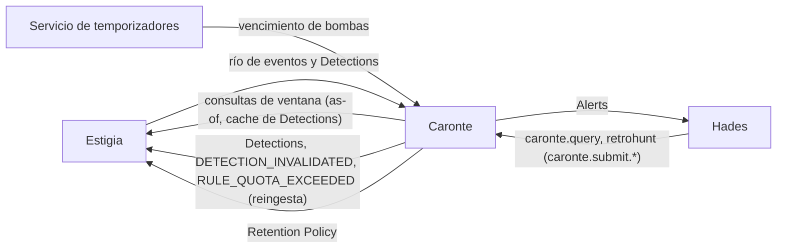
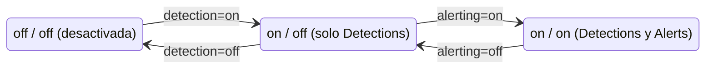
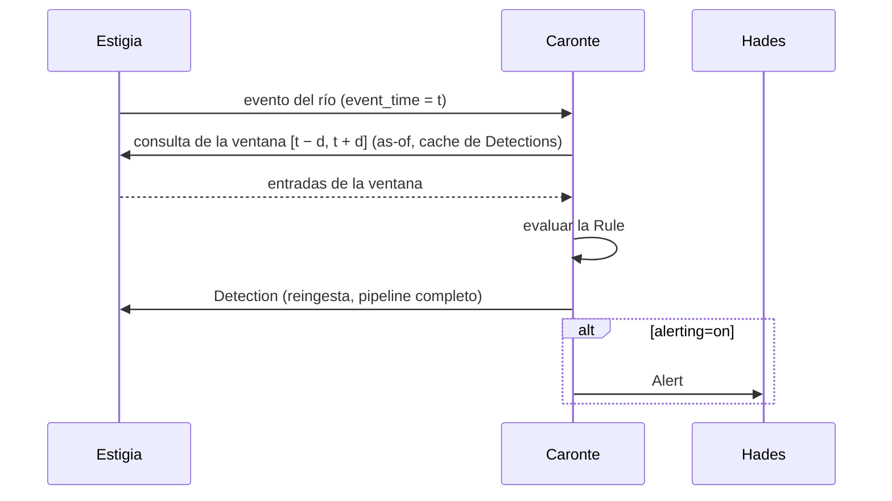
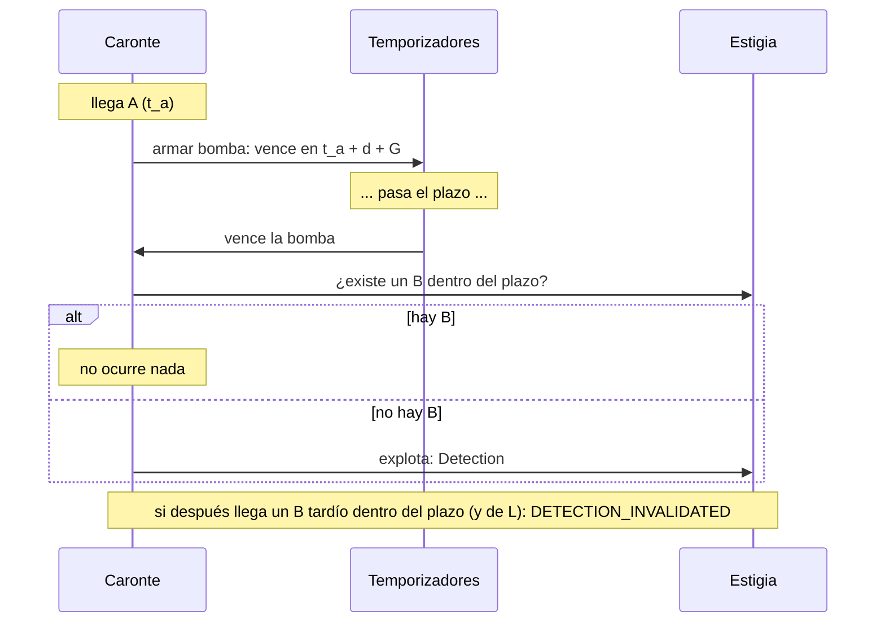
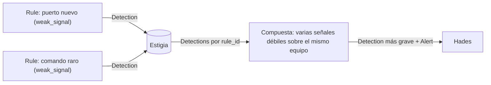

# Caronte — Detection Engine

*En la mitología, el barquero del Estigia que decide quién cruza hacia el Inframundo.* · Estado: diseñado · Última revisión: 2026-11-01

Ver también: [ARCHITECTURE](../ARCHITECTURE.md) (visión transversal) · [GLOSSARY](../GLOSSARY.md) · [DECISIONS](../DECISIONS.md) · [Estigia](estigia.md) · [Hades](hades.md)

---

## 1. Propósito y frontera

Caronte evalúa Rules YARA-L sobre los eventos del río de Estigia y sobre las Detections de otras Rules. Cuando una Rule se cumple, emite una Detection (un hecho, que vuelve a Estigia) y, si la Rule alerta, una Alert para Hades. Solo cruza quien paga el óbolo: quien cumple una Rule.

| Hace | No hace |
|---|---|
| Evaluar Rules YARA-L single-event, multi-event y compuestas | Rules programadas o ausencias sin evento disparador (eso es monitoring) |
| Emitir Detections y reingestarlas en Estigia | Dar veredictos ni decidir cómo agrupar o suprimir Alerts (es de Hades) |
| Notificar Alerts a Hades | Guardar estado: las ventanas son consultas a Estigia |
| Contener ráfagas (`suppression_window`, cuota) | Escribir en Data Tables |
| Validar el grafo de Rules y publicar la Retention Policy | |
| Retrohunt: ejecutar una Rule sobre el pasado | |

**Reactivo y sin estado:** cada evaluación la dispara un evento o una Detection reales. Una ventana es una consulta a Estigia por `event_time`, y el contexto de las entidades se consulta *as-of* `event_time`; como Estigia persiste antes de publicar, todo lo que Caronte recibe ya es consultable.

---

## 2. Contexto



| Con quién | Qué recibe Caronte | Qué entrega Caronte |
|---|---|---|
| **Estigia** | El río de eventos (incluidas las Detections reingestadas), resultados de consultas | Detections y hechos propios (reingesta), Retention Policy |
| **Hades** | Consultas de Rules y Detections, retrohunts | Alerts |
| **Temporizadores** | El vencimiento de cada bomba | — |

Las Rules se publican con sus dependencias (Playbook, Data Tables), para que Hades y Estigia comprueben si están en uso antes de retirar un Playbook o borrar una Data Table.

---

## 3. Conceptos

| Elemento | Naturaleza |
|---|---|
| **Rule** | Texto YARA-L. Describe *qué* detecta. Cada cambio genera una `version` nueva; su `rule_id` (`ru_<UUID>`) es estable entre versiones |
| **Rule Deployment** | Describe *cómo* se ejecuta: `status`, `detection`, `alerting` y los estados *degradada* y *limitada*. Cambiarlo no genera versión |
| **Detection** | Hecho inmutable: una Rule se cumplió. Es un *conteo útil* (que algo ha pasado, no cada repetición). Se reingesta en Estigia |
| **Alert** | Notificación a Hades de algo sobre lo que actuar. Objeto propio, distinto de la Detection |
| **Bomb** | Modelo de ejecución de "A sin B": A arma un temporizador; al vencer, si no hay B en el plazo, explota |
| **Composite Rule** | Rule multi-event cuyas entradas son Detections de otras Rules, referenciadas por `rule_id` |

### Rule Deployment



- **`status`:** `develop / test / production`. Viaja en la Detection (`rule_status`) y en la Alert (`mode`). Es una etiqueta para entornos y CI: Hades no la usa.
- **`alerting=on` exige `detection=on`.** La combinación on / off sirve, p. ej., para señales débiles.
- **Degradada:** una compuesta cuya Rule referenciada está desactivada, limitada o filtrada por `status`.
- **Limitada:** una Rule que superó su cuota de Detections del día.

---

## 4. Cómo funciona

### Evaluación



### Ventanas y eventos tardíos

- Cada evento lleva `event_time` (cuándo ocurrió) e `ingest_time` (cuándo entró en Estigia). Las ventanas se evalúan siempre por `event_time`.
- **`over <d>`:** ventana deslizante exacta: se cumple si existe alguna ventana de longitud `d` que satisfaga la condición.
- **`over <d> before|after $pivot`:** deslizante anclada al pivote, como en YARA-L; el límite del pivote es inclusivo. El orden estricto se expresa con comparaciones explícitas de timestamp en `events`.
- **Ventana simétrica:** al llegar un participante con `event_time = t`, se consulta `[t − d, t + d]` y se exige que las entradas quepan en una ventana de longitud `d` que contenga a `t`. Así un tardío encuentra a los vecinos que llegaron antes que él pero ocurrieron después. En las secuencias, si llega el pivote se mira hacia delante; si llega otro participante, se buscan pivotes hacia atrás.
- **Lateness `L`** (configurable, 48 h por defecto): un participante con un retraso superior se persiste, pero no dispara evaluaciones.

### Bomba ("A sin B")

Es el modelo de ejecución de `over <d> after $a` con `$a and !$b`; no cambia la sintaxis.



- **Gracia `G`:** mecha extra configurable por Rule, del orden de minutos, para absorber retrasos normales.
- **Desactivar = comprobar al vencer:** no hay carreras y la evaluación es idempotente.
- **Una bomba por cada A.** Nunca se reinicia (reiniciarla permitiría retrasar la explosión indefinidamente); la agrupación la hace Hades.
- **Desactivación tardía:** si llega un B dentro del plazo después de la explosión (y dentro de `L`), Caronte emite `DETECTION_INVALIDATED`, que referencia la Detection original sin modificarla, y lo propaga en cascada a las Detections de las compuestas construidas sobre ella. Hades decide qué hacer con cada Alert.
- **A tardío:** si su plazo ya venció en `event_time`, se evalúa en el momento.
- El temporizador vive fuera de Caronte, que sigue sin estado.

### Detecciones compuestas



- La Detection se reingesta en Estigia y la consumen otras Rules, igual que un evento. Caronte no la conserva.
- **Selección de entradas solo por `rule_id`**, con la ruta de SecOps (`$d.detection.detection.rule_id = "ru_..."`) y, por convención, un comentario `// <nombre de la rule>` encima. No se usa el nombre (renombrar rompería referencias), ni tags, ni Data Tables.
- **Agrupación** por la entidad en `match`: la Detection lleva todas las entidades resueltas con su rol, y cada compuesta decide por cuál agrupa.
- **Casan por solapamiento de `time_window`.** Filtran por `rule_status` en su sección `events`.
- **Validación estática del grafo** al desplegar o cambiar cualquier Rule: las referencias existen, no hay ciclos y la profundidad no supera `max_depth` (configurable; hoy 1, así que una compuesta solo consume Detections de Rules sobre eventos). `depth` se calcula al desplegar: 0 sobre eventos, 1 + la máxima de sus referencias.
- **Integridad referencial:** no se crea una compuesta con un `rule_id` inexistente ni se borra una Rule referenciada. Se referencia sin versión.
- **Retention Policy:** al validar el grafo, Caronte calcula `{rule_id → max(ventana de las compuestas que lo referencian) + L}` y la publica en Estigia, que retiene en cache esas Detections.

### Retrohunt

El usuario ejecuta una Rule bajo demanda sobre un rango temporal pasado. Se expone como task con el contrato común: Hades lo lanza con `caronte.submit.query` y recoge las Detections con `caronte.submit.result`.

---

## 5. Contratos

### Detection

Espejo del recurso Detection de SecOps más extensiones. Referencia por IDs: no copia los eventos, porque Estigia ya los guarda.

```yaml
id: de_<hash>
type: RULE_DETECTION
created_time
detection_time                 # = time_window.end
time_window: {start, end}      # single-event: start = end = event_time
detection:
  rule_id / rule_name / rule_version
  rule_type: SINGLE_EVENT | MULTI_EVENT
  alert_state: ALERTING | NOT_ALERTING
  rule_labels: {k: v}          # copia de meta
  variables: {k: v}            # outcome + match vars (severidad incluida)
  rule_status                  # extensión
  depth                        # extensión
collection_elements:           # linaje, agrupado por variable de la Rule
  - {label: "$d", kind: event | detection, ids: [...]}
entities:                      # extensión: entidades resueltas con su rol
  - {role, entity_id, entity_type, as_of}
first_event_time / last_event_time       # extensión
first_ingest_time / last_ingest_time     # extensión
```

`DETECTION_INVALIDATED` es un hecho aparte (`detection_id`, `reason`, `references`).

### Alert

Lleva solo lo necesario para enrutar y agrupar: `alert_id`, `detection_id`, `mode` (= `rule_status`), `rule_id`, `playbook`, `grouping_key`, IDs de las entidades y la clave de supresión. Hades consulta a Estigia el detalle *as-of* `event_time`. La Alert no se reingesta en Estigia: su dueño es Hades.

### Identificadores deterministas

| Objeto | ID |
|---|---|
| Detection single-event | `hash(rule_id + version + event_id)` |
| Detection multi-event | `hash(rule_id + version + match_key + window_start)`, con `window_start` = `event_time` de la primera entrada del grupo |
| Detection con `suppression_window` | `hash(rule_id + version + suppression_key + floor(event_time / suppression_window))`: las repeticiones del mismo bloque comparten ID y Estigia las descarta en Ingest |
| Bomba | `hash(rule_id + version + event_id del pivote)` |
| Alert | `hash(detection_id)` |

### API (destino `caronte`)

| Función | Verbo | Para qué |
|---|---|---|
| Rules y Detections | `caronte.query` | Consultar una Rule, su Deployment o una Detection |
| `retrohunt` | `caronte.submit.query` → `caronte.submit.result` | Ejecutar una Rule sobre el pasado y recoger sus Detections |

Con el contrato común de las APIs internas de Cerbero.

---

## 6. Configuración y extensión

### Escribir una Rule

Esqueleto YARA-L: `meta / events / match / outcome / condition / options`. **single-event** sin `match`; **multi-event** con `match` (umbrales, secuencias y "A sin B" con `$a and !$b`).

Ejemplo (los campos UDM son ilustrativos):

```text
rule unknown_device {
  meta:
    description = "Dispositivo no conocido en la red privada"
    author = "owner"
    category = "network"
    playbook = "unknown_device:latest"
  events:
    $e.metadata.event_type = "DEVICE_SEEN"
    not $e.principal.mac in %known_devices.mac
  outcome:
    $grouping_key = $e.principal.entity_id
  condition:
    $e
}
```

**Schema de `meta`** (valores string; las listas, separadas por comas; las claves desconocidas se permiten y no se validan, por compatibilidad con SecOps):

| Clave | Obligatoria | Contenido |
|---|---|---|
| `description` | Sí | Qué detecta |
| `author` | Sí | Autor |
| `category` | Sí | Ámbito, de una lista cerrada configurada en Caronte. Una categoría desconocida bloquea el despliegue |
| `context` | No | Por qué importa y qué hacer. Hades puede usarlo al comunicar |
| `tags` | No | Etiquetas. `weak_signal` (la Rule solo emite Detections) es reservada y descriptiva: nunca selecciona entradas |
| `mitre_attack` | No | IDs de técnicas (`Txxxx`, `Txxxx.yyy`) |
| `links` | No | URLs externas |
| `playbook` | Sí, si `alerting=on` | Playbook principal, estilo imagen Docker: `nombre:latest` o `nombre:1.2.0` |

**Outcomes reservados:**

- `$grouping_key`: obligatorio y de valor único si `alerting=on` (un `entity_id` o una tupla ordenada, nunca una lista). Es la clave con la que Hades agrupa.
- `$suppression_key`: la clave de la supresión de Detections (en multi-event, las match vars).

### Al desplegar

- **Bloquea:** con `alerting=on`, que el `playbook` no exista en Hades o que falte `$grouping_key`; una `category` desconocida; un grafo de compuestas inválido.
- **Avisa (sin bloquear):** `weak_signal` con `alerting=on`; una compuesta que referencia una Rule con `suppression_window`; una Rule con `detection` y `alerting` en ON que apunta a una versión `0.x` de su Playbook.

### Contención de ruido

| Nivel | Mecanismo | Quién lo define |
|---|---|---|
| **Supresión de Detections** | `options: suppression_window` + `$suppression_key`, como en YARA-L. Opt-in, 0 por defecto, ≥ la ventana de `match`. Pensado para ráfagas (p. ej. DDoS) | El autor de la Rule |
| **Cuota de Detections** | Máximo por `rule_id` (todas sus versiones) y día natural UTC; configurable, mínimo 100, por defecto 1.000. Al superarla, deja de emitir hasta el día siguiente, marca la Rule como limitada (sus compuestas pasan a degradadas) y emite `RULE_QUOTA_EXCEEDED` | El sistema (red de seguridad) |
| **Supresión de acción** | Agrupar Alerts, añadirlas a un Case abierto, escalar | Hades |

Por debajo de esos umbrales, Caronte no suprime nada: todas las Detections se persisten.

---

## 7. Organización interna

```text
caronte/
├── domain/
│   ├── rules/           # Rule, versión, meta, outcomes reservados
│   ├── deployment/      # Rule Deployment, degradada, limitada, cuota
│   ├── detections/      # Detection, Alert, identificadores deterministas
│   └── graph/           # grafo de compuestas, depth, integridad, Retention Policy
├── application/         # evaluar, armar y vencer bombas, desplegar, retrohunt
└── infrastructure/
    ├── yaral/           # parser y evaluador de YARA-L
    ├── consumers/       # río de Estigia y vencimientos de bombas
    ├── clients/         # consultas a Estigia
    ├── publishers/      # reingesta a Estigia, Alerts a Hades
    └── api/             # caronte.query, retrohunt
```

| Patrón | Por qué |
|---|---|
| DDD medio (Rule, Rule Deployment, Detection, Alert) | Reglas de despliegue y de grafo con invariantes |
| Sin estado propio | Las ventanas son consultas; el temporizador de las bombas vive fuera |
| Identificadores deterministas | Reevaluar es idempotente: las repeticiones se descartan en Estigia |

---

## 8. Datos

- **Caronte no guarda eventos ni Detections:** las Detections viven en Estigia.
- **Guarda las Rules** (con sus versiones), sus Deployments, el grafo y los contadores de cuota del día.
- Las bombas armadas viven en el servicio de temporizadores.

---

## 9. Seguridad

- **Identidad:** `spiffe://cerbero.home/caronte`, mTLS y JWT ligado al canal (ver [Identidad y seguridad](../ARCHITECTURE.md#6-identidad-y-seguridad)).
- **Solo lectura sobre Estigia** (consultas), más la reingesta de sus propios hechos y la Retention Policy. No escribe en Data Tables.

---

## 10. Operación

| Qué falla | Efecto | Recuperación |
|---|---|---|
| Caronte | Los eventos se acumulan en el río sin evaluar; las bombas que vencen esperan en el servicio de temporizadores | Consume lo pendiente al volver, incluidas las bombas vencidas |
| Estigia | No recibe flujo ni puede consultar | El flujo se reanuda al volver |

- **Reevaluar es seguro:** los identificadores deterministas hacen idempotente la reevaluación.
- **Observabilidad** con OpenTelemetry y logs estructurados; las Rules limitadas y las compuestas degradadas son visibles.

---

## 11. Pruebas

- **Rules:** se prueban en entornos funcionales completos y con CI (de ahí las etiquetas `develop / test` de `status`); el retrohunt permite ver qué habría detectado una Rule sobre el pasado.
- **Motor:** unitarias del evaluador YARA-L, de las ventanas (simétrica, lateness), de las bombas y de los identificadores deterministas; integración contra Estigia.

---

## 12. Decisiones y riesgos

Resumen; el detalle y el porqué están en [DECISIONS](../DECISIONS.md#caronte-frente-a-yara-l-lenguaje).

- **Frente a YARA-L:** `over <d>` sin pivote es deslizante exacta, no *hop window* (la ejecución es reactiva).
- **Frente a SecOps:** `max_depth` configurable (hoy 1); entradas de compuestas solo por `rule_id`; integridad referencial y compuestas degradadas; lateness `L` y ventana simétrica; `DETECTION_INVALIDATED`; la Detection referencia por IDs; la Alert es un objeto propio; supresión de acción en Hades; cuota por `rule_id` y día; la Rule declara su Playbook y su `$grouping_key`; Caronte no escribe en Data Tables.

---

## 13. Preguntas frecuentes

**¿Por qué no hay Rules programadas?**
Porque Caronte es reactivo: cada evaluación la dispara algo que ha pasado de verdad. Las ausencias con plazo se resuelven con bombas, que arranca un evento real.

**¿Qué es exactamente una bomba?**
"Se abre la puerta y nadie mete el código en 5 minutos": al llegar A se arma un temporizador; si al vencer no hay B en el plazo, explota y genera la Detection.

**¿Y si el B llega tarde, cuando la bomba ya explotó?**
Caronte emite `DETECTION_INVALIDATED` sin tocar la Detection original, y lo propaga a las compuestas. Hades decide qué hacer.

**¿Detection y Alert no son lo mismo?**
No. La Detection es un hecho (una Rule se cumplió) y alimenta a otras Rules; la Alert es una notificación para actuar, solo si la Rule alerta.

**¿Por qué las compuestas referencian por `rule_id` y no por nombre o etiqueta?**
Para que las dependencias sean explícitas: se puede validar el grafo y renombrar una Rule sin romper nada.

**¿Qué pasa si una Rule se desboca?**
La cuota la limita hasta el día siguiente y se emite `RULE_QUOTA_EXCEEDED`, que otra Rule puede convertir en Alert.

---

## 14. Referencias

Google SecOps (YARA-L 2.0):

- [Overview of YARA-L 2.0](https://cloud.google.com/chronicle/docs/yara-l/yara-l-overview)
- [Get started with YARA-L](https://docs.cloud.google.com/chronicle/docs/yara-l/getting-started)
- [Single and multiple event rules](https://docs.cloud.google.com/chronicle/docs/yara-l/yara-l-2-0-examples)
- [Windowing logic](https://docs.cloud.google.com/chronicle/docs/yara-l/windowing-logic)
- [Options section syntax](https://docs.cloud.google.com/chronicle/docs/yara-l/options-syntax)
- [Construct composite detection rules](https://docs.cloud.google.com/chronicle/docs/yara-l/composite-detection-rules)
- [Configure alert suppression](https://docs.cloud.google.com/chronicle/docs/investigation/alert-suppression)
- [YARA-L 2.0 known issues](https://docs.cloud.google.com/chronicle/docs/detection/yara-l-issues)
