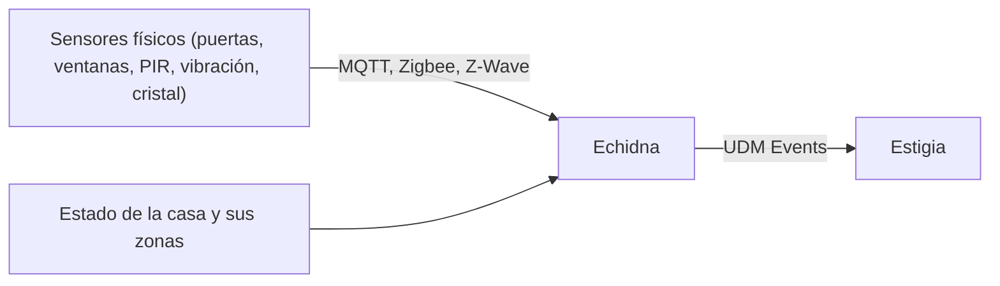
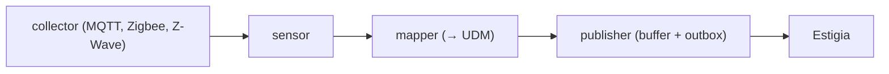

# Echidna — SIEM físico (seguridad perimetral)

*En la mitología, la madre de los guardianes y de la fuerza terrenal.* · Estado: alcance definido; el modelo detallado está abierto en [DECISIONS](../DECISIONS.md) · Última revisión: 2026-11-01

Ver también: [ARCHITECTURE](../ARCHITECTURE.md) (visión transversal y [contrato UDM](../ARCHITECTURE.md#4-contrato-udm)) · [GLOSSARY](../GLOSSARY.md) · [Orthros](orthros.md) · [Estigia](estigia.md)

---

## 1. Propósito y frontera

Echidna es la cabeza del dominio físico y domótico de la casa: recoge lo que pasa en puertas, ventanas, presencia y zonas, lo normaliza a UDM y lo entrega a Estigia.

| Hace | No hace |
|---|---|
| Leer sensores magnéticos de apertura en puertas y ventanas | Detectar con Rules: eso es de Caronte |
| Ingerir telemetría de presencia (PIR), vibración y rotura de cristal | Decidir ni actuar |
| Integrarse con protocolos domóticos (MQTT, Zigbee, Z-Wave) | Emitir Alerts: sus sensores emiten eventos |
| Registrar los cambios de estado de la casa y sus zonas (*Armado / Desarmado / Mantenimiento*) | |
| Parsear a UDM y enviar a Estigia, con buffer local | |

**Por qué es una pieza aparte:** el dominio físico tiene sus propias fuentes y protocolos. Con Echidna, Caronte puede combinar lo físico con lo digital en las mismas Rules (p. ej. una ventana abierta con la casa armada).

---

## 2. Contexto

Relación con Estigia: **Published Language** (UDM). Su mapper es su frontera de traducción, igual que el parser en Orthros.

---

## 3. Conceptos

| Concepto | Qué es |
|---|---|
| **Collector** | Adapter de entrada, uno por fuente (MQTT, Zigbee, Z-Wave...) |
| **Sensor** | Análisis de bajo nivel sobre los datos de origen. Emite eventos, nunca Alerts |
| **Mapper** | Traducción del modelo interno al UDM |
| **Publisher** | Puerto de salida hacia Estigia, con buffer local |
| **Zona** | Parte de la casa con su propio estado |
| **Estado de la casa** | *Armado*, *Desarmado* o *Mantenimiento*, de la casa o de una zona |

---

## 4. Cómo funciona

Un evento físico (p. ej. "se abre la ventana del salón") llega por su protocolo, el sensor lo interpreta, el mapper lo traduce a UDM y el publisher lo envía a Estigia. Si Estigia no está disponible, se acumula en el buffer local y se reenvía al volver.

---

## 5. Contratos

- **Salida:** UDM Events según el [contrato UDM](../ARCHITECTURE.md#4-contrato-udm), con `event_id` determinista para que Estigia descarte duplicados.
- **Entrada:** los protocolos de cada fuente, a través de sus collectors.

---

## 6. Configuración y extensión

- **Añadir una fuente** es añadir un collector (un adapter de entrada).
- Si Echidna adopta un modelo de control plane y agentes como el de Orthros está abierto en [DECISIONS](../DECISIONS.md).

---

## 7. Organización interna

| Estructura | Patrón |
|---|---|
| `collector → sensor → mapper → publisher` | Pipes & Filters; DDD ligero con value objects (Zona, Sensor físico) |

---

## 8. Datos

Solo un buffer local de UDM Events pendientes de enviar. Los datos de origen no salen de Echidna; viaja el UDM Event.

---

## 9. Seguridad

Se comunica con el resto de Cerbero con la identidad común (ver [Identidad y seguridad](../ARCHITECTURE.md#6-identidad-y-seguridad)).

---

## 10. Operación

| Qué falla | Efecto | Recuperación |
|---|---|---|
| Echidna | No llegan eventos del dominio físico; el resto sigue con el dominio de red | Reanuda y vacía su buffer |
| Estigia | Echidna acumula en su buffer local | Reenvía al volver |

---

## 11. Pruebas

Estrategia común de Cerbero (unit, integración, API, E2E): mappers contra mensajes de ejemplo de cada protocolo, `event_id` determinista y el buffer ante una caída de Estigia.

---

## 12. Decisiones y riesgos

Abierto en [DECISIONS](../DECISIONS.md): el modelo de Echidna (si adopta control plane y agentes como Orthros). La correlación entre dominios (red y físico) la hace Caronte con sus Rules.

---

## 13. Preguntas frecuentes

**¿Echidna da la alarma si se abre una ventana?**
No. Echidna solo registra el hecho como evento; decidir si merece una Alert es de una Rule de Caronte (p. ej. ventana abierta con la casa armada).

**¿Qué pasa si se cae la conexión con Estigia?**
Los eventos se guardan en el buffer local y se reenvían al volver.

---

## 14. Referencias

Los protocolos de cada fuente (MQTT, Zigbee, Z-Wave) se documentan con su collector.
