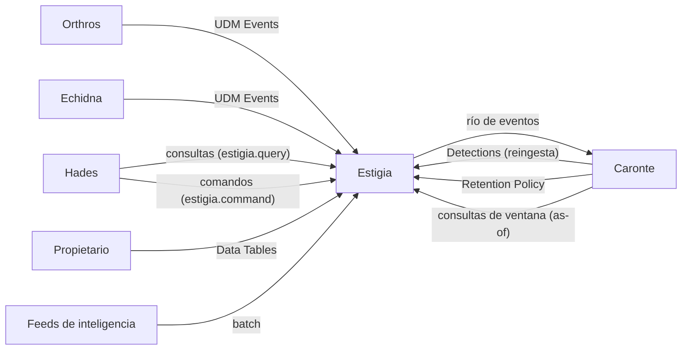
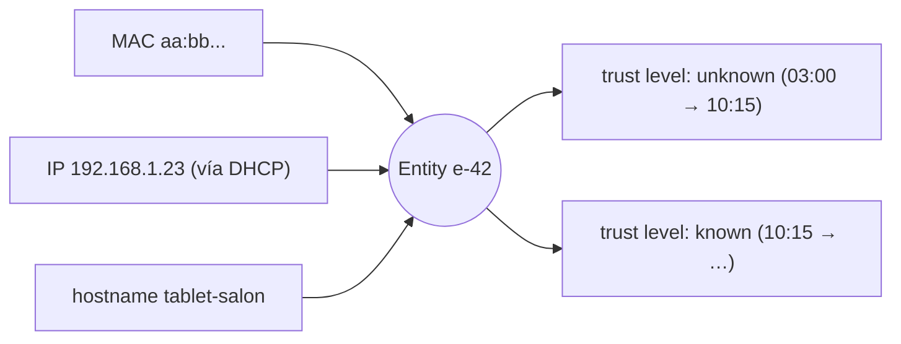

# Estigia — Unified Data Model

*En la mitología, el río del Inframundo por el que deben pasar todas las almas.* · Estado: diseñado · Última revisión: 2026-11-01

Ver también: [ARCHITECTURE](../ARCHITECTURE.md) (visión transversal y [contrato UDM](../ARCHITECTURE.md#4-contrato-udm)) · [GLOSSARY](../GLOSSARY.md) · [DECISIONS](../DECISIONS.md)

---

## 1. Propósito y frontera

Estigia es el cauce obligatorio de los datos de Cerbero y su memoria común. Es dueña del esquema UDM, valida lo que llega, reconcilia las identidades de los activos en entidades con historia, enriquece cada evento con el contexto del momento en que ocurrió, lo guarda y lo publica en el río que consume Caronte.

| Hace | No hace |
|---|---|
| Definir y versionar el esquema UDM | Parsear formatos de origen (lo hacen las cabezas) |
| Validar, deduplicar y poner en cuarentena lo inválido | Decidir si algo merece una Alert (es de Caronte) |
| Resolver entidades y guardar su historia (*as-of*) | Dar veredictos o actuar (es de Hades) |
| Enriquecer con contexto y Reference Data | Guardar Raw Logs: el dato original no sale de su origen |
| Persistir y publicar el río de eventos | |
| Servir consultas a Caronte y Hades; aplicar sus comandos | |

**Frontera:** Estigia **anota hechos** ("este dominio está en una lista de phishing", "este activo es desconocido"). Juzgarlos es de Caronte y de Hades.

**Por qué es una pieza aparte:** todos los proyectos hablan el mismo lenguaje (UDM) y consultan la misma verdad. Concentrarlo evita que cada pieza reconcilie identidades o guarde su propia copia del mundo.

---

## 2. Contexto



| Con quién | Qué recibe Estigia | Qué entrega Estigia |
|---|---|---|
| **Orthros, Echidna** (cabezas) | UDM Events ya parseados en origen | — |
| **Caronte** | Detections y `DETECTION_INVALIDATED` (como eventos), Retention Policy | El río de eventos; consultas de ventana, entidades *as-of* y Data Tables |
| **Hades** | Comandos de contexto y de filas de Data Tables | Detalle de Detections, contexto *as-of*, eventos, Data Tables |
| **Propietario** | Data Tables | — |
| **Feeds** | IOCs, CVEs | — |

| Relación | Patrón DDD |
|---|---|
| Cabezas → Estigia | **Published Language** (UDM) |
| Estigia → Caronte | **Open Host Service** + Published Language |
| Caronte, Hades → Estigia | **Customer / Supplier** |

---

## 3. Conceptos

| Elemento | Naturaleza | Quién escribe |
|---|---|---|
| **UDM Event** | Hecho inmutable | Pipeline de ingesta |
| **Detection** | Hecho inmutable (evento de tipo `RULE_DETECTION`) | Caronte, a través del pipeline de ingesta |
| **Entity** | Mutable, con historia (intervalos de validez) | Pipeline de ingesta (identidad) y Hades (contexto permanente: trust level, anotaciones) |
| **Reference Data** | Inteligencia externa (IOCs, CVEs) | Procesos batch de feeds |
| **Data Table** | Registros temporales o de duración incierta, fuera del UDM (whitelists, invitados), con TTL opcional por tabla y por fila e historial de cambios | El propietario y Hades (Responses, Jobs y cronjobs) |

### Entidades

- **Entity resolution:** las identidades de un activo (MAC, IP, hostname, dirección Zigbee...) se reconcilian en una entidad única. No depende de un único identificador (p. ej. las MAC aleatorias de los móviles).
- **Intervalos de validez:** el estado de cada entidad se guarda con su ventana temporal. Permite responder "¿era conocido este dispositivo a las 03:12?" y enriquecer con el contexto del momento del evento.



### Contexto permanente frente a Data Tables

| | Contexto de entidad | Data Table |
|---|---|---|
| Qué guarda | Conocimiento permanente (trust level sin caducidad, anotaciones) | Registros temporales o de duración incierta (invitado aprobado 48 h, whitelist) |
| Caducidad | No | TTL opcional por tabla y por fila (recomendable si se conoce) |
| Escriben | Hades | El propietario y Hades |
| Historia | Intervalos de validez | Historial de cambios |

---

## 4. Cómo funciona

### Flujo de escritura

```text
           ┌──────────────────────────────── ESTIGIA ─────────────────────────────────┐
Eurytion   │                                                                          │
Echidna ──▶│ 1.Ingest → 2.Validate → 3.Resolve → 4.Enrich → 5.Persist → 6.Publish ──▶ │──▶ Caronte
           │     │           │           │           │            │                   │
           │   dedup    Quarantine   Entity     Reference    Proyecciones             │
           │ (event_id)              events     Data         (+ outbox)               │
           └──────────────────────────────────────────────────────────────────────────┘
```

| Paso | Qué hace |
|---|---|
| **1. Ingest** | Recibe el evento y descarta duplicados por `event_id`. El `event_id` es determinista: se deriva del origen (p. ej. `hash(agent_id + secuencia en origen)`). En las Detections es su `detection_id` |
| **2. Validate** | Comprueba que la versión del esquema es conocida y el evento es válido. Si no, va a Quarantine |
| **3. Resolve** | Extrae los identificadores observados, los asocia a una Entity existente o crea una nueva, y añade el `entity_id` al evento. Emite eventos de entidad (creada, identificador vinculado, actualizada) |
| **4. Enrich** | Añade el contexto de la entidad en el momento en que ocurrió el evento y las coincidencias con Reference Data |
| **5. Persist** | Guarda el evento y actualiza las proyecciones, con outbox. Si es una Detection cubierta por la Retention Policy, la escribe también en la cache de Detections |
| **6. Publish** | Emite el evento resuelto y enriquecido al río |

**Invariante:** Estigia persiste antes de publicar. Todo lo que ve Caronte ya es consultable por Caronte y por Hades.

### Ejemplo: un dispositivo desconocido

```mermaid
sequenceDiagram
    participant Eu as Eurytion (ARP scan)
    participant Es as Estigia
    participant Ca as Caronte
    Eu->>Es: UDM Event (dispositivo visto: MAC, IP)
    Es->>Es: Ingest: event_id nuevo
    Es->>Es: Validate: esquema conocido
    Es->>Es: Resolve: MAC desconocida → Entity nueva (EntityCreated)
    Es->>Es: Enrich: trust level unknown; no está en la Data Table de conocidos
    Es->>Es: Persist (+ outbox)
    Es->>Ca: Publish al río
    Ca->>Es: consulta de contexto as-of event_time
```

### Enriquecimiento en tres niveles

| Nivel | Qué | Cuándo |
|---|---|---|
| **Core** (síncrono) | Entity resolution, contexto de la entidad en el momento del evento, lookup contra Reference Data | En el pipeline, antes de publicar |
| **Extended** (asíncrono) | Consultas puntuales a servicios externos que no ofrecen listas | Tras publicar; el resultado se emite como evento de enriquecimiento que referencia al original |
| **Batch** (programado) | Descarga de feeds (IOCs, CVEs) como Reference Data; al cargar IOCs nuevos, IOC Matching retroactivo sobre eventos recientes | Por calendario; las coincidencias se emiten al río como eventos |

El nivel batch convierte fuentes lentas o con consultas limitadas en búsquedas locales del nivel core.

### Comandos de Hades

- **Contexto de entidad** (trust level, anotaciones) y **filas de Data Tables**.
- **Idempotentes** por la clave que genera Hades. Estigia confirma devolviendo el **valor anterior** (el dato para compensar) y publica `EntityContextChanged` o el cambio de fila.
- **Nunca retroactivos:** el contexto se aplica como un intervalo de validez nuevo desde el momento del comando. Las Detections ya emitidas no cambian.
- **Historial estilo git:** revertir añade la reversión; volver a un punto concreto se registra como un cambio añadido que restaura el estado de ese momento. Nunca se reescribe la historia, porque rompería las consultas *as-of* y la auditoría.
- Cada cambio lleva su `source` (`response`, `job`, `cronjob` u `owner`, con su id).

---

## 5. Contratos

- **Esquema UDM** (ver [contrato UDM](../ARCHITECTURE.md#4-contrato-udm)): Estigia lo define y versiona; cada evento declara su versión; los cambios son compatibles hacia atrás. Un evento lleva tipo, origen (cabeza y sensor), marca temporal, identificadores de entidad observados y datos normalizados.
- **Río de eventos:** eventos resueltos y enriquecidos, publicados tras persistir (outbox).
- **Consultas y comandos** con el contrato común de las APIs internas, que Hades usa como `estigia.query` y `estigia.command`:

| Función | Tipo | Para qué |
|---|---|---|
| Contexto de una entidad *as-of* | Consulta | Enriquecer e investigar con el contexto del momento |
| Búsqueda de eventos y ventanas | Consulta | Investigar y evaluar ventanas de Rules |
| Detección y su linaje | Consulta | Detalle de una Detection (`collection_elements`, entidades con rol) |
| Data Tables | Consulta | Relacionar eventos con tablas del propietario |
| Trust level, anotación | Comando | Juicio de Hades tras un Case |
| Fila de Data Table | Comando | Datos temporales desde Responses, Jobs o cronjobs |

- **Retention Policy** (de Caronte): `{rule_id → max(ventana de las compuestas que lo referencian) + L}`.

---

## 6. Configuración y extensión

- **Data Tables:** tablas de varias columnas que mantiene el propietario y que Hades puede escribir; TTL opcional por tabla y por fila.
- **Feeds:** fuentes de IOCs y CVEs cargadas por procesos batch.
- **Esquema UDM:** se extiende con versiones nuevas compatibles hacia atrás.
- **Antes de borrar una Data Table,** Estigia comprueba si alguna Rule la usa (Caronte publica las dependencias de cada Rule). Si está en uso, el borrado se bloquea.

---

## 7. Organización interna

```text
estigia/
├── domain/
│   ├── events/          # UDM Event, validación, versión de esquema
│   ├── entities/        # Entity, identificadores, resolución, intervalos de validez
│   ├── reference/       # Reference Data, IOC Matching
│   └── tables/          # Data Tables, TTL, historial
├── application/         # pipeline (Ingest → Publish), consultas, comandos
└── infrastructure/
    ├── ingest/          # entrada de las cabezas y la reingesta de Caronte
    ├── store/           # almacenamiento, proyecciones, cache de Detections
    ├── publisher/       # río de eventos (outbox)
    ├── batch/           # carga de feeds
    └── api/             # consultas y comandos (estigia.*)
```

| Patrón | Dónde | Por qué |
|---|---|---|
| CQRS | Escritura por el pipeline; lectura por proyecciones | La ingesta y las consultas tienen formas y ritmos distintos |
| DDD fuerte | Entidades (Asset, identificadores, resolución) | La reconciliación de identidades es la parte con más reglas |
| Pipes & Filters | El pipeline de ingesta | Cada paso hace una cosa y se encadena |
| Transactional Outbox | Persistir y publicar | No se pierde un evento ni se publica uno sin haber persistido |

---

## 8. Datos

### Lado de lectura

Proyecciones para búsqueda de eventos, contexto de entidades con su historia, estado de la casa, Reference Data y Data Tables.

- **Índice inverso `event_id → detection_id`:** solo se añaden filas. Permite saber en qué Detections participó un evento sin modificar el evento.
- **Cache de Detections:** acelera las consultas de ventana de Caronte.
  - Solo contiene Detections de los `rule_id` de la Retention Policy (los que consume alguna compuesta); los eventos no entran.
  - **Expira por TTL:** el de cada `rule_id` lo fija la Retention Policy.
  - **Es derivada y reconstruible:** si falta una entrada, se lee del almacenamiento. No es fuente de verdad ni punto de fallo.
  - Cuando cambia la Retention Policy, se rehidratan los rangos afectados.

### Gobierno del dato

| Vía de escritura | Qué escribe |
|---|---|
| Pipeline de ingesta (cabezas) | Hechos: eventos e identidad de las entidades |
| Procesos batch | Reference Data |
| Caronte (reingesta) | Hechos: Detections, `DETECTION_INVALIDATED`, `RULE_QUOTA_EXCEEDED` |
| Caronte (comandos) | Retention Policy de la cache de Detections |
| Hades (comandos) | Juicio: contexto de las entidades tras analizar un Case (el único componente que lo modifica) y filas de Data Tables |
| Propietario | Data Tables, directamente. Es responsable de lo que vierte al río |

- **Sin Raw Logs:** el dato original se parsea en origen y no viaja a Estigia.
- **Datos personales:** identificadores de dispositivos y su actividad en casa.
- **Copias:** política común de Cerbero (regla 3-2-1, cifradas, restauración probada); la cache y las proyecciones no se copian, se reconstruyen.

---

## 9. Seguridad

- **Identidad:** `spiffe://cerbero.home/estigia`, mTLS y JWT ligado al canal (ver [Identidad y seguridad](../ARCHITECTURE.md#6-identidad-y-seguridad)).
- **Quién escribe qué:** lo fija el gobierno del dato; solo Hades modifica el contexto de las entidades, y todo comando lleva su `source` y el contexto de auditoría.
- **Auditoría:** cadena de hashes en sus streams y checkpoints firmados por Hécate.

---

## 10. Operación

| Qué falla | Efecto | Recuperación |
|---|---|---|
| Estigia | Las cabezas guardan en su buffer local; Caronte no recibe flujo ni puede consultar; Hades no puede investigar | Las cabezas reenvían; el flujo se reanuda |
| Caronte | Los eventos se acumulan en el río sin evaluar | Caronte consume lo pendiente al volver |

- **Consumidores idempotentes:** reentregar un evento no lo duplica (deduplicación por `event_id`).
- **Observabilidad:** OpenTelemetry y logs estructurados a stdout, como el resto de Cerbero; los eventos en Quarantine son visibles para revisar parsers.

---

## 11. Pruebas

Estrategia común de Cerbero (unit, integración, API, E2E). Los invariantes que más importa cubrir: deduplicación por `event_id`, cuarentena de lo inválido, resolución de entidades con identificadores cambiantes, consultas *as-of*, persistir antes de publicar y comandos nunca retroactivos.

---

## 12. Decisiones y riesgos

Resumen; el detalle y el porqué están en [DECISIONS](../DECISIONS.md).

- **Sin Raw Logs:** las cabezas producen UDM de forma nativa, en lugar de delegar el parseo a la plataforma (la diferencia principal con SecOps).
- **Data Tables con varios escritores** (el propietario y Hades), TTL opcional e historial; Caronte no escribe en ellas.
- **Contexto de entidad sin caducidad:** lo temporal va a Data Tables con TTL.
- **Historial añadido** (revertir y volver a un punto, estilo git): reescribir rompería las consultas *as-of* y la auditoría.

---

## 13. Preguntas frecuentes

**¿Por qué no guarda el log original?**
Porque las cabezas ya parsean en origen al UDM. Lo que no se parseó en su momento no se recupera: los fallos de parseo se cuentan en el heartbeat de los agentes para que se vean.

**¿Cómo sabe que un dispositivo con MAC aleatoria es el mismo?**
La entity resolution no depende de un único identificador: combina los que observa (MAC, IP, hostname...) para reconciliarlos en una entidad.

**Si marco un dispositivo como conocido, ¿cambian las Detections pasadas?**
No. El cambio se aplica desde ese momento como un intervalo nuevo; lo pasado se sigue viendo con el contexto que tenía.

**¿Cuándo uso una Data Table y cuándo el contexto de la entidad?**
Data Table para lo temporal o de duración incierta (un invitado durante el fin de semana); contexto para lo permanente (este portátil es de la familia).

**¿Qué pasa si llega un evento duplicado?**
Se descarta en Ingest por su `event_id` determinista.

---

## 14. Referencias

- Google SecOps: el UDM y las Data Tables de SecOps son la referencia del modelo; ver las referencias de [Caronte](caronte.md) para YARA-L y la [documentación de SecOps](https://docs.cloud.google.com/chronicle/docs).
