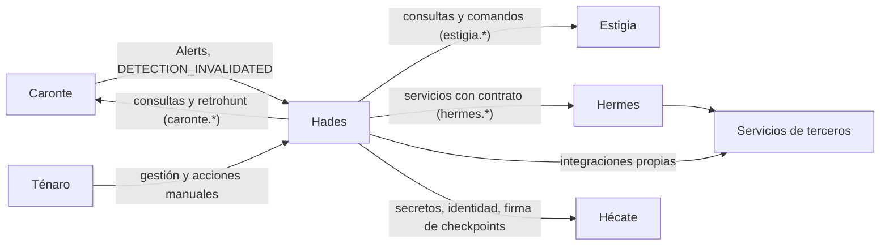
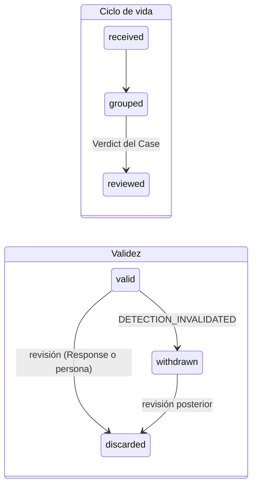
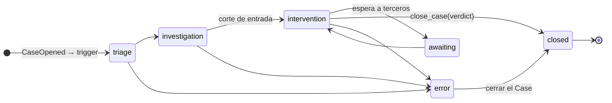
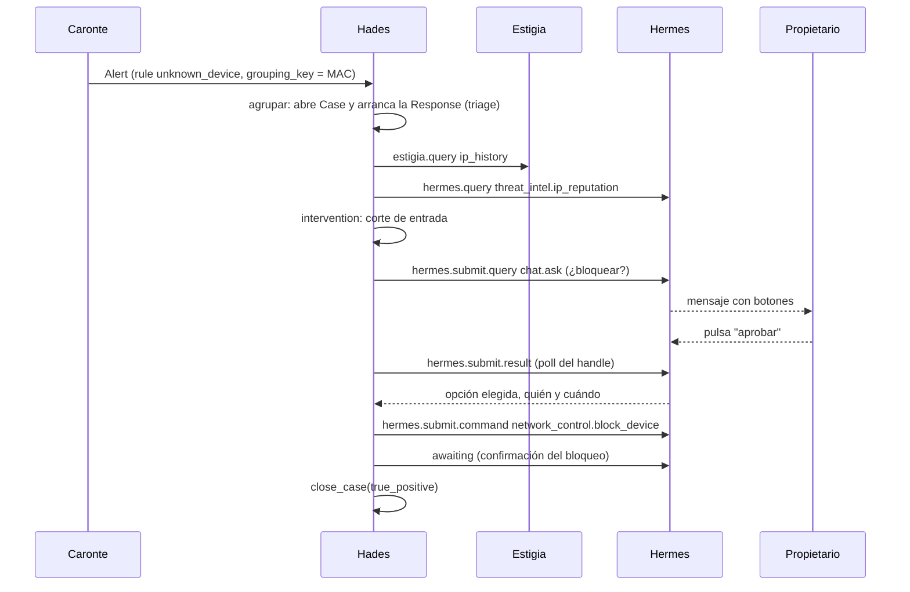

# Hades — SOAR de Cerbero

*En la mitología, el dios que gobierna el Inframundo y dicta sentencia.* · Estado: diseñado · Última revisión: 2026-11-01

Ver también: [ARCHITECTURE](../ARCHITECTURE.md) (visión transversal) · [GLOSSARY](../GLOSSARY.md) · [DECISIONS](../DECISIONS.md)

---

## 1. Propósito y frontera

Hades es el núcleo de decisión y respuesta de Cerbero. Recibe las Alerts de Caronte, las agrupa en Cases, ejecuta la respuesta definida en Playbooks y concluye con un Verdict.

| Hace | No hace |
|---|---|
| Agrupar Alerts en Cases y gestionar su ciclo de vida | Recopilar, parsear o detectar (son de las cabezas, Estigia y Caronte) |
| Orquestar la respuesta con Playbooks (Responses) | Mirar el `mode` de la Alert: las Rules inmaduras se prueban en entornos completos |
| Investigar consultando a Estigia, Caronte y servicios de terceros | Guardar secretos (los custodia Hécate) |
| Dar el Verdict y medir la calidad de las Rules | Controlar ráfagas de Detections (lo hace Caronte) |
| Modificar el contexto de las entidades y las Data Tables en Estigia | |
| Suprimir acción: agrupar, añadir a un Case abierto, escalar | |

**Por qué es una pieza aparte:** detectar y responder tienen ritmos y modelos distintos. Caronte es reactivo y sin estado; Hades es un flujo de trabajo con estado de larga duración (un Case puede durar días, una Response espera respuestas de personas), y su historia es la auditoría.

---

## 2. Contexto



| Con quién | Qué recibe Hades | Qué entrega Hades |
|---|---|---|
| **Caronte** | Alerts (notificación con cabecera de enrutado) y `DETECTION_INVALIDATED` | Consultas de Rules y Detections, retrohunts |
| **Estigia** | Detalle de la Detection, contexto de las entidades *as-of*, eventos | Comandos de contexto (trust level, anotaciones) y filas de Data Tables |
| **Hermes** | Resultados de llamadas síncronas y estado de tasks | Peticiones a servicios de terceros con contrato (chat, ticketing, threat intel...) |
| **Hécate** | Secretos de sus integraciones, certificados, firma de checkpoints | — (Hécate nunca llama a nadie) |
| **Ténaro** | Gestión (Playbooks, integraciones), acciones manuales | Vistas: Cases, timelines, salud de los Playbooks, eventos |

Hades habla con los demás componentes por API, con el contrato común de Cerbero (ver [ARCHITECTURE](../ARCHITECTURE.md#3-comunicación-entre-proyectos)). Nunca escucha el pub/sub de otro componente: consulta.

---

## 3. Conceptos

### Aggregates

Hades tiene dos módulos que se comunican por eventos: **gestión de Cases** (Alert, Case) y **automatización** (Playbook, Response). Los cuatro aggregates se guardan como secuencia de eventos.

| Aggregate | Qué es | Invariantes principales | Stream |
|---|---|---|---|
| **Alert** | La notificación de Caronte, con ciclo de vida propio | Pertenece como mucho a un Case; idempotente por `alert_id` | `alert/{alert_id}` |
| **Case** | El asunto: pertenencia de Alerts, status, corte de entrada, `related_cases`, Verdict, contacto | Nace de una Alert y tiene siempre al menos una; corte irreversible; el Verdict es solo del Case | `case/{case_id}` |
| **Playbook** | La definición: trigger, caminos, bloques, versión, contacto, owner / maintainer | Encadenado válido; versiones inmutables; no se retira si una Rule lo usa | `playbook/{playbook_id}` |
| **Response** | Una ejecución de un Playbook: stage actual, pasos, errores, SLA, señales | Ejecuta una versión fijada; un único `subject` | `response/{response_id}` |

```text
Flujo:       Rule ──▶ Detection ──(alerting=on)──▶ Alert ──agrupación──▶ Case
Referencias: Rule ··label playbook··▶ Playbook   (viaja en la cabecera de la Alert; validado al desplegar)
             Response ──ejecuta versión fijada──▶ Playbook
             Response ──subject──▶ Case
             Case ──related_cases──▶ Case
```

- **`subject`** es genérico (`{type: case | alert, id}`); los Playbooks actúan sobre Cases.
- **Case : Response = 1 : N:** la Response principal, relanzamientos y Responses secundarias lanzadas por eventos.
- **El stage vive en la Response;** el Case solo refleja el corte de entrada.
- **Aggregate de soporte:** `grouping/{rule_id}/{grouping_key}` serializa la agrupación con concurrencia optimista.

### Alert: ciclo de vida y validez



- La validez es una dimensión aparte y puede cambiar en cualquier punto del ciclo. Precedencia: `discarded` > `withdrawn` > `valid`; los dos eventos quedan registrados.
- `reviewed` lo pone el Verdict del Case sobre todas sus Alerts, válidas o no.
- Una Alert invalidada antes de agruparse no abre ni se une a ningún Case.
- **Cambio de contexto ≠ invalidación:** si el propietario añade después el dispositivo a una Data Table, es información para el Verdict, no lo decide el sistema.

### Case: agrupación

Un Case agrupa las Alerts que se resolverían con un único Verdict. Cada Rule que alerta cubre un caso de uso ya cribado; el Case lo hace específico (una entidad) y evaluable como "nuevo" (una ventana).

- **1 Case = 1 `rule_id` = 1 Playbook principal**, el que declara la Rule en su label `playbook`. Un Playbook puede servir a varias Rules.
- **Clave:** `rule_id` + `$grouping_key`, de valor único (un `entity_id` o una tupla ordenada): una Alert nunca coincide con dos Cases. Se usa `entity_id` y no el valor crudo, porque la IP cambia con DHCP.
- **Ventana:** 7 días desde la primera Alert del Case, y solo mientras acepta Alerts. Si no hay un Case que acepte, se abre uno nuevo.
- **`related_cases`:** el Case nuevo referencia al anterior con la misma clave (`same_key`), abierto o cerrado, o a Cases similares que encuentra la Response (`similar`). El Playbook del anterior recibe `RelatedCaseOpened` y decide.
- **Sin tope de Alerts por Case:** solo guarda referencias.
- **Status `open / closed`**, separado del stage, como en SecOps.
- **Sin Playbook fallback:** su existencia se garantiza al desplegar la Rule y al retirar el Playbook. Como red de seguridad, el Case queda en error `playbook_missing` y no ejecuta nada en su lugar.
- **Overflow de Cases similares** (una Rule sobre muchas claves): se mitiga donde se genera, en las Rules y el alerting (`$grouping_key` más grueso, `suppression_window`, `weak_signal`, cuota). Las Responses pueden reutilizar trabajo entre Cases similares (p. ej. el ticket ya abierto).
- **Silence (modo silencio):** el Case sigue recibiendo Alerts, pero sus reacciones no se ejecutan. Es un atributo del Case con fin y motivo obligatorios (`CaseMuted` / `CaseUnmuted`), o una política preventiva consultada al abrir el Case (p. ej. una ventana de mantenimiento). Filtra en los suscriptores; la Response principal sigue registrando y enriqueciendo.

### Verdict y cierre

- **Tres campos al cerrar**, como recomienda SecOps: motivo de cierre, Verdict (disposition) y root cause.
- **Valores del Verdict:**
  - `true_positive` (True Positive): amenaza real.
  - `benign_positive` (Benign Positive): la Rule acertó, pero es legítimo (la tablet del hermano). Pide actualizar el contexto.
  - `false_positive` (False Positive): la Rule se equivocó. Mide la calidad de la Rule.
  - `undetermined` (Undetermined): sin datos para concluir.
- **Motivos de cierre:** `verdict` (con Verdict), `discarded` y `withdrawn` (sin Verdict). Sin Alerts `valid`: si alguna es `discarded`, el Case se cierra como `discarded`; si todas son `withdrawn`, como `withdrawn`.
- **Quién lo da:** `by = {type: human | automation | external, id}`: una persona, una Response o un sistema externo (p. ej. el cierre de un ticket).
- **`VerdictGiven` / `VerdictCorrected`:** el Verdict es una señal con su valor, `by` y root cause. Una corrección conserva la historia sin reabrir el Case y puede lanzar las compensaciones de los efectos del Verdict anterior.
- **Invalidación tras el cierre:** `AlertInvalidated` llega al stream de la Alert; el Case cerrado y su Verdict no cambian, pero reciben la señal y los suscriptores deciden.
- **Métricas por Rule:** `true_positive`, `benign_positive`, `false_positive`, `undetermined`, `discarded` y `withdrawn` por separado, con el último Verdict de cada Case, más las correcciones según `by`.

---

## 4. Cómo funciona

### La Response principal



| Stage | Acepta Alerts | Para qué |
|---|---|---|
| `triage` | Sí | Revisión automática: descartar Alerts, Cases similares |
| `investigation` | Sí | Enrichment local (Estigia) y externo (Hermes o integraciones) |
| `intervention` | No | Al entrar, corte de entrada. Ejecuta la respuesta (efectos con compensación) y comunica |
| `awaiting` | No | Derivado: mientras un `awaiting` o un `submit.result` espera después del corte |
| `error` | Como el stage donde falló | `error(reason, step)`. Salida: relanzar o cerrar el Case |
| `closed` | No | Case cerrado |

Cada Playbook puede definir stages propios. Antes del corte, una espera no cambia el stage.

- **`entry_alert`:** camino que la Response principal ejecuta por cada `AlertGrouped` mientras el Case acepta Alerts (enrichment, `discard_alert` o señal). Es el único sitio donde se evalúa cada Alert, la primera incluida. `${alerts.unprocessed}` permite revisar si han entrado Alerts nuevas durante el análisis.
- **Corte de entrada:** al entrar en `intervention` se ejecuta una puerta: espera a los `entry_alert` en curso, comprueba que no hay Alerts sin procesar (si las hay, las procesa y vuelve a comprobar) y hace un **corte optimista con versión esperada**: si entró otra Alert entre la comprobación y el corte, el Case lo rechaza y se repite. Tras `CaseIntakeClosed`, las Alerts nuevas van a un Case nuevo con `related_cases`. El corte es irreversible.

### Ejemplo: un dispositivo desconocido en la red



El Playbook de este ejemplo:

```yaml
playbook: unknown_device
version: 0.1.0
trigger: { rule: unknown_device }
flow:
  - open:     { type: open_case, sla: 4h }
  - scan:     { type: loop, kind: foreach, over: "${entities.ip}", as: ip, body: check_ip }
  - act:      { type: condition, if: "${any(steps.rep[*].result.reputation == 'malicious')}", then: intervene, else: close_benign }
paths:
  check_ip:
    stage: investigation
    blocks:
      - history:  { type: estigia.query, function: ip_history, input: { ip: "${ip}" } }
      - rep:      { type: hermes.query, service: threat_intel@1, function: ip_reputation, input: { ip: "${ip}" } }
  intervene:
    stage: intervention                                          # corte implícito al entrar
    blocks:
      - ask:      { type: hermes.submit.query, service: chat@1, function: ask,
                    input: { recipients: [{ type: group, id: home-owners }], template: approve_block, data: { ... }, options: [approve, deny] } }
      - approval: { type: hermes.submit.result, poll: ["${steps.ask.handle}"], interval: 30s, sla: 1h }
      - decide:   { type: switch, on: "${steps.approval.primary_result}", cases: { approve: contain, deny: close_benign } }
  contain:
    blocks:
      - isolate:  { type: hermes.submit.command, service: network_control@1, function: block_device, input: { mac: "${entities.mac}" } }
      - done:     { type: awaiting, poll: ["${steps.isolate.handle}"], interval: 30s, sla: 30m }
      - close:    { type: close_case, verdict: true_positive, root_cause: "..." }
  close_benign:
    blocks:
      - flag:     { type: hades.signal, stream: device_reviewed, payload: { mac: "${entities.mac}" }, reason: "Dispositivo revisado como legítimo" }
      - close:    { type: close_case, verdict: benign_positive }
```

### Esperas

- `submit.result` y `awaiting` consultan por API el estado de los `handle` de `poll` cada `interval`. Solo se esperan respuestas de terceros: una persona aprueba o responde por un canal (p. ej. un `chat.ask`).
- Vencer el `sla` emite `SlaBreached` y **la espera continúa**; el `timeout`, si existe, es el límite duro (status `timeout` y el flujo decide).
- Lo que llega se registra como evento propio de Hades con `origin: service`.

### Relanzar, idempotencia y compensación

- **Relanzar** desde el paso fallido con la misma versión fijada, o entera. El input se puede cambiar; la edición queda como evento con `by`.
- **Idempotencia:** los bloques con efecto externo usan la clave `response_id + paso + hash(input resuelto)`. Con el mismo input, un reintento no duplica el efecto; con el input cambiado, es un efecto nuevo e intencionado. Quien ejecuta el efecto (Estigia, Hermes) guarda y comprueba la clave.
- **Compensación (saga):** cada bloque con efecto declara su acción inversa o que no es reversible (un mensaje enviado). Se lanza al pedir "revertir" o con `VerdictCorrected` y queda registrada como un cambio añadido.

### Errores y SLA

| Nivel | Emite | Quién reacciona |
|---|---|---|
| **Bloque** | `BlockFaulted`, `BlockTimedOut` | La Response: reintento con backoff, `skip` o rama. Si no lo maneja → `ResponseFailed` |
| **Response** | `ResponseFailed`, `ResponseTerminated`, `SlaBreached(type)` | Hades |
| **Hades** | stage `error(reason, step)` + evento de error autocontenido | Suscriptores |

- **Timeout técnico de bloque siempre presente**, con valor por defecto: nada se queda parado en silencio.
- **El `reason` lo pone el elemento que falla:** `action_failed` o `action_timeout` (bloque), `playbook_missing` (Hades). Un fallo del runtime es un fallo de Hades, no del Playbook.
- **Los errores los avisa algo externo a la Response que falla:** un Playbook secundario cuyo trigger es `ResponseFailed`, o un Job. Playbook y Case llevan información de contacto.
- **`ResponseTerminated` no es un fallo:** el Case se cerró antes de que la Response terminara (p. ej. `withdrawn`).
- **SLA opcionales:** de Alert (hasta `reviewed`), de Case (en `open_case`), de Stage y de espera (en `awaiting` y `submit.result`). Vencer un SLA no es un error: emite `SlaBreached(type)`, una señal.

### Eventos: registrar ≠ reaccionar

Todo evento se persiste aunque nadie lo escuche. Los eventos suben por la jerarquía (bloque → stage → Response → Case → Hades), como en el DOM, y cada nivel puede escuchar los de niveles superiores (p. ej. un bloque que se cancela con `CaseClosed`). Las notificaciones internas de Hades (cambio de stage, notificación completada) son eventos suscribibles.

- **Triggers = suscripciones:** un Playbook secundario se lanza con cualquier evento de Hades, incluidas las señales propias. Cada suscripción declara su `purpose` (qué se quiere conseguir como proceso completo).
- **Orquestación y coreografía:** `hades.submit.command run_playbook` lanza un Playbook concreto y puede seguirlo (se sabe a quién se llama); un trigger reacciona a un evento sin que el emisor sepa quién escucha. Son complementarios.
- **`hades.signal`:** publica una señal en un stream de Hades con `payload` y `reason`. No espera nada ni tiene efectos propios: los provocan los suscriptores.
- **Todo evento lleva** `category`, `subcategory`, `origin`, `correlation_id` y `causation_id`. La cadena de causas da trazabilidad y protege de bucles, con profundidad máxima.
- **`origin = { type: component | service, name }`.** Hades traduce en su frontera cada mensaje externo a un evento propio (capa anticorrupción), p. ej. la Alert de Caronte → `AlertReceived` con `origin: caronte`.
- **Los usuarios solo emiten `signal`;** `lifecycle`, `progress` y `error` los emite el sistema. Los fallos manejados suben marcados como `handled`.

---

## 5. Contratos

### Lo que Hades consume

| Origen | Qué | Cómo |
|---|---|---|
| Caronte | Alert: `alert_id`, `detection_id`, `mode`, `rule_id`, `playbook`, `grouping_key`, ids de entidades, clave de supresión | Evento de integración; `alert_id = hash(detection_id)` hace idempotente el consumo |
| Caronte | `DETECTION_INVALIDATED` (también en cascada a compuestas) | Evento de integración |
| Estigia, Caronte, Hermes | Funciones publicadas en sus API Contracts | Bloques `destino.verbo` |

### Lo que Hades publica (destino `hades`)

| Función | Verbo | Para qué |
|---|---|---|
| `similar_cases` | `hades.query` | Cases parecidos (misma Rule, entidad...) para reutilizar trabajo |
| Datos de un Case | `hades.query` | Leer otro Case |
| `run_playbook` | `hades.submit.command` | Lanzar un Playbook concreto y seguirlo, con límites de profundidad y sin ciclos |
| `signal` | `hades.signal` | Publicar una señal con `stream`, `payload` y `reason` |

Mismo sobre, mismos errores y misma versión en la ruta que el resto de componentes. Hades no publica un pub/sub para otros componentes; Ténaro lee sus proyecciones por API.

### Bloques de un Playbook

**Control:**

| Bloque | Qué hace |
|---|---|
| `trigger` | Condición de inicio: la Rule (principal) o un evento con filtro (secundario) |
| `open_case` | Configura el Case: metadata y SLA de Case |
| `condition` / `switch` | Bifurcación sobre los resultados |
| `loop` | `while`, `do_while` o `foreach` sobre un camino |
| `discard_alert` | Marca una Alert como `discarded` |
| `close_case` | Cierra el Case con su zona `verdict` explícita. Puede haber uno por cada camino de cierre. Solo en el principal |

**`destino.verbo`** (`hermes`, `hades`, `caronte`, `estigia`), sin código, por parámetros guiados por el API Contract de cada función:

| Bloque | Qué hace | Devuelve |
|---|---|---|
| `<app>.query` | Consulta síncrona | El resultado |
| `<app>.command` | Cambio síncrono | La confirmación |
| `<app>.submit.query` | Encarga obtener datos que tardan | `handle` |
| `<app>.submit.command` | Encarga un cambio y sigue su estado | `handle` |
| `<app>.submit.result` | Recoge el resultado de uno o varios `submit` | Los resultados, en el orden de `poll` |
| `<app>.dispatch` | Manda una orden y se desentiende | Nada (el id queda en el timeline) |
| `<app>.signal` | Avisa de un cambio de interés a los suscriptores | — |
| `awaiting` | Espera a varios `handle` sin recoger datos | Los estados, en el orden de `poll` |
| `action` | Código propio de una integración de Hades | El resultado de la action |

- **El API Contract de la función dice qué hace:** consulta o cambio, qué cambia (`side_effect`, descrito con la entrada) y qué datos salen a un tercero (`discloses_data`). El registro valida que el verbo encaja: `query` y `submit.query` con una consulta; `command`, `submit.command` y `dispatch` con un cambio.
- **Un `handle` siempre se usa:** en un `submit.result`, en un `awaiting` o pasándolo a otro bloque (p. ej. a otro Playbook que lo recogerá).
- **Espera común:** `poll` (siempre un array de `handle`), `interval`, `sla` y `timeout` opcional.

**Datos de la Response:** Case, Alerts, entidades y, por bloque, `status` (`completed / failed / timeout / skipped`), `result` (JSON), `primary_result` (valor primitivo), `message` y `handle` en los `submit`; también el input resuelto. Las referencias son `${steps.<id>.<campo>}`.

### Categorías de eventos

| `category` | `subcategory` | Qué recoge |
|---|---|---|
| `lifecycle` | `alert` | `AlertReceived` |
| `lifecycle` | `case` | `CaseOpened`, `CaseClosed` (con motivo de cierre) |
| `lifecycle` | `response` | `ResponseStarted`, `ResponseCompleted`, `ResponseTerminated` |
| `lifecycle` | `playbook` | `PlaybookPublished`, `PlaybookRetired` |
| `progress` | `stage` | `StageEntered`, `StageCompleted` |
| `progress` | `intake` | `AlertGrouped`, `CaseIntakeClosed` |
| `progress` | `block` | `BlockCompleted` |
| `progress` | `awaiting` | `AwaitingStarted`, `AwaitingResolved` |
| `error` | `action_failed` | Un bloque falló con error explícito |
| `error` | `action_timeout` | Un bloque superó su timeout técnico |
| `error` | `playbook_missing` | La Alert apunta a un Playbook que no existe |
| `signal` | `sla` | `SlaBreached` (Alert, Case, Stage o espera) |
| `signal` | `validity` | `AlertDiscarded`, `AlertInvalidated` |
| `signal` | `verdict` | `VerdictGiven`, `VerdictCorrected` |
| `signal` | `relation` | `RelatedCaseOpened` |
| `signal` | `integration` | Lo que Hades registra al resolver un `submit.result` o un `awaiting` |
| `signal` | `context` | `EntityContextChanged`, cambios de filas en Data Tables |
| `signal` | `custom` | Señales propias (`hades.signal`, eventos de bloque) |

---

## 6. Configuración y extensión

### Playbooks

| Tipo | Trigger | Estructura |
|---|---|---|
| **Principal** | La Rule, por su label `playbook` | Obligatorio `open_case → triage → intervention → close_case`. Solo él abre, corta y cierra el Case |
| **Secundario** | Un evento de Hades (suscripción con filtro) | Solo `trigger` y bloques. Actúa sobre el Case existente sin abrirlo ni cerrarlo |

- **Formato:** JSON Schema como formato oficial, escrito en YAML, validado al registrar. El diagrama se genera del documento. Expresiones con `${...}`.
- **Estructura:** `flow:` es la línea principal, en orden; `paths:` son caminos con nombre definidos aparte, como los objetos referenciados de OpenAPI. Cada camino declara su `stage:`. `condition` y `switch` apuntan a caminos por nombre; al terminar un camino se vuelve al bloque siguiente del que lo llamó, salvo que acabe en `close_case`.
- **Bucles:** un único bloque `loop` con el cuerpo como camino; no hay saltos arbitrarios. `while` y `do_while` exigen `max_iterations`, salvo que el cuerpo espere a terceros.
- **Versionado:** semver, `0.1.0` en desarrollo y `1.0.0` al pasar a producción. Major = cambia el contrato (trigger, eventos emitidos o escuchados). La Rule referencia `nombre:latest` o `nombre:1.2.0` y la Response fija la versión al arrancar.
- **Validaciones al registrar:** contratos y referencias, estructura del principal, `max_iterations`, valores literales de Verdict, grafo de triggers sin ciclos, verbo coherente con su función y uso de cada `handle`. Avisos que no bloquean: funciones con `discloses_data`, señales sin `reason`, suscripciones sin `purpose` y versiones deprecadas.

### Integraciones

Una integración es código Python con un manifiesto JSON, para lo que no se resuelve con parámetros:

```json
{
  "integration": "home_scoring",
  "version": "1.0.0",
  "official": false,
  "owner": "...", "maintainer": "...",
  "use":     ["hermes.chat.v1.ChatClient"],
  "extends": ["hermes.threat_intel.v1.ThreatIntelClient"],
  "env":     { "THREAT_INTEL_INSTANCE": { "type": "string", "default": "virustotal_home" },
               "API_TOKEN": { "type": "secret" } },
  "config":  { "MALICIOUS_SCORE": 70 },
  "managers": { "scoring": { "exposes": ["ScoringPolicy", "WeightedScore"] } },
  "exposes": ["CombineAction"],
  "actions": { "combine": { "input": "...", "output": "..." } },
  "jobs":     { "refresh_blocklist": { "input": "...", "side_effect": "..." } },
  "cronjobs": { "daily_digest": { "schedule": "0 8 * * *", "side_effect": "..." } }
}
```

| Pieza | Qué es | Qué documenta |
|---|---|---|
| `use` / `extends` | Clases de Hermes que usa tal cual o que extiende (añadir, nunca sobrescribir) | — |
| `env` | Lo que cambia por despliegue (instancia, secretos como `secret://`) | Tipo y valor por defecto |
| `config` | Valores fijos de la integración, sin lógica | — |
| Managers | Definiciones de clases y su jerarquía, sin instanciar nada a nivel de módulo | Esquema de clases y diagrama de jerarquía |
| `exposes` | Clases públicas, lo único que otra integración puede importar | Cambiarlas de forma incompatible es major |
| Actions | Código que hace una cosa (SRP) | API Contract (entradas y salidas) |
| Jobs / cronjobs | Código fuera de los Playbooks, a mano o por evento; el cronjob, por calendario | Entradas y side effects, con compensación o `non_reversible` |

- **Nuestras y propias:** las nuestras vienen con Hades y son de solo lectura; una propia importa lo que exponen sin copiarlo.
- **Versionado:** semver; el bloque referencia `integración@major.action` y la Response fija la versión exacta.
- **Deprecación:** una versión `deprecated` lleva mensaje y sustituta, avisa sin bloquear y emite `VersionDeprecated`; no se retira mientras algo la use. Mismo patrón para los Playbooks.
- **SDK de integraciones:** clases base de Action, Job y cronjob, clientes tipados de los componentes (generados de su OpenAPI), acceso a `env`, logging estructurado y propagación de idempotencia y de `correlation_id` / `causation_id`. Los Jobs no usan `awaiting`: consultan el estado de sus tasks con el SDK.

---

## 7. Organización interna

```text
hades/
├── domain/
│   ├── cases/           # Alert, Case, agrupación, validez, Verdict
│   ├── automation/      # Playbook, Response, stages, bloques, esperas, compensación
│   └── events/          # categorías, origin, correlación
├── application/         # casos de uso: recibir Alert, agrupar, ejecutar bloque, cerrar Case, registrar Playbook
└── infrastructure/
    ├── consumers/       # Alerts y DETECTION_INVALIDATED de Caronte
    ├── clients/         # Estigia, Caronte, Hermes, Hécate (generados de su OpenAPI)
    ├── runner/          # ejecución aislada de las integraciones (proceso y entorno virtual propios)
    ├── store/           # event store y proyecciones
    └── api/             # API para Ténaro y destino hades.*
```

| Patrón | Dónde | Por qué |
|---|---|---|
| DDD táctico fuerte | Los cuatro aggregates | Reglas de negocio con invariantes (pertenencia, corte, Verdict) |
| Event Sourcing | Los cuatro aggregates | La cronología es la auditoría, y la Response se reanuda desde su stream |
| CQRS | Comandos sobre los aggregates; proyecciones por pregunta | Las vistas (timeline, salud) tienen formas distintas a los aggregates |
| Process Manager | La Response | Procesos de larga duración que esperan a terceros |
| Saga | Compensación de efectos | Deshacer lo hecho fuera cuando el Verdict cambia o se pide revertir |

---

## 8. Datos

| Dato | Dónde | Notas |
|---|---|---|
| Streams de Alert, Case, Playbook y Response | Event store de Hades | Append-only, con cadena de hashes |
| Soporte de agrupación (`grouping/...`) | Event store | Concurrencia optimista |
| Proyecciones | Store de lectura | Reconstruibles desde el event store |
| Definiciones de Playbooks e integraciones | Hades, versionadas | Hades es su fuente de verdad |
| Resultados de los bloques | Stream de la Response | El resultado de Hermes queda aquí aunque Hermes lo archive |

**Proyecciones**, con la convención `{sujeto}-{tipo}` (`-timeline` = historia de una instancia; `-health` = métricas sobre muchas):

- `case-timeline`: el Case con sus Alerts y Responses, unido por `case_id`;
- `playbook-health`: la definición con sus ejecuciones (tasa de fallo, paso que falla);
- `event-log`: todos los eventos, filtrables por categoría, subcategoría, Playbook, Case, Rule, rango de tiempo y `handled`.

**Datos personales:** Hades solo guarda referencias a contactos; las direcciones viven en Hermes.

**Copias de seguridad:** el event store y las definiciones (Playbooks e integraciones), con la regla 3-2-1 y restauración probada; las proyecciones no se copian.

---

## 9. Seguridad

- **Identidad:** `spiffe://cerbero.home/hades`, con certificado de 3 días emitido por Hécate. Cada integración tiene su **identidad hija** (`spiffe://cerbero.home/hades/integration/<nombre>`), que pide Hades; Hades no lee sus secretos.
- **Llamadas:** mTLS más un JWT corto firmado por Hades, ligado al canal, con permisos y el contexto de auditoría (`source`, Response, Playbook o Job, owner / maintainer o la persona). Ver [Identidad y seguridad](../ARCHITECTURE.md#6-identidad-y-seguridad).
- **Secretos:** los de las integraciones son referencias `secret://hades/integration/<nombre>/...`, resueltas al ejecutar; nunca entran en los datos de una Response.
- **No repudio:** todo cambio lleva `source = { type: response | job | cronjob | owner, id }` y queda atribuido: en una ejecución automática, al sistema junto con el owner / maintainer del Playbook o Job; en una acción humana, a la persona. Los checkpoints de la auditoría los firma Hécate.
- **Acciones manuales** (desde Ténaro): lanzar una Response, corregir un Verdict, relanzar. Sin permisos por rol: owner y maintainer los declaran las definiciones, y cada modificación queda registrada con quién la hizo.

---

## 10. Operación

| Qué falla | Efecto en Hades | Recuperación |
|---|---|---|
| Hades | Las Alerts se acumulan sin atender | Procesa las pendientes al volver; cada Response se reanuda desde su stream |
| Estigia | No puede investigar ni modificar contexto | Los bloques fallan y se reintentan según el Playbook |
| Hermes | Los bloques `hermes.*` fallan; las tasks ya aceptadas no se pierden | Relanzar o reintentar al volver |
| Hécate | Las integraciones usan la caché de secretos hasta 1 h; después, lo que necesita un secreto falla | Desbloquear Hécate |

- **Salud y observabilidad:** OpenTelemetry (trazas hasta Hermes y el proveedor), métricas por Playbook y bloque, logs estructurados a stdout.
- **Avisos por cronjobs de Hades:** consultan el estado de Hermes (`/capabilities`) y de Hécate (ámbito `status`) y emiten señales; Playbooks secundarios avisan al owner o al maintainer.
- **Límites:** timeout técnico por bloque, profundidad máxima por `causation_id` en las cadenas de Playbooks, `max_iterations` en los bucles.

---

## 11. Pruebas

- **Unitarias:** reglas de los aggregates (agrupación, corte, validez, Verdict) y validaciones del registro de Playbooks.
- **Integración:** ejecución de Responses contra Estigia, Caronte y Hermes con sus dobles; los proveedores `fake` de Hermes y una Hécate de pruebas.
- **API:** el destino `hades.*` y la API de Ténaro, contra sus contratos.
- **E2E:** entornos funcionales completos (otro trust domain), donde se prueban también las Rules inmaduras y los Playbooks con CI.

---

## 12. Decisiones y riesgos

Resumen; el detalle y el porqué están en [DECISIONS](../DECISIONS.md#hades-frente-a-secops-soar-producto).

- **Frente a SecOps:** Alert y Case como aggregates separados con validez propia; agrupación por `rule_id` + `$grouping_key` de valor único; ventana de 7 días; sin tope de Alerts por Case; sin Playbook fallback; corte irreversible al entrar en `intervention`; Hades no mira el `mode`; Verdict separado del motivo de cierre y root cause, con `benign_positive`, `by` y `VerdictCorrected`; eventos de primera clase; Playbook declarativo con semver; lanzar y recoger separados; bloques `destino.verbo` sin código; sin connectors.
- **Descartado:** Playbook fallback; Silence como aggregate; tratamiento por `mode`; `assigned` en la Alert; agrupar Cases (overflow, merge, Case padre); grafo plano con `next`; `listen_event`; `valid_to` en el trust level; corte con un bloque propio; esperar al customer en la UI de Hades.

---

## 13. Preguntas frecuentes

**¿Qué pasa si llega una Alert después de haber actuado?**
Va a un Case nuevo que referencia al anterior (`related_cases`, `same_key`). El Playbook del anterior recibe `RelatedCaseOpened` y decide.

**¿Y si la misma señal salta cada 5 minutos (p. ej. el ARP scan)?**
La agrupación la junta en un Case durante 7 días. Para cortarla en origen, la primera Response deja escrito que el dispositivo ya está tratado (una fila en la Data Table de conocidos o un trust level), y la Rule lo consulta.

**¿Por qué no hay un Playbook por defecto?**
Porque se garantiza que el Playbook existe al desplegar la Rule y al retirarlo. Un fallback escondería errores de configuración.

**¿Quién puede dar un Verdict?**
Una persona, una Response o un sistema externo (p. ej. el cierre de un ticket); siempre queda registrado con `by`. Se puede corregir con `VerdictCorrected`.

**Si vence un SLA, ¿se para el Playbook?**
No. Vencer un SLA es una señal (`SlaBreached`) para que alguien revise; la espera continúa. Lo único que corta es el `timeout`.

**¿Cómo me entero de que un Playbook está fallando?**
`ResponseFailed` es un evento; un Playbook secundario suscrito a él (o un Job) avisa. Además, `playbook-health` muestra la tasa de fallo y el paso que falla.

**¿Cuándo uso una `action` y cuándo un bloque `destino.verbo`?**
Si basta con llamar a una función publicada con parámetros, `destino.verbo`. La `action` es para lógica propia (combinar, transformar, hablar con un servicio que no está en Hermes).

**¿Puede una integración hablar directamente con un tercero?**
Sí. Lo recomendado es crear la librería en Hermes, pero no es obligatorio.

**¿Dónde se ven los secretos que usa un Playbook?**
En ningún sitio: un Playbook nunca maneja secretos. Las integraciones los resuelven al ejecutar con su propia identidad.

---

## 14. Referencias

Google SecOps SOAR:

- [Configure alert grouping](https://docs.cloud.google.com/chronicle/docs/soar/investigate/working-with-alerts/alert-grouping-mechanism-admin)
- [Resolve and close cases](https://docs.cloud.google.com/chronicle/docs/soar/investigate/working-with-cases/how-to-close-cases)
- [Create a case manually](https://docs.cloud.google.com/chronicle/docs/soar/investigate/working-with-cases/create-a-manual-case)
- [Case playbooks overview](https://docs.cloud.google.com/chronicle/docs/soar/respond/working-with-playbooks/case-playbooks)
- [Manage playbook actions](https://docs.cloud.google.com/chronicle/docs/soar/respond/working-with-playbooks/using-actions-in-playbooks)
- [Configure automatic retries](https://docs.cloud.google.com/chronicle/docs/soar/respond/working-with-playbooks/retry-actions)
- [Configure timeouts for playbook async actions](https://docs.cloud.google.com/chronicle/docs/soar/respond/working-with-playbooks/how-do-i-configure-timeouts-for-playbook-async-actions)
- [Monitor response and playbook health](https://docs.cloud.google.com/chronicle/docs/reports/response-health-monitoring-and-troubleshooting-dashboard)
- [Monitor playbook performance](https://docs.cloud.google.com/chronicle/docs/soar/respond/working-with-playbooks/understanding-playbook-monitoring)
- [SOAR data foundations](https://docs.cloud.google.com/chronicle/docs/reference/soar-data-dashboard)
- [Use the IDE](https://docs.cloud.google.com/chronicle/docs/soar/respond/ide/using-the-ide)
