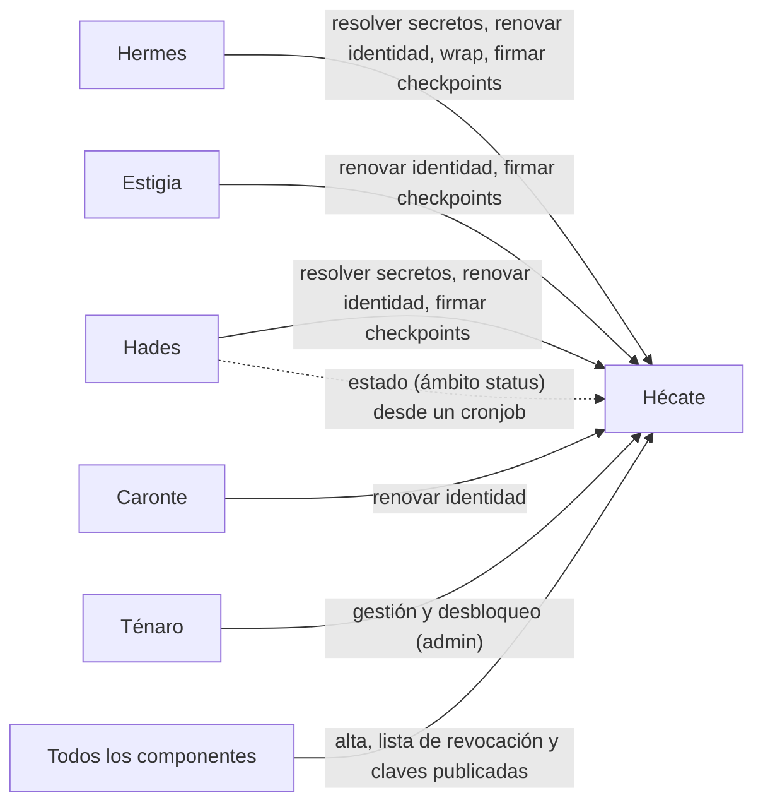
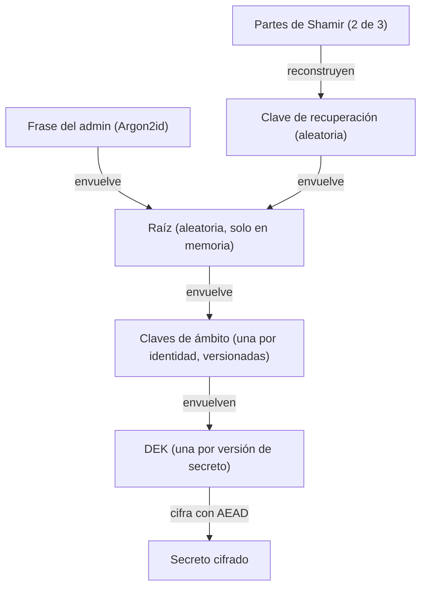
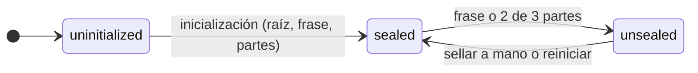
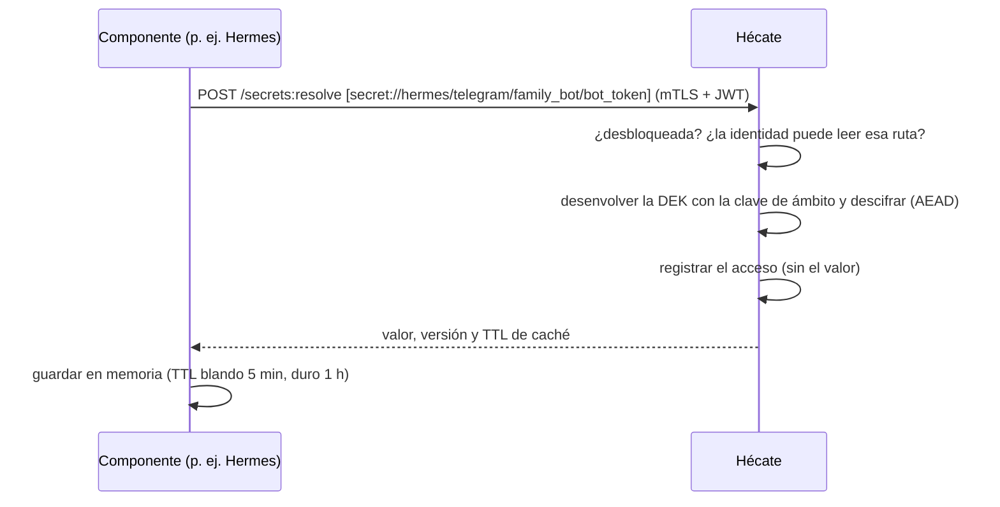
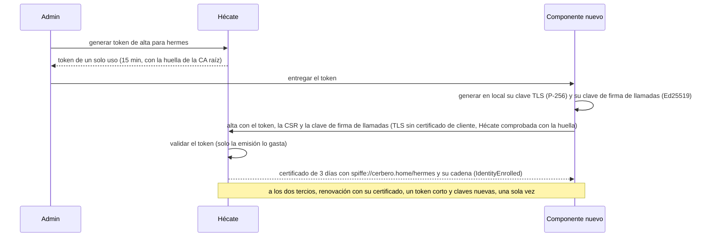
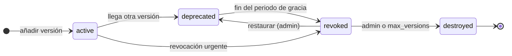
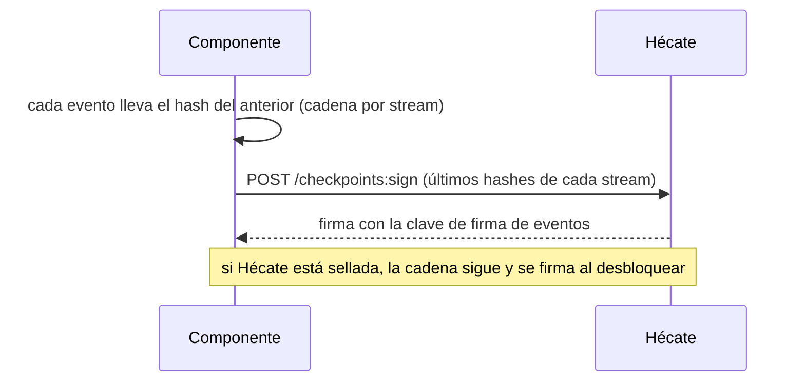

# Hécate — secretos y claves

*En la mitología, la guardiana de las llaves y las puertas del inframundo.* · Estado: diseñado · Última revisión: 2026-11-10

Ver también: [ARCHITECTURE](../ARCHITECTURE.md) (visión transversal, en especial [Identidad y seguridad](../ARCHITECTURE.md#6-identidad-y-seguridad)) · [GLOSSARY](../GLOSSARY.md) · [DECISIONS](../DECISIONS.md)

---

## 1. Propósito y frontera

Hécate custodia lo que abre las puertas de Cerbero: los **secretos de terceros** (tokens, API keys, credenciales) y las **claves de Cerbero** (la CA interna que da identidad a los componentes, las claves de firma y su rotación). También firma la auditoría de todos los componentes, para que nadie pueda reescribir lo que pasó.

| Hace | No hace |
|---|---|
| Guardar secretos cifrados por capas, con versiones y rotación | Exponerse a internet: solo vive en la red interna |
| Emitir y renovar las identidades de los componentes (CA interna) | Llamar a nadie: siempre le piden |
| Gestionar las claves de cifrado y de firma, y rotarlas | Entregar secretos a los Playbooks: los resuelven los componentes al ejecutar |
| Firmar los checkpoints de auditoría de todo Cerbero | Inventar criptografía: usa primitivas de librerías auditadas, salvo Shamir, sin auditoría pública ([riesgo aceptado](../DECISIONS.md#riesgos-aceptados)) |
| Envolver claves de otros componentes (`wrap` / `unwrap`) | Autenticar a las personas (lo hace Ténaro con passkeys) |

**Por qué es una pieza aparte:** es el objetivo más valioso de Cerbero. Separarla permite que su raíz viva solo en memoria, que no se exponga nunca y que tenga su propia auditoría, y que el resto de componentes no guarde ningún secreto en claro.

**Cómo se construye:** en Cerbero, para entender cómo funciona por dentro, pero con primitivas de librerías auditadas (aws-lc-rs para AES-256-GCM, HKDF y HMAC; libsodium para Argon2id) detrás de un port `CryptoProvider`; Shamir viene de vsss-rs, sin auditoría pública ([riesgo aceptado](../DECISIONS.md#riesgos-aceptados)). El primer adapter es software; un adapter de hardware (TPM o YubiKey) encaja en el mismo port. La CA usa rcgen y x509-parser detrás de un port `PkiProvider`, y la API entre componentes, axum sobre rustls (solo TLS 1.3) y jsonwebtoken para los tokens cortos ([ADR 0009](adr/0009-pila-api-hecate.md)).

---

## 2. Contexto



| Con quién | Qué pide a Hécate |
|---|---|
| **Todos los componentes** | Darse de alta con un token y renovar su certificado; consultar la lista de revocación y las claves de firma de llamadas publicadas, siempre autenticados; resolver sus secretos; firmar los checkpoints de su auditoría |
| **Hades** | Además, identidades hijas para sus integraciones y, desde un cronjob, el estado (ámbito `status`) |
| **Hermes** | Además, `wrap` / `unwrap` para cifrar sus copias de seguridad |
| **Ténaro** | Gestión (secretos, permisos, identidades, rotaciones) y desbloqueo, siempre con el admin autenticado |

---

## 3. Conceptos

### Aggregates

| Aggregate | Qué es | Estados |
|---|---|---|
| **Secret** | Un secreto en una ruta `secret://<identidad>/<resto>`, con metadatos (owner, tipo del valor, `max_versions`, `rotate_every`, `expires_at`) | Por versión: `active`, `deprecated`, `revoked`, `destroyed` |
| **Key** | Una clave propia: de cifrado por ámbito, la CA con sus intermedias o de firma de eventos | Por versión: `active`, `decrypt_only` / `verify_only`, `retired` |
| **Certificate** | Un certificado emitido a una identidad: su emisión, su única renovación y su revocación | `valid`, `revoked`, `expired` |
| **Identity** | Un componente o una identidad hija (`spiffe://cerbero.home/...`), con sus tokens de alta | Sin alta (solo tokens), `enrolled`, `disabled` |
| **Access Policy** | Qué rutas y operaciones puede usar una identidad | Versionada |

- Todos son event-sourced y **ningún evento lleva un valor**: solo metadatos, versiones y quién.
- Los accesos (resoluciones, renovaciones, `wrap` / `unwrap`, rechazos, intentos de desbloqueo) van a un **registro de accesos** aparte, append-only, para que los secretos no crezcan con cada lectura.
- Las escrituras de secretos llevan la versión esperada (como el *check-and-set* de OpenBao), para que dos cambios simultáneos no se pisen. Las órdenes del admin sobre identidades, certificados y tokens no la llevan: su resultado no depende de lo que leyó antes, y repetir una que no cambia nada no escribe eventos.
- **El admin escribe valores pero nunca los lee.** Para comprobar lo que escribió ve la **huella** de cada versión (ver más abajo); el valor solo sale por la resolución, que es de las identidades.

### Jerarquía de claves (cifrado por sobre)



| Nivel | Qué cifra | Rotación | Coste de rotar |
|---|---|---|---|
| **Raíz** | Solo las claves de ámbito | A petición del admin | Volver a envolver unas pocas claves de ámbito |
| **Clave de ámbito** | Las DEK de su ámbito | Periódica (90 días por defecto) y manual | Volver a envolver las DEK; los secretos no se tocan |
| **DEK** | Una versión de un secreto | No se rota: cada versión tiene la suya, aleatoria | — |

- **El ámbito es la identidad:** el ámbito de cifrado coincide con el de acceso, así que una clave de ámbito comprometida solo expone los secretos de esa identidad.
- **Una clave, un uso:** AES-256-GCM para cifrar; Ed25519 para firmar (JWT y eventos); ECDSA P-256 para la CA.
- **Agilidad criptográfica:** cada dato cifrado guarda el algoritmo y la versión de clave usados, para poder cambiar de algoritmo sin migrar todo de golpe.

### Formato de un secreto cifrado

```json
{ "alg": "AES-256-GCM", "scope_key": "hermes", "scope_key_version": 3,
  "wrapped_dek": "...", "nonce": "...", "ciphertext": "...",
  "aad": { "path": "secret://hermes/telegram/family_bot/bot_token", "version": 7, "scope": "hermes" } }
```

La ruta, la versión y el ámbito van como **datos asociados** del AEAD: si alguien mueve el dato cifrado a otra ruta, no se descifra. Cada capa lleva los suyos: la clave de ámbito, su identidad y su versión; la DEK, la ruta, la versión, la identidad y la versión de la clave de ámbito; el valor, la ruta, la versión y la identidad.

### Dónde se guarda

| Tabla (SQLite) | Contenido | Se borra |
|---|---|---|
| `events` | Los eventos de los aggregates `Secret` (stream `secret/<identidad>/<resto>`), `Key` (streams `key/<identidad>` y `ca`), `Identity` (stream `identity/<nombre>`) y `Certificate` (stream `certificate/<identidad>/<serie>`): solo metadatos, fechas y huellas. Append-only (triggers que rechazan `UPDATE` y `DELETE`) y con la versión esperada del stream en cada escritura | Nunca |
| `secret_material` | Por versión: el valor cifrado con su DEK y la DEK envuelta por la clave de ámbito | Al destruir la versión |
| `key_material` | Por identidad y versión: la clave de ámbito envuelta por la raíz | Nunca |
| `ca_material` | Por generación y versión de intermedia: los certificados de la CA raíz y de la intermedia, y la clave de la intermedia envuelta por la raíz | Al retirar la intermedia |
| `hecate_tls` | La clave propia de Hécate, en claro ([riesgo aceptado](../DECISIONS.md#riesgos-aceptados)), con la serie de su certificado | Se sustituye con cada certificado nuevo |
| `enroll_attempts` | El freno de las altas fallidas | Nunca |

- **El material va fuera de los eventos** porque el borrado criptográfico exige poder eliminar la DEK de una versión o la clave de una intermedia, y un registro append-only no lo permite. Los eventos y el material de un cambio se escriben en una sola transacción: un corte deja el secreto como estaba. SQLite trabaja con `secure_delete`, así que una DEK borrada tampoco queda en páginas libres de las copias.
- **Huella:** HMAC-SHA256 del valor con una clave derivada (HKDF-SHA256) de la clave de ámbito, truncado a 8 bytes y mostrado como `ab12-cd34-ef56-7890`. Al llevar clave, solo Hécate la calcula: quien vea la lista no puede adivinar valores débiles por fuerza bruta. Se guarda en el evento de la versión y aparece solo en las respuestas de `secrets.create`, `secrets.add_version` y `secrets.get`; nunca en el registro de accesos.

---

## 4. Cómo funciona

### Arranque y desbloqueo



- **Sellada** solo admite desbloquear y consultar el estado. La API sigue escuchando con el certificado vigente de Hécate y responde `unavailable` a los componentes, sin emitir, renovar ni publicar nada; si ese certificado caduca, deja de escuchar hasta que se desbloquea y se renueva ([riesgo aceptado](../DECISIONS.md#riesgos-aceptados)). Al reiniciar, vuelve a `sealed`. El admin puede sellarla a mano con una sola acción (p. ej. ante una intrusión).
- **La raíz es aleatoria y se guarda cifrada dos veces:** con una clave derivada de la frase del admin (para el día a día) y con una clave de recuperación aleatoria que se reparte en tres partes de Shamir, de las que bastan dos (para recuperarla si se olvida la frase). Cambiar la frase o repartir de nuevo las partes solo sustituye una de las dos protecciones; la raíz y los secretos no se tocan, y ambas operaciones exigen demostrarlo de nuevo con la frase actual o con dos partes.
- **Se desbloquea desde Ténaro** (passkey del admin + frase, por mTLS) **o con una CLI local** en el equipo de Hécate.
- **Canal local de administración:** la CLI `hecate` habla con el proceso por un socket Unix (permisos `0600` en un directorio `0700`, solo el mismo usuario). Usa el sobre y los códigos de error comunes, con `conflict` para "operación no permitida en el estado actual"; no publica API Contracts ni `/capabilities`, porque no cruza componentes (constitución, principio II). La salud de Hécate se consulta por este canal (`hecate status`); la API no tiene `/health`.
- **Operaciones de secretos en el canal local** (todas exigen Hécate desbloqueada y dejan una fila en el registro de accesos con `subject: admin`, la ruta y la versión; contrato en [specs/002-hecate-secrets/contracts](../specs/002-hecate-secrets/contracts/control-protocol.md)):

  | Operación | CLI | Notas |
  |---|---|---|
  | `secrets.create` | `hecate secrets create <ruta> --type <tipo> [--from-file]` | Versión 1; falla con `conflict` si la ruta existe |
  | `secrets.add_version` | `hecate secrets put <ruta> [--from-file]` | Exige `expected_version` |
  | `secrets.list` · `secrets.get` | `hecate secrets list [--identity]` · `get <ruta>` | Metadatos y huellas, nunca el valor |
  | `secrets.revoke` · `restore` · `promote` | `hecate secrets revoke\|restore\|promote <ruta> --version <n>` | Sin prueba; llevan `expected_version` |
  | `secrets.destroy` | `hecate secrets destroy <ruta> --version <n> [--with-shares]` | Exige la prueba (frase actual o dos partes) y cuenta en el contador común |

  El valor se pide sin eco o se lee de un fichero, nunca de la línea de órdenes. `hecate status` añade los recuentos de secretos caducados y por caducar en 7 días, que se calculan con los metadatos y también responden sellada.
- **Operaciones de la CA y de las identidades en el canal local** (todas exigen Hécate desbloqueada y dejan una fila con `subject: admin`, la identidad y, si la hay, la serie; contrato en [specs/003-hecate-identities/contracts](../specs/003-hecate-identities/contracts/control-protocol.md)):

  | Operación | CLI | Notas |
  |---|---|---|
  | `ca.create.*` | `hecate ca create --trust-domain <td> --out <ruta>` | La CLI genera la CA raíz, firma la intermedia que prepara Hécate y escribe la copia de su clave protegida con la frase de la CA; la CA no existe hasta que el admin devuelve una copia guardada y la CLI la abre |
  | `ca.intermediate.*` | `hecate ca renew-intermediate --root-key <ruta>` | La CLI abre la copia con la frase de la CA y firma la intermedia nueva |
  | `ca.replace.*` | `hecate ca replace --out <ruta> [--with-shares]` | Exige la prueba (frase actual o dos partes, cuenta en el contador común) y una frase nueva de la CA; sigue como la creación |
  | `tokens.create` · `list` · `annul` | `hecate tokens create <identidad>` · `list` · `annul <id>` | El token se muestra una sola vez |
  | `identities.list` · `get` | `hecate identities list` · `get <identidad>` | Estado y certificados, sin claves ni tokens |
  | `identities.disable` · `enable` | `hecate identities disable <identidad> [--urgent]` · `enable <identidad>` | La identidad `hecate` no se deshabilita |
  | `certificates.revoke` | `hecate certificates revoke <serie> [--urgent]` | El certificado de Hécate solo admite `--urgent` y se reemite al momento |

  La clave de la CA raíz nunca entra en el proceso de Hécate: solo existe en la memoria de la CLI durante cada ceremonia y en la copia que el admin guarda en dos soportes. La frase de la CA solo llega a Hécate al crear o sustituir la CA, para comprobar que no es la de desbloqueo. `hecate status` añade el bloque de la CA, también sellada: la serie y la caducidad del certificado de Hécate, los días que le quedan a la intermedia si son menos de 30, cuántas identidades caducan en 24 horas, los intentos de renovación sospechosos y si las altas están frenadas.
- **Inicialización, una sola vez:** se genera la raíz, el admin fija la frase (mínimo 12 caracteres) y se generan las tres partes de Shamir, que se muestran una vez y se confirman con dos de ellas; hasta confirmar no se guarda nada. La CA se crea después, en su propia ceremonia (`hecate ca create`). Una vez inicializada, no hay operación para borrarlo todo: volver a empezar es un procedimiento manual (parar Hécate y borrar sus datos).
- La raíz solo vive en memoria, sin swap ni volcados de memoria. Cada intento de inicializar, desbloquear, sellar o cambiar la protección queda en el registro de accesos. Tras tres fallos seguidos, la espera es de 1, 2, 4 y 8 minutos y después de 15; el contador sobrevive a los reinicios y es común a la frase, las partes y las pruebas para cambiar la protección.

### Resolver un secreto

La resolución (`resolve(identidad, referencias)`) es hoy un caso de uso interno sin canal: el canal local es del admin, que no lee valores, y su canal autenticado por identidad depende de la Access Policy, [abierta](../DECISIONS.md#abiertas). Sus reglas ya están en el caso de uso: todo o nada, tiempos de caché 300 s y 3600 s, y un único `not_found` con el mismo mensaje tanto si el secreto no existe, como si es de otra identidad o no tiene versión `active`.



### Alta y renovación de una identidad



- **Renovación única:** cada certificado se renueva una vez. Un segundo intento con el mismo certificado se trata como un robo de clave: Hécate revoca con urgencia todos los certificados válidos de esa identidad, y el estado lo cuenta.
- **Repetición:** la misma petición con la misma `Idempotency-Key` devuelve el mismo certificado sin efectos, para que un componente que no recibió la respuesta la recupere.
- **Freno de altas:** tras 10 altas fallidas seguidas, las siguientes esperan 1, 2, 4, 8 y 15 minutos, con un contador propio y una fila por tanda en el registro de accesos.
- **Revocación:** pasiva por defecto (solo quita la renovación: el certificado y su clave de firma de llamadas valen hasta caducar) o urgente (deja de valer al momento, entra en la lista de revocación hasta que caduca y su clave deja de firmar llamadas nuevas).
- **Lo que publica Hécate:** la lista de revocación, una CRL X.509 por intermedia, y las claves de firma de llamadas que valen para llamadas nuevas. Las dos valen 5 minutos y los componentes las refrescan; una clave concreta se puede pedir siempre, también si ya solo verifica firmas pasadas. Las consultas atendidas no dejan fila y los rechazos sí.
- **Deshabilitar** una identidad le quita la renovación, sus claves de las publicadas y sus tokens pendientes, e impide crearle tokens; con `--urgent`, sus certificados válidos entran en la lista de revocación. Habilitada de nuevo, solo vuelve a tener certificado con un alta y un token nuevo.
- **Certificado propio de Hécate** (`spiffe://<trust domain>/hecate`): se emite al crear o sustituir la CA y se renueva a los dos tercios de su vida. Solo admite la revocación urgente, que lo reemite al momento con otra clave.
- **Intermedia:** dura un año y el estado avisa cuando le quedan menos de 30 días; se renueva con la copia de la clave de la CA raíz, también ya caducada. La anterior solo firma la lista de revocación de sus certificados, y su clave se destruye cuando caduca el último.

Los detalles de la identidad (formato SPIFFE, trust domains, identidades hijas, revocación, JWT ligado al canal) están en [Identidad y seguridad](../ARCHITECTURE.md#6-identidad-y-seguridad).

### Rotar una clave de ámbito

1. La versión nueva cifra lo nuevo; las anteriores pasan a `decrypt_only`.
2. Un proceso de Hécate vuelve a envolver las DEK antiguas con la versión nueva (el equivalente a `rewrap`, sin tocar los secretos).
3. Cuando ninguna DEK depende de una versión antigua, pasa a `retired` y se puede destruir. **No se puede destruir una versión de la que aún depende una DEK.**

### Ciclo de vida de un secreto



- **Periodo de gracia** de 24 h por defecto: la versión anterior aún se resuelve si se pide explícitamente. Se calcula al leer (una `deprecated` pasada su gracia cuenta como `revoked`), sin procesos en segundo plano; restaurar una `revoked` la deja `deprecated` con una gracia nueva.
- **`max_versions`** (10 por defecto, de 2 a 100): al superarlo, la más antigua se destruye. El mínimo de 2 deja a la versión anterior su gracia tras rotar.
- **Volver a la anterior** (p. ej. si las credenciales nuevas no funcionan): el admin la promueve otra vez a `active`, como evento.
- **`destroy` es borrado criptográfico:** se borra la DEK de esa versión; los eventos siguen y el dato ya no se puede descifrar. Solo se destruye una versión `revoked` y el admin lo demuestra de nuevo con la frase actual o dos partes (el mismo contador de intentos que el desbloqueo); revocar, restaurar y promover no piden prueba, y la destrucción por `max_versions` tampoco.
- **Rotación de un secreto de terceros:** el admin rota en el proveedor y añade la versión nueva desde Ténaro; los componentes la recogen al refrescar su caché. Después, la prueba de conexión de la instancia (en Hermes) lo confirma.
- **Avisos de rotación:** `rotate_every` y `expires_at` en los metadatos; un cronjob de Hades consulta el estado y un Playbook secundario avisa al admin.
- **En una fuga:** se revoca sin periodo de gracia y se rota en el proveedor.

### Auditoría y checkpoints



- Modificar o borrar un evento rompe la cadena o la firma, y se detecta.
- La clave de firma nunca sale de Hécate: un componente comprometido no puede reescribir su historia ya firmada.
- Cada cambio guarda el JWT de quien lo pidió; Hécate conserva las claves de firma de llamadas antiguas para verificar firmas pasadas.
- Un cronjob de Hades lanza la verificación periódica; si algo no cuadra, señal `AuditIntegrityBroken`.

---

## 5. Contratos

| Superficie | Operación | Qué hace |
|---|---|---|
| **Ejecución** | `POST /v1/identities:enroll` | Alta con un token de un solo uso, sin certificado de cliente: la CSR y la clave de firma de llamadas |
| | `POST /v1/certificates:renew` | Renueva, una sola vez, el certificado de la identidad que llama, con claves nuevas |
| | `GET /v1/revocations` | La lista de revocación: una CRL por intermedia, válida 5 minutos |
| | `GET /v1/keys` · `GET /v1/keys/{kid}` | Las claves de firma de llamadas que valen para llamadas nuevas, válidas 5 minutos; o una concreta, también antigua |
| | `GET /v1/capabilities` | Las operaciones de esta versión de la API |
| | `POST /v1/secrets:resolve` | Resuelve varias referencias a la vez; devuelve valor, versión y TTL de caché |
| | `POST /v1/keys/{id}:wrap` · `:unwrap` | Envuelve o desenvuelve la DEK de otro componente con la clave de su ámbito |
| | `POST /v1/checkpoints:sign` | Firma los últimos hashes de los streams de un componente |
| **Estado** (ámbito `status`) | Consulta | Sellada o no, recuentos y avisos agregados (secretos por rotar o caducar, certificados por caducar) y resultado de la verificación de la auditoría. Nunca rutas ni metadatos de un secreto concreto |
| **Gestión** (admin) | Canal local y Ténaro | Secretos y versiones, revocar, restaurar, destruir, permisos, la CA, tokens de alta, identidades, revocar certificados, rotar claves, sellar |
| **Desbloqueo** | Desbloquear, consultar el estado | Lo único disponible mientras está sellada |

- Mismo contrato común que el resto de componentes (sobre, errores, versión en la ruta), con el OpenAPI en `shared/contracts/src/cerbero_contracts/openapi/hecate.v1.json`. La API habla solo TLS 1.3: el alta se autentica con el token y lo demás con el certificado de cliente y un token corto ligado a él. Sellada, todo responde `unavailable`.
- **Referencias a secretos:** `secret://<ruta>` resuelve la versión activa; `secret://<ruta>@7`, una concreta.
- **Los Playbooks no tienen destino `hecate`:** los secretos nunca entran en los datos de una Response.

---

## 6. Configuración y extensión

- **Permisos que salen de las declaraciones:** al registrar una instancia de Hermes o una integración de Hades, sus referencias `secret://` dan permiso de lectura a su identidad. Una referencia fuera de su ámbito se rechaza. El valor lo introduce el admin aparte.
- **Metadatos de cada secreto:** owner, tipo del valor (`string`, `json`, `pem`...), validado al escribir; `max_versions`; `rotate_every`; `expires_at`.
- **Parámetros configurables:** perfil de Argon2id (`sensitive` por defecto o `moderate`, nunca uno más débil), periodo de gracia, rotación de las claves de ámbito, TTL de caché, duración de los certificados, retención de la auditoría.
- **Hardware:** un adapter del `CryptoProvider` (TPM o YubiKey) para desbloqueo automático y claves que no salen del dispositivo.

---

## 7. Organización interna

Un workspace de Cargo con un crate por capa:

```text
hecate/
├── crates/
│   ├── domain/              # hecate-domain
│   │   ├── sealing/         # sellado: frase, partes de Shamir, intentos, protección de la raíz
│   │   ├── secrets/         # Secret y sus versiones, ciclo de vida
│   │   ├── keys/            # Key, jerarquía, rotación, salvaguarda al destruir
│   │   ├── ca/              # la CA: generaciones, intermedias y copia de la clave raíz
│   │   ├── identity/        # Identity, Certificate, tokens de alta, freno de altas
│   │   ├── access_policy/   # Access Policy, ámbitos, permisos derivados de las declaraciones
│   │   └── audit/           # registro de accesos, cadenas, checkpoints
│   ├── application/         # hecate-application: casos de uso (resolver, alta, renovar, revocar, ceremonias de la CA, wrap, firmar checkpoint, desbloquear, gestionar)
│   ├── infrastructure/      # hecate-infrastructure
│   │   ├── crypto           # CryptoProvider: adapter de software (aws-lc-rs, libsodium, vsss-rs)
│   │   ├── pki              # PkiProvider: la CA y sus certificados con rcgen y x509-parser
│   │   ├── store/           # event store, material cifrado y proyecciones en SQLite
│   │   ├── control/         # canal local de administración (desbloqueo y gestión)
│   │   └── api/             # API entre componentes: axum sobre rustls (TLS 1.3), tokens cortos con jsonwebtoken
│   └── cli/                 # hecate-cli: las órdenes y el binario `hecate`
└── tests/vectors/           # vectores de prueba conocidos (cifrado, datos asociados, eventos y valores)
```

| Patrón | Dónde | Por qué |
|---|---|---|
| Event Sourcing | Los aggregates y el registro de accesos | La historia es la auditoría; ningún evento lleva valores |
| Ports y adapters | `CryptoProvider`, `PkiProvider` | Cambiar a hardware o de librería sin tocar el dominio |
| Cifrado por sobre | Raíz → ámbito → DEK | Rotar barato y aislar el daño por ámbito |

---

## 8. Datos

| Dato | Copia |
|---|---|
| Configuración de sellado (la raíz cifrada dos veces), contador de intentos y registro de accesos, en SQLite ([ADR 0003](adr/0003-persistencia-hecate-sqlite.md)) | Sí |
| Event store (`events`, solo metadatos) y material cifrado (`secret_material`: valor y DEK envuelta; `key_material`: claves de ámbito envueltas; `ca_material`: certificados de la CA y claves de las intermedias envueltas) | Sí |
| Clave propia de Hécate (`hecate_tls`), en claro ([riesgo aceptado](../DECISIONS.md#riesgos-aceptados)) y freno de altas (`enroll_attempts`) | Sí |
| Registro de accesos y políticas | Sí |
| La raíz en claro y las cachés | Nunca: solo existen en memoria |
| Clave de la CA raíz | Nunca en Hécate: solo la copia protegida con la frase de la CA que escribe la CLI, que el admin guarda en dos soportes en sitios distintos |

- **Sin la frase o las partes, las copias no sirven**, a propósito.
- Regla 3-2-1, como el resto de Cerbero; la restauración se prueba en un entorno aislado, sin red hacia casa.
- **Retención larga de la auditoría** (p. ej. un año o más, configurable), independiente de los datos: destruir un secreto no borra sus eventos.
- **Datos personales:** ninguno más allá de quién hizo cada cambio.

---

## 9. Seguridad

- **Nunca expuesta a internet;** API interna solo con TLS 1.3. Los componentes se autentican con su certificado y un token corto (Ed25519, 5 minutos como mucho, un solo uso) firmado con su clave de firma de llamadas; el alta, con un token de un solo uso cuya huella les deja comprobar a Hécate antes de enviar nada. Hécate valida la cadena en la aplicación, así que todo rechazo responde `auth` y deja fila.
- **Políticas:** cada identidad solo lee `secret://<su identidad>/**`; lo demás está denegado. Una identidad padre no lee los secretos de sus hijas. Compartir un secreto es una excepción explícita y auditada.
- **Quién hace qué:** los componentes solo se dan de alta, renuevan y leen lo publicado o sus secretos; la gestión y el desbloqueo, solo el admin, por la CLI local o desde Ténaro.
- **Material de la CA:** la clave de la CA raíz nunca entra en Hécate; la de cada intermedia se guarda envuelta por la raíz y solo se descifra para la operación que firma. La frase de la CA, las claves y los tokens de paso se borran de la memoria al terminar cada operación.
- **Cada cambio de política** se versiona y se registra con quién; los rechazos van al registro de accesos.
- **Proceso** con usuario propio, sin swap ni volcados de memoria.

---

## 10. Operación

| Qué pasa | Efecto | Recuperación |
|---|---|---|
| Hécate caída o sellada | Los componentes siguen con la caché hasta 1 h; después, lo que necesita un secreto falla con `internal`. Las identidades aguantan hasta 3 días; sellada, la API responde `unavailable` | Arrancar y desbloquear (Ténaro o CLI) |
| Se pierde el disco | Igual que caída | Restaurar la copia y desbloquear con la frase o las partes |
| Se olvida la frase | Nada, mientras siga desbloqueada | Desbloquear con 2 de 3 partes y fijar una frase nueva |
| Se pierden la frase y las partes | Los datos no se pueden descifrar, ni desde las copias | Inicializar de nuevo, dar de alta otra vez las identidades y volver a introducir los secretos |
| Se compromete la CA intermedia, o se pierden la clave de la CA raíz o su frase | Se pueden emitir identidades falsas, o no se puede renovar la intermedia | Sustituir la CA (`hecate ca replace`, con la prueba y una frase nueva de la CA): Hécate destruye la intermedia anterior y solo acepta la CA nueva; cada componente vuelve a darse de alta con un token nuevo |
| La intermedia va a caducar | El estado avisa a falta de 30 días; caducada, Hécate deja de emitir | Renovarla con la copia de la clave de la CA raíz (`hecate ca renew-intermediate`) |
| Se compromete la clave de un componente | Puede suplantarlo hasta que caduque su certificado | Revocarlo con urgencia o deshabilitar la identidad; ante un segundo intento de renovar, Hécate revoca sola |
| Se compromete la clave propia de Hécate | Alguien podría hacerse pasar por Hécate ante los componentes | Revocar su certificado con urgencia: Hécate se identifica al momento con uno nuevo y el anterior entra en la lista de revocación |
| Se compromete una clave de ámbito | Los secretos de ese ámbito quedan expuestos | Rotarla, volver a envolver, destruir la versión comprometida y rotar esos secretos en el proveedor |

- Cada fila es un procedimiento escrito.
- **Una sola instancia**, sin alta disponibilidad: la caché y los certificados de 3 días cubren las caídas cortas.
- **Tras un corte de luz de toda la casa**, Hécate queda sellada y no hay avisos hasta desbloquearla (los avisos dependen de secretos que custodia); Ténaro muestra el estado.
- **Observabilidad** con OpenTelemetry: resoluciones, rechazos, desbloqueos, caducidades, rotaciones pendientes y progreso de las rotaciones de claves; logs sin valores.
- **Avisos:** un cronjob de Hades consulta el ámbito `status` y emite señales (sellada, certificados por caducar, rotaciones pendientes, integridad de la auditoría).

---

## 11. Pruebas

- **Criptografía:** vectores de prueba conocidos y pruebas de manipulación: cambiar la ruta, la versión o un byte del dato cifrado impide descifrarlo.
- **Integración:** rotación, `rewrap`, salvaguarda al destruir, desbloqueo con frase y con partes, ceremonias de la CA, alta, renovación y revocación de identidades, con un componente de prueba contra la API.
- **Una Hécate de pruebas** (otro trust domain y secretos de prueba) para los entornos funcionales completos y la CI del resto de componentes.
- **Restauración** probada en un entorno aislado.

---

## 12. Decisiones y riesgos

Resumen; el detalle y el porqué están en [DECISIONS](../DECISIONS.md#hécate-frente-a-sus-referencias-openbao--vault-step-ca-spiffe).

- **Frente a sus referencias:** se construye en Cerbero sin inventar criptografía; frase del admin más Shamir de recuperación; certificados de 3 días; identidad SPIFFE sin SPIRE; JWT ligado al canal mTLS; Hécate firma los checkpoints de todo Cerbero; renovación única con detección de reutilización; claves de firma de llamadas solo para componentes autenticados; sustituir la CA en lugar de revocar la intermedia; alta sin certificado de cliente.
- **Descartado:** IdP con OIDC, OAuth *client credentials*, claves API compartidas, OpenBao / SOPS + age / variables de entorno como almacén, inventar criptografía.
- **Riesgos aceptados:** Hécate firma sus propios checkpoints (solo lo cubre un anclaje externo); tras un corte de luz no hay avisos hasta desbloquearla; la raíz está en memoria mientras Hécate está desbloqueada (los secretos de paso se borran al terminar cada operación); ninguna implementación de Shamir tiene una auditoría pública; la clave propia de Hécate se guarda en claro para responder sellada con su certificado vigente.

---

## 13. Preguntas frecuentes

**¿Qué pasa si se va la luz?**
Todo arranca y Hécate queda sellada. Los componentes aguantan con su caché hasta 1 h y sus identidades hasta 3 días; el admin la desbloquea desde Ténaro o con la CLI.

**¿Y si olvido la frase?**
Se desbloquea con 2 de las 3 partes de Shamir y se fija una frase nueva. Si se pierden la frase y las partes, no hay forma de recuperar los datos, ni desde las copias: es el precio de que nadie más pueda hacerlo.

**¿Un Playbook puede leer un secreto?**
No. Los secretos los resuelven los componentes al ejecutar, con su propia identidad; nunca entran en los datos de una Response.

**¿Por qué no usar OpenBao directamente?**
Para aprender cómo funciona por dentro. Se toma su modelo como referencia (sellado, versiones, `rewrap`) y se usan primitivas de librerías auditadas, salvo Shamir, sin auditoría pública ([riesgo aceptado](../DECISIONS.md#riesgos-aceptados)).

**¿Cómo cambio el token de un bot?**
Rotándolo en el proveedor, añadiendo la versión nueva desde Ténaro y lanzando la prueba de conexión de la instancia. Si falla, se vuelve a la versión anterior.

**¿Qué ve Hades del estado de Hécate?**
Solo recuentos y avisos agregados por su ámbito `status`, nunca la lista de secretos.

**¿Qué pasa si alguien manipula la auditoría de un componente?**
Se rompe la cadena de hashes o la firma del checkpoint, y la verificación periódica lo detecta.

---

## 14. Referencias

- OpenBao: [Seal/Unseal](https://openbao.org/docs/concepts/seal/) · [KV v2](https://openbao.org/docs/secrets/kv/kv-v2/) · [Transit](https://openbao.org/docs/secrets/transit/)
- Google Cloud KMS: [Envelope encryption](https://docs.cloud.google.com/kms/docs/envelope-encryption) · [Re-encrypting data](https://docs.cloud.google.com/kms/docs/re-encrypt-data)
- step-ca: [Production](https://smallstep.com/docs/step-ca/certificate-authority-server-production/) · [Provisioners](https://smallstep.com/docs/step-ca/provisioners/) · [Renewal](https://smallstep.com/docs/step-ca/renewal/) · [Revocation](https://smallstep.com/docs/step-ca/revocation/)
- SPIFFE: [Concepts](https://spiffe.io/docs/latest/spiffe-about/spiffe-concepts/) · [X.509-SVID](https://spiffe.io/docs/latest/spiffe-specs/x509-svid/) · [SPIRE concepts](https://spiffe.io/docs/latest/spire-about/spire-concepts/)
