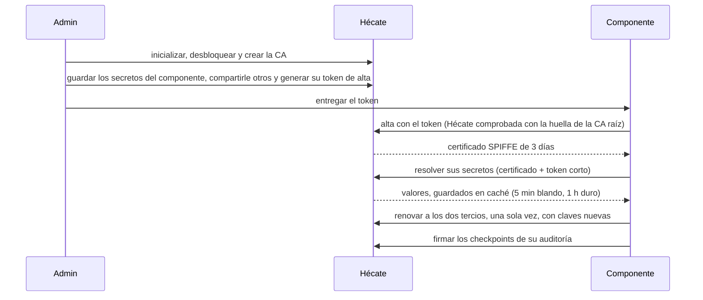

# Hécate — secretos y claves

*En la mitología, la guardiana de las llaves y las puertas del inframundo.* · Última revisión: 2026-11-12

Ver también: [ARCHITECTURE](../ARCHITECTURE.md) (visión transversal, en especial
[Identidad y seguridad](../ARCHITECTURE.md#6-identidad-y-seguridad)) · [GLOSSARY](../GLOSSARY.md) ·
[DECISIONS](../DECISIONS.md)

---

## Por qué existe

Los componentes de Cerbero necesitan secretos de terceros (tokens de bots, API keys, credenciales de las
integraciones), tienen que saber con quién hablan en la red interna, y nadie tiene que poder reescribir su historia. Sin
una pieza que lo resuelva, cada componente guardaría sus propios secretos, se fiaría de la red y protegería su propia
auditoría.

Hécate custodia lo que abre las puertas de Cerbero: los **secretos de terceros** y las **claves de Cerbero** (la CA
interna que da identidad a los componentes, las claves de firma y su rotación). También firma la auditoría de todos los
componentes, para que nadie pueda reescribir lo que pasó.

**Por qué es una pieza aparte:** es el objetivo más valioso de Cerbero. Separarla permite que su raíz viva solo en
memoria, que no se exponga nunca y que tenga su propia auditoría, y que el resto de componentes no guarde ningún secreto
en claro.

## Qué hace y qué no hace

| Hace | No hace |
|---|---|
| Guardar secretos cifrados por capas, con versiones y rotación | Exponerse a internet: solo vive en la red interna |
| Emitir y renovar las identidades de los componentes (CA interna) | Llamar a nadie: siempre le piden |
| Gestionar las claves de cifrado y de firma, y rotarlas | Entregar secretos a los Playbooks: los resuelven los componentes al ejecutar, y los Playbooks no tienen destino `hecate` |
| Firmar los checkpoints de auditoría de todo Cerbero | Inventar criptografía: usa primitivas de librerías auditadas, salvo Shamir, sin auditoría pública ([riesgo aceptado](../DECISIONS.md#riesgos-aceptados)) |
| Envolver claves de otros componentes (`wrap` / `unwrap`) | Autenticar a las personas (lo hace Ténaro con passkeys) |

## Quién la usa

| Con quién | Qué pide a Hécate |
|---|---|
| **Todos los componentes** | Darse de alta con un token y renovar su certificado; consultar la lista de revocación y las claves de firma de llamadas publicadas, siempre autenticados; resolver sus secretos y los que el admin les comparte; firmar los checkpoints de su auditoría |
| **Hades** | Además, identidades hijas para sus integraciones y, desde un cronjob, el estado (con el permiso de estado) |
| **Hermes** | Además, `wrap` / `unwrap` para cifrar sus copias de seguridad |
| **Ténaro** | Gestión (secretos, Access Policy, identidades, rotaciones) y desbloqueo, siempre con el admin autenticado |
| **El admin** | Inicializarla, desbloquearla, sellarla y gestionarla con la CLI local en el equipo de Hécate, o desde Ténaro; escribe valores, pero nunca los lee |

Hécate tiene dos superficies. La **API entre componentes** habla solo TLS 1.3, con el contrato común de Cerbero (sobre,
errores, versión en la ruta) y su
[OpenAPI](../shared/contracts/src/cerbero_contracts/openapi/hecate.v1.json): el alta se autentica con un token de un
solo uso, y el resto con el certificado del componente y un token corto. El **canal local de administración** es un
socket Unix en el equipo de Hécate, que usa la CLI `hecate`. Con Hécate sellada, el canal local solo desbloquea y da el
estado, y la API solo responde el estado agregado.

## Cómo encaja todo

1. El admin pone Hécate en marcha una vez: la inicializa con su frase y tres partes de recuperación, la desbloquea y
   crea la CA.
2. Guarda los secretos de un componente, que se pueden preparar antes de su alta, le comparte los de otros si hace
   falta y le genera un token de alta.
3. El componente se da de alta con el token, tras comprobar que habla con Hécate, y recibe su certificado.
4. Cada llamada lleva su certificado y un token corto. Resuelve sus secretos y los guarda en caché, y refresca la lista
   de revocación y las claves publicadas.
5. A los dos tercios de la vida de su certificado lo renueva, una sola vez y con claves nuevas.
6. Hécate deja una fila por cada acceso y firma los checkpoints de la auditoría del componente.

Sus cinco aggregates:

| Aggregate | Qué es | Estados |
|---|---|---|
| **Secret** | Un secreto en una ruta `secret://<identidad>/<resto>`, con metadatos (owner, tipo del valor, `max_versions`, `rotate_every`, `expires_at`) | Por versión: `active`, `deprecated`, `revoked`, `destroyed` |
| **Key** | Una clave propia: de cifrado por ámbito, la CA con sus intermedias o de firma de eventos | Por versión: `active`, `decrypt_only` / `verify_only`, `retired` |
| **Certificate** | Un certificado emitido a una identidad: su emisión, su única renovación y su revocación | `valid`, `revoked`, `expired` |
| **Identity** | Un componente o una identidad hija (`spiffe://cerbero.home/...`), con sus tokens de alta | Sin alta (solo tokens), `enrolled`, `disabled` |
| **Access Policy** | Lo que una identidad puede usar además de sus propios secretos: las excepciones del admin, cada una para leer un secreto concreto de otra identidad, y el permiso de estado | Versionada: cada cambio, con quién y cuándo |

Todos son event-sourced y ningún evento lleva un valor; los accesos van a un registro aparte.

## Conceptos

- **[Sellado](hecate/sellado.md).** Todo lo que Hécate cifra cuelga de una raíz aleatoria que solo vive en memoria
  mientras Hécate está desbloqueada. La raíz se guarda cifrada dos veces: con la frase del admin, para el día a día, y
  con una clave de recuperación repartida en tres partes, de las que bastan dos. Hécate arranca siempre sellada, se
  desbloquea con la frase o con dos partes, y un freno de intentos la protege de la fuerza bruta.
- **[Secretos](hecate/secretos.md).** Cada secreto se cifra por sobre: la raíz envuelve una clave de ámbito por
  identidad, que envuelve una clave por versión, que cifra el valor. Cada secreto tiene versiones con periodo de gracia,
  un máximo de versiones y metadatos de rotación y caducidad. El admin comprueba lo que escribió con una huella, sin
  leer el valor, y destruir una versión es borrado criptográfico.
- **[Identidades](hecate/identidades.md).** Hécate es la CA interna de Cerbero, en dos niveles: la clave de la CA raíz
  nunca entra en Hécate, y la intermedia firma certificados SPIFFE de tres días. Un componente se da de alta con un
  token de un solo uso y renueva cada certificado una sola vez; un segundo intento se trata como un robo de clave. La
  revocación es pasiva por defecto y urgente cuando hace falta.
- **[Acceso](hecate/acceso.md).** Cada identidad solo resuelve sus propios secretos, salvo las excepciones que el admin
  comparte, secreto a secreto, en su Access Policy. La resolución comprueba todo antes de descifrar nada, y sus
  rechazos no se distinguen ni por su contenido ni por su tiempo. El permiso de estado deja ver recuentos agregados,
  nunca nombres.
- **[Auditoría](hecate/auditoria.md).** Cada uso y cada intento deja una fila en un registro de accesos append-only,
  que nunca lleva valores. Hécate firma además los checkpoints de la auditoría de cada componente, para que nadie pueda
  reescribir su historia.
- **[Seguridad](hecate/seguridad.md).** Frente a qué protege Hécate (el robo del disco, un componente comprometido,
  alguien en la red interna, un error del admin), qué mecanismo cubre cada amenaza, qué datos guarda y cuáles nunca
  salen de la memoria, y los riesgos que acepta.

## Usarla y desarrollarla

- **[Integrar un componente](hecate/integracion.md).** Lo que hace un componente para usar Hécate, sin leer su código:
  qué claves genera y guarda, el alta, el token corto de cada llamada, la renovación, lo que refresca, la resolución y
  su caché, el estado, los errores y Hécate sellada.
- **[CLI y configuración](hecate/cli.md).** Cómo se lanza Hécate, qué necesita del sistema, sus variables de entorno y
  cada orden de la CLI, con sus argumentos, su salida y sus códigos de salida.
- **[Operación](hecate/operacion.md).** La puesta en marcha y un procedimiento paso a paso para cada situación: el
  arranque tras un reinicio, la frase olvidada, la pérdida del disco, la intermedia que caduca, la CA comprometida y
  cada clave comprometida.
- **[Desarrollo](../hecate/README.md).** Cómo se compila Hécate, cómo se pasa su suite en macOS y en un contenedor
  Linux, sus comprobaciones de calidad, el componente de prueba y cómo se organizan sus crates.

## Ante fallos

| Qué pasa | Efecto | Recuperación |
|---|---|---|
| Hécate caída o sellada | Los componentes siguen con la caché hasta 1 h; después, lo que necesita un secreto falla con `internal`. Las identidades aguantan hasta 3 días; sellada, la API responde `unavailable`, salvo el estado agregado | Arrancar y desbloquear |
| Se pierde el disco | Igual que caída | Restaurar la copia y desbloquear con la frase o las partes |
| Se olvida la frase | Nada, mientras siga desbloqueada | Desbloquear con 2 de 3 partes y fijar una frase nueva |
| Se pierden la frase y las partes | Los datos no se pueden descifrar, ni desde las copias | Inicializar de nuevo, dar de alta otra vez las identidades y volver a introducir los secretos |
| Se compromete una clave o se pierde la de la CA raíz | Según la clave, suplantar a un componente o a Hécate, emitir identidades falsas, exponer un ámbito o no poder renovar la intermedia | Revocar, sustituir la CA o rotar, según el caso |

- El procedimiento de cada situación está en [operación](hecate/operacion.md).
- **Una sola instancia**, sin alta disponibilidad: la caché y los certificados de 3 días cubren las caídas cortas.
- **Tras un corte de luz de toda la casa**, Hécate queda sellada y no hay avisos hasta desbloquearla (los avisos
  dependen de secretos que custodia); Ténaro muestra el estado.

## Decisiones y riesgos

Resumen; el detalle y el porqué están en
[DECISIONS](../DECISIONS.md#hécate-frente-a-sus-referencias-openbao--vault-step-ca-spiffe).

- **Cómo se construye:** en Cerbero, para entender cómo funciona por dentro, en Rust
  ([ADR 0005](adr/0005-rust-para-orthros-y-hecate.md), [ADR 0007](adr/0007-pila-hecate-rust.md)) y sobre SQLite
  ([ADR 0003](adr/0003-persistencia-hecate-sqlite.md)). Usa primitivas de librerías auditadas (aws-lc-rs para
  AES-256-GCM, HKDF y HMAC; libsodium para Argon2id) detrás de un port `CryptoProvider`, y Shamir de vsss-rs. La CA usa
  rcgen y x509-parser detrás de un port `PkiProvider`, y la API, axum sobre rustls (solo TLS 1.3) y jsonwebtoken para
  los tokens cortos ([ADR 0009](adr/0009-pila-api-hecate.md)). La licencia permite enlazar con OpenSSL
  ([ADR 0008](adr/0008-excepcion-openssl-agpl.md)), y la Access Policy tiene su propio
  [ADR 0010](adr/0010-access-policy-hecate.md).
- **Frente a sus referencias:** se construye en Cerbero sin inventar criptografía; frase del admin más Shamir de
  recuperación; certificados de 3 días; identidad SPIFFE sin SPIRE; JWT ligado al canal mTLS; Hécate firma los
  checkpoints de todo Cerbero; renovación única con detección de reutilización; claves de firma de llamadas solo para
  componentes autenticados; sustituir la CA en lugar de revocar la intermedia; alta sin certificado de cliente;
  excepciones de acceso por secreto concreto, sin comodines ni políticas ligadas a tokens.
- **Descartado:** IdP con OIDC, OAuth *client credentials*, claves API compartidas, OpenBao / SOPS + age / variables de
  entorno como almacén, inventar criptografía.
- **Riesgos aceptados:** Hécate firma sus propios checkpoints (solo lo cubre un anclaje externo); tras un corte de luz
  no hay avisos hasta desbloquearla; la raíz está en memoria mientras Hécate está desbloqueada (los secretos de paso se
  borran al terminar cada operación); ninguna implementación de Shamir tiene una auditoría pública; la clave propia de
  Hécate se guarda en claro para responder sellada con su certificado vigente. Frente a qué protege cada mecanismo, en
  [seguridad](hecate/seguridad.md).
- **Observabilidad** con OpenTelemetry: resoluciones, rechazos, desbloqueos, caducidades, rotaciones pendientes y
  progreso de las rotaciones de claves; los logs nunca llevan valores. La decisión común está entre las
  [abiertas](../DECISIONS.md#abiertas).

## Preguntas frecuentes

**¿Qué pasa si se va la luz?**
Todo arranca y Hécate queda sellada. Los componentes aguantan con su caché hasta 1 h y sus identidades hasta 3 días; el
admin la desbloquea desde Ténaro o con la CLI.

**¿Y si olvido la frase?**
Se desbloquea con 2 de las 3 partes de Shamir y se fija una frase nueva. Si se pierden la frase y las partes, no hay
forma de recuperar los datos, ni desde las copias: es el precio de que nadie más pueda hacerlo
([sellado](hecate/sellado.md)).

**¿Un Playbook puede leer un secreto?**
No. Los secretos los resuelven los componentes al ejecutar, con su propia identidad; nunca entran en los datos de una
Response.

**¿Por qué no usar OpenBao directamente?**
Para aprender cómo funciona por dentro. Se toma su modelo como referencia (sellado, versiones, `rewrap`) y se usan
primitivas de librerías auditadas, salvo Shamir, sin auditoría pública
([riesgo aceptado](../DECISIONS.md#riesgos-aceptados)).

**¿Cómo cambio el token de un bot?**
Rotándolo en el proveedor, añadiendo la versión nueva desde Ténaro o la CLI y lanzando la prueba de conexión de la
instancia. Si falla, se vuelve a la versión anterior
([ciclo de vida](hecate/secretos.md#el-ciclo-de-vida-de-un-secreto)).

**¿Qué ve Hades del estado de Hécate?**
Solo los recuentos agregados de `GET /v1/status`, con el permiso de estado que le concede el admin; nunca rutas ni
nombres ([permiso de estado](hecate/acceso.md#el-permiso-de-estado)).

**¿Cómo comparto un secreto entre dos componentes?**
Con una excepción: `hecate policies grant-read <identidad> <ruta>` deja a esa identidad resolver ese secreto concreto,
y `revoke-read` se lo retira desde la petición siguiente. Cada cambio queda en el historial de su política, con quién lo
hizo ([Access Policy](hecate/acceso.md#la-access-policy)).

**¿Qué pasa si alguien manipula la auditoría de un componente?**
Se rompe la cadena de hashes o la firma del checkpoint, y la verificación periódica lo detecta
([auditoría](hecate/auditoria.md#la-firma-de-checkpoints)).

## Referencias

- OpenBao: [Seal/Unseal](https://openbao.org/docs/concepts/seal/) · [KV v2](https://openbao.org/docs/secrets/kv/kv-v2/)
  · [Transit](https://openbao.org/docs/secrets/transit/)
- Google Cloud KMS: [Envelope encryption](https://docs.cloud.google.com/kms/docs/envelope-encryption) ·
  [Re-encrypting data](https://docs.cloud.google.com/kms/docs/re-encrypt-data)
- step-ca: [Production](https://smallstep.com/docs/step-ca/certificate-authority-server-production/) ·
  [Provisioners](https://smallstep.com/docs/step-ca/provisioners/) ·
  [Renewal](https://smallstep.com/docs/step-ca/renewal/) · [Revocation](https://smallstep.com/docs/step-ca/revocation/)
- SPIFFE: [Concepts](https://spiffe.io/docs/latest/spiffe-about/spiffe-concepts/) ·
  [X.509-SVID](https://spiffe.io/docs/latest/spiffe-specs/x509-svid/) ·
  [SPIRE concepts](https://spiffe.io/docs/latest/spire-about/spire-concepts/)
