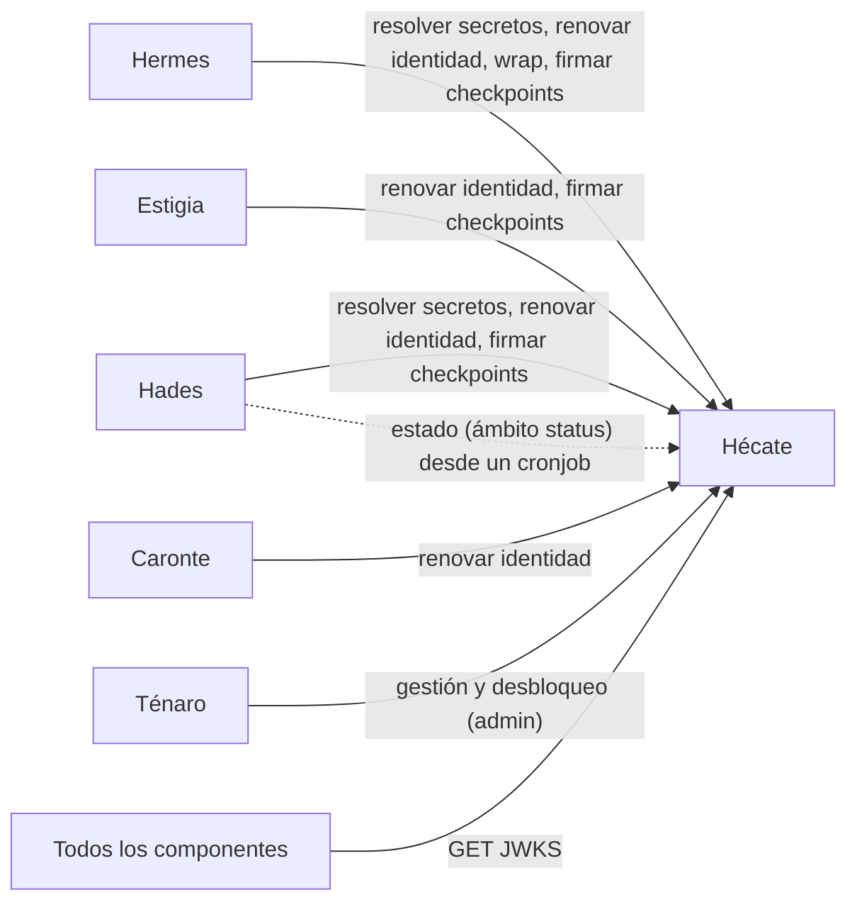
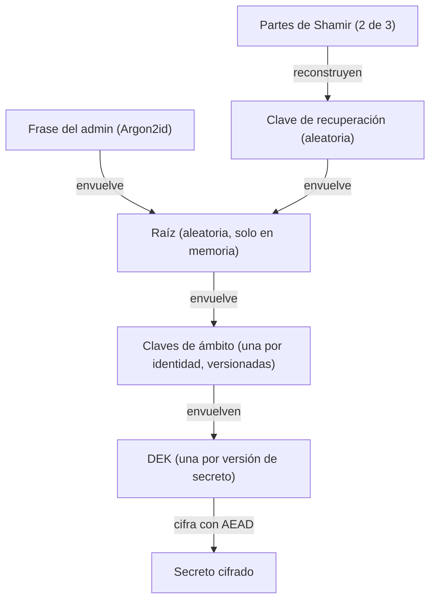
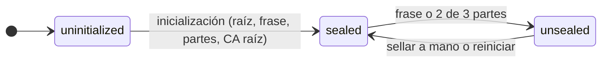
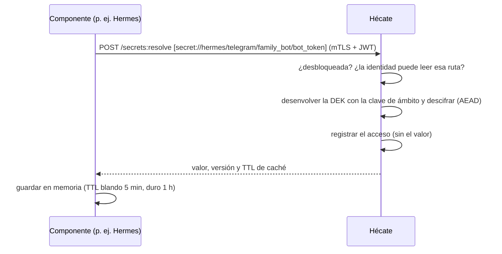
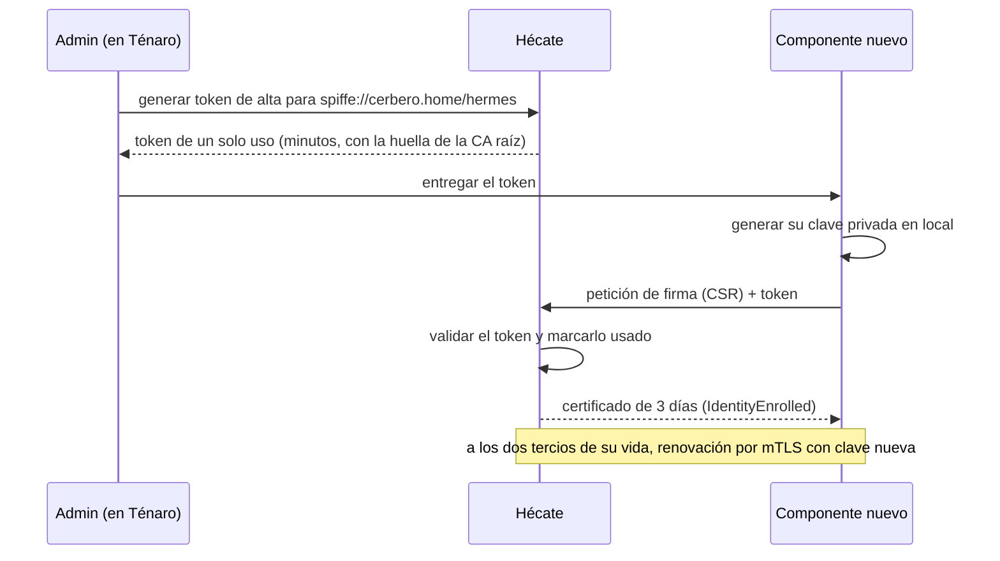
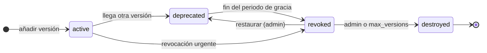
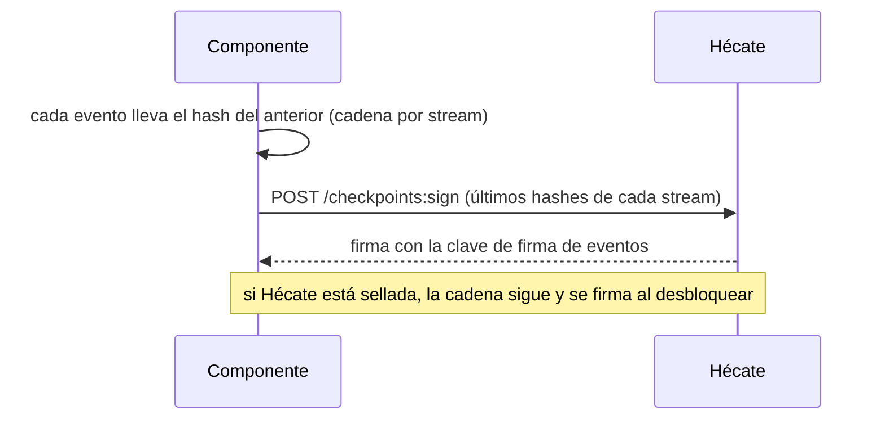

# Hécate — secretos y claves

*En la mitología, la guardiana de las llaves y las puertas del inframundo.* · Estado: diseñado · Última revisión: 2026-11-07

Ver también: [ARCHITECTURE](../ARCHITECTURE.md) (visión transversal, en especial [Identidad y seguridad](../ARCHITECTURE.md#6-identidad-y-seguridad)) · [GLOSSARY](../GLOSSARY.md) · [DECISIONS](../DECISIONS.md)

---

## 1. Propósito y frontera

Hécate custodia lo que abre las puertas de Cerbero: los **secretos de terceros** (tokens, API keys, credenciales) y las **claves de Cerbero** (la CA interna que da identidad a los componentes, las claves de firma y su rotación). También firma la auditoría de todos los componentes, para que nadie pueda reescribir lo que pasó.

| Hace | No hace |
|---|---|
| Guardar secretos cifrados por capas, con versiones y rotación | Exponerse a internet: solo vive en la red interna |
| Emitir y renovar las identidades de los componentes (CA interna) | Llamar a nadie: siempre le piden |
| Gestionar las claves de cifrado y de firma, y rotarlas | Entregar secretos a los Playbooks: los resuelven los componentes al ejecutar |
| Firmar los checkpoints de auditoría de todo Cerbero | Inventar criptografía: usa primitivas de librerías auditadas |
| Envolver claves de otros componentes (`wrap` / `unwrap`) | Autenticar a las personas (lo hace Ténaro con passkeys) |

**Por qué es una pieza aparte:** es el objetivo más valioso de Cerbero. Separarla permite que su raíz viva solo en memoria, que no se exponga nunca y que tenga su propia auditoría, y que el resto de componentes no guarde ningún secreto en claro.

**Cómo se construye:** en Cerbero, para entender cómo funciona por dentro, pero con primitivas de librerías auditadas (`cryptography`, `PyNaCl` y, para Shamir, `PyCryptodome`) detrás de un port `CryptoProvider`. El primer adapter es software; un adapter de hardware (TPM o YubiKey) encaja en el mismo port.

---

## 2. Contexto



| Con quién | Qué pide a Hécate |
|---|---|
| **Todos los componentes** | Renovar su certificado; resolver sus secretos; firmar los checkpoints de su auditoría; leer el JWKS |
| **Hades** | Además, identidades hijas para sus integraciones y, desde un cronjob, el estado (ámbito `status`) |
| **Hermes** | Además, `wrap` / `unwrap` para cifrar sus copias de seguridad |
| **Ténaro** | Gestión (secretos, permisos, identidades, rotaciones) y desbloqueo, siempre con el admin autenticado |

---

## 3. Conceptos

### Aggregates

| Aggregate | Qué es | Estados |
|---|---|---|
| **Secret** | Un secreto en una ruta `secret://<identidad>/<resto>`, con metadatos (owner, tipo del valor, `max_versions`, `rotate_every`, `expires_at`) | Por versión: `active`, `deprecated`, `revoked`, `destroyed` |
| **Key** | Una clave propia: de cifrado por ámbito, de la CA intermedia o de firma de eventos | Por versión: `active`, `decrypt_only` / `verify_only`, `retired` |
| **Certificate** | Un certificado emitido a una identidad | `valid`, `revoked`, `expired` |
| **Identity** | Un componente o una identidad hija (`spiffe://cerbero.home/...`) | `enrolled`, `disabled` |
| **Access Policy** | Qué rutas y operaciones puede usar una identidad | Versionada |

- Todos son event-sourced y **ningún evento lleva un valor**: solo metadatos, versiones y quién.
- Los accesos (resoluciones, renovaciones, `wrap` / `unwrap`, rechazos, intentos de desbloqueo) van a un **registro de accesos** aparte, append-only, para que los secretos no crezcan con cada lectura.
- Las escrituras llevan la versión esperada (como el *check-and-set* de OpenBao), para que dos cambios simultáneos no se pisen.

### Jerarquía de claves (cifrado por sobre)



| Nivel | Qué cifra | Rotación | Coste de rotar |
|---|---|---|---|
| **Raíz** | Solo las claves de ámbito | A petición del admin | Volver a envolver unas pocas claves de ámbito |
| **Clave de ámbito** | Las DEK de su ámbito | Periódica (90 días por defecto) y manual | Volver a envolver las DEK; los secretos no se tocan |
| **DEK** | Una versión de un secreto | No se rota: cada versión tiene la suya, aleatoria | — |

- **El ámbito es la identidad:** el ámbito de cifrado coincide con el de acceso, así que una clave de ámbito comprometida solo expone los secretos de esa identidad.
- **Una clave, un uso:** AES-256-GCM para cifrar; Ed25519 para firmar (JWT y eventos); ECDSA P-256 para la CA.
- **Agilidad criptográfica:** cada dato cifrado guarda el algoritmo y la versión de clave usados, para poder cambiar de algoritmo sin migrar todo de golpe.

### Formato de un secreto cifrado

```json
{ "alg": "AES-256-GCM", "scope_key": "hermes", "scope_key_version": 3,
  "wrapped_dek": "...", "nonce": "...", "ciphertext": "...",
  "aad": { "path": "secret://hermes/telegram/family_bot/bot_token", "version": 7, "scope": "hermes" } }
```

La ruta, la versión y el ámbito van como **datos asociados** del AEAD: si alguien mueve el dato cifrado a otra ruta, no se descifra.

---

## 4. Cómo funciona

### Arranque y desbloqueo



- **Sellada** solo admite desbloquear y consultar el estado; `/health/ready` es falso. Al reiniciar, vuelve a `sealed`. El admin puede sellarla a mano con una sola acción (p. ej. ante una intrusión).
- **La raíz es aleatoria y se guarda cifrada dos veces:** con una clave derivada de la frase del admin (para el día a día) y con una clave de recuperación aleatoria que se reparte en tres partes de Shamir, de las que bastan dos (para recuperarla si se olvida la frase). Cambiar la frase o repartir de nuevo las partes solo sustituye una de las dos protecciones; la raíz y los secretos no se tocan, y ambas operaciones exigen demostrarlo de nuevo con la frase actual o con dos partes.
- **Se desbloquea desde Ténaro** (passkey del admin + frase, por mTLS) **o con una CLI local** en el equipo de Hécate.
- **Canal local de administración:** la CLI `hecate` habla con el proceso por un socket Unix (permisos `0600` en un directorio `0700`, solo el mismo usuario). Usa el sobre y los códigos de error comunes, con `conflict` para "operación no permitida en el estado actual"; no publica API Contracts ni `/capabilities`, porque no cruza componentes (constitución, principio II).
- **Inicialización, una sola vez:** se genera la raíz, el admin fija la frase (mínimo 12 caracteres) y se generan las tres partes de Shamir, que se muestran una vez y se confirman con dos de ellas; hasta confirmar no se guarda nada. La CA raíz offline no la crea la inicialización, sino el alta de identidades. Una vez inicializada, no hay operación para borrarlo todo: volver a empezar es un procedimiento manual (parar Hécate y borrar sus datos).
- La raíz solo vive en memoria, sin swap ni volcados de memoria. Cada intento de inicializar, desbloquear, sellar o cambiar la protección queda en el registro de accesos. Tras tres fallos seguidos, la espera es de 1, 2, 4 y 8 minutos y después de 15; el contador sobrevive a los reinicios y es común a la frase, las partes y las pruebas para cambiar la protección.

### Resolver un secreto



### Alta y renovación de una identidad



Los detalles de la identidad (formato SPIFFE, trust domains, identidades hijas, revocación, JWT ligado al canal) están en [Identidad y seguridad](../ARCHITECTURE.md#6-identidad-y-seguridad).

### Rotar una clave de ámbito

1. La versión nueva cifra lo nuevo; las anteriores pasan a `decrypt_only`.
2. Un proceso de Hécate vuelve a envolver las DEK antiguas con la versión nueva (el equivalente a `rewrap`, sin tocar los secretos).
3. Cuando ninguna DEK depende de una versión antigua, pasa a `retired` y se puede destruir. **No se puede destruir una versión de la que aún depende una DEK.**

### Ciclo de vida de un secreto



- **Periodo de gracia** de 24 h por defecto: la versión anterior aún se resuelve si se pide explícitamente.
- **`max_versions`** (10 por defecto): al superarlo, la más antigua se destruye.
- **Volver a la anterior** (p. ej. si las credenciales nuevas no funcionan): el admin la promueve otra vez a `active`, como evento.
- **`destroy` es borrado criptográfico:** se borra la DEK de esa versión; los eventos siguen y el dato ya no se puede descifrar.
- **Rotación de un secreto de terceros:** el admin rota en el proveedor y añade la versión nueva desde Ténaro; los componentes la recogen al refrescar su caché. Después, la prueba de conexión de la instancia (en Hermes) lo confirma.
- **Avisos de rotación:** `rotate_every` y `expires_at` en los metadatos; un cronjob de Hades consulta el estado y un Playbook secundario avisa al admin.
- **En una fuga:** se revoca sin periodo de gracia y se rota en el proveedor.

### Auditoría y checkpoints



- Modificar o borrar un evento rompe la cadena o la firma, y se detecta.
- La clave de firma nunca sale de Hécate: un componente comprometido no puede reescribir su historia ya firmada.
- Cada cambio guarda el JWT de quien lo pidió; el JWKS conserva las claves públicas antiguas para verificar firmas pasadas.
- Un cronjob de Hades lanza la verificación periódica; si algo no cuadra, señal `AuditIntegrityBroken`.

---

## 5. Contratos

| Superficie | Operación | Qué hace |
|---|---|---|
| **Ejecución** | `POST /secrets:resolve` | Resuelve varias referencias a la vez; devuelve valor, versión y TTL de caché |
| | `POST /certificates:renew` | Renueva el certificado de la identidad que llama (CSR por mTLS) |
| | `POST /keys/{id}:wrap` · `:unwrap` | Envuelve o desenvuelve la DEK de otro componente con la clave de su ámbito |
| | `POST /checkpoints:sign` | Firma los últimos hashes de los streams de un componente |
| **Estado** (ámbito `status`) | Consulta | Sellada o no, recuentos y avisos agregados (secretos por rotar o caducar, certificados por caducar) y resultado de la verificación de la auditoría. Nunca rutas ni metadatos de un secreto concreto |
| **Pública** | `GET /.well-known/jwks.json` | Claves públicas de firma, con su histórico |
| **Gestión** (admin, desde Ténaro) | Varias | Secretos y versiones, revocar, restaurar, destruir, permisos, altas y bajas de identidades, revocar certificados, rotar claves, sellar |
| **Desbloqueo** | Desbloquear, consultar el estado | Lo único disponible mientras está sellada |
| **Salud** | `/health/live`, `/health/ready` | `ready` es falso mientras está sellada |

- Mismo contrato común que el resto de componentes (sobre, errores, versión en la ruta), siempre por mTLS.
- **Referencias a secretos:** `secret://<ruta>` resuelve la versión activa; `secret://<ruta>@7`, una concreta.
- **Los Playbooks no tienen destino `hecate`:** los secretos nunca entran en los datos de una Response.

---

## 6. Configuración y extensión

- **Permisos que salen de las declaraciones:** al registrar una instancia de Hermes o una integración de Hades, sus referencias `secret://` dan permiso de lectura a su identidad. Una referencia fuera de su ámbito se rechaza. El valor lo introduce el admin aparte.
- **Metadatos de cada secreto:** owner, tipo del valor (`string`, `json`, `pem`...), validado al escribir; `max_versions`; `rotate_every`; `expires_at`.
- **Parámetros configurables:** perfil de Argon2id (`sensitive` por defecto o `moderate`, nunca uno más débil), periodo de gracia, rotación de las claves de ámbito, TTL de caché, duración de los certificados, retención de la auditoría.
- **Hardware:** un adapter del `CryptoProvider` (TPM o YubiKey) para desbloqueo automático y claves que no salen del dispositivo.

---

## 7. Organización interna

```text
hecate/
├── domain/
│   ├── secrets/         # Secret y sus versiones, ciclo de vida
│   ├── keys/            # Key, jerarquía, rotación, salvaguarda al destruir
│   ├── identity/        # Identity, Certificate, alta, renovación, revocación
│   ├── access_policy/   # Access Policy, ámbitos, permisos derivados de las declaraciones
│   └── audit/           # registro de accesos, cadenas, checkpoints
├── application/         # casos de uso: resolver, renovar, wrap, firmar checkpoint, desbloquear, gestionar
└── infrastructure/
    ├── crypto/          # CryptoProvider: adapter de software (cryptography, PyNaCl, PyCryptodome)
    ├── store/           # event store y proyecciones
    └── api/             # API interna (mTLS), JWKS, desbloqueo
```

| Patrón | Dónde | Por qué |
|---|---|---|
| Event Sourcing | Los cinco aggregates y el registro de accesos | La historia es la auditoría; ningún evento lleva valores |
| Ports y adapters | `CryptoProvider` | Cambiar a hardware sin tocar el dominio |
| Cifrado por sobre | Raíz → ámbito → DEK | Rotar barato y aislar el daño por ámbito |

---

## 8. Datos

| Dato | Copia |
|---|---|
| Configuración de sellado (la raíz cifrada dos veces), contador de intentos y registro de accesos, en SQLite ([ADR 0003](adr/0003-persistencia-hecate-sqlite.md)) | Sí |
| Event store (datos cifrados, DEK y claves de ámbito envueltas) | Sí |
| Registro de accesos y políticas | Sí |
| La raíz en claro y las cachés | Nunca: solo existen en memoria |
| CA raíz | Copia offline propia, en dos soportes guardados en sitios distintos |

- **Sin la frase o las partes, las copias no sirven**, a propósito.
- Regla 3-2-1, como el resto de Cerbero; la restauración se prueba en un entorno aislado, sin red hacia casa.
- **Retención larga de la auditoría** (p. ej. un año o más, configurable), independiente de los datos: destruir un secreto no borra sus eventos.
- **Datos personales:** ninguno más allá de quién hizo cada cambio.

---

## 9. Seguridad

- **Nunca expuesta a internet;** API interna con mTLS y JWT ligado al canal.
- **Políticas:** cada identidad solo lee `secret://<su identidad>/**`; lo demás está denegado. Una identidad padre no lee los secretos de sus hijas. Compartir un secreto es una excepción explícita y auditada.
- **Quién hace qué:** los componentes solo leen y renuevan; la gestión y el desbloqueo, solo el admin desde Ténaro (o la CLI local para desbloquear).
- **Cada cambio de política** se versiona y se registra con quién; los rechazos van al registro de accesos.
- **Proceso** con usuario propio, sin swap ni volcados de memoria.

---

## 10. Operación

| Qué pasa | Efecto | Recuperación |
|---|---|---|
| Hécate caída o sellada | Los componentes siguen con la caché hasta 1 h; después, lo que necesita un secreto falla con `internal`. Las identidades aguantan hasta 3 días | Arrancar y desbloquear (Ténaro o CLI) |
| Se pierde el disco | Igual que caída | Restaurar la copia y desbloquear con la frase o las partes |
| Se olvida la frase | Nada, mientras siga desbloqueada | Desbloquear con 2 de 3 partes y fijar una frase nueva |
| Se pierden la frase y las partes | Los datos no se pueden descifrar, ni desde las copias | Inicializar de nuevo, dar de alta otra vez las identidades y volver a introducir los secretos |
| Se compromete la CA intermedia | Se pueden emitir identidades falsas | Revocarla, emitir una nueva con la raíz offline y renovar todas las identidades |
| Se compromete una clave de ámbito | Los secretos de ese ámbito quedan expuestos | Rotarla, volver a envolver, destruir la versión comprometida y rotar esos secretos en el proveedor |

- Cada fila es un procedimiento escrito.
- **Una sola instancia**, sin alta disponibilidad: la caché y los certificados de 3 días cubren las caídas cortas.
- **Tras un corte de luz de toda la casa**, Hécate queda sellada y no hay avisos hasta desbloquearla (los avisos dependen de secretos que custodia); Ténaro muestra el estado.
- **Observabilidad** con OpenTelemetry: resoluciones, rechazos, desbloqueos, caducidades, rotaciones pendientes y progreso de las rotaciones de claves; logs sin valores.
- **Avisos:** un cronjob de Hades consulta el ámbito `status` y emite señales (sellada, certificados por caducar, rotaciones pendientes, integridad de la auditoría).

---

## 11. Pruebas

- **Criptografía:** vectores de prueba conocidos y pruebas de manipulación: cambiar la ruta, la versión o un byte del dato cifrado impide descifrarlo.
- **Integración:** rotación, `rewrap`, salvaguarda al destruir, desbloqueo con frase y con partes, alta y renovación de identidades.
- **Una Hécate de pruebas** (otro trust domain y secretos de prueba) para los entornos funcionales completos y la CI del resto de componentes.
- **Restauración** probada en un entorno aislado.

---

## 12. Decisiones y riesgos

Resumen; el detalle y el porqué están en [DECISIONS](../DECISIONS.md#hécate-frente-a-sus-referencias-openbao--vault-step-ca-spiffe).

- **Frente a sus referencias:** se construye en Cerbero sin inventar criptografía; frase del admin más Shamir de recuperación; certificados de 3 días; identidad SPIFFE sin SPIRE; JWT ligado al canal mTLS; Hécate firma los checkpoints de todo Cerbero.
- **Descartado:** IdP con OIDC, OAuth *client credentials*, claves API compartidas, OpenBao / SOPS + age / variables de entorno como almacén, inventar criptografía.
- **Riesgos aceptados:** Hécate firma sus propios checkpoints (solo lo cubre un anclaje externo); tras un corte de luz no hay avisos hasta desbloquearla; Python no garantiza borrar la raíz de la memoria.

---

## 13. Preguntas frecuentes

**¿Qué pasa si se va la luz?**
Todo arranca y Hécate queda sellada. Los componentes aguantan con su caché hasta 1 h y sus identidades hasta 3 días; el admin la desbloquea desde Ténaro o con la CLI.

**¿Y si olvido la frase?**
Se desbloquea con 2 de las 3 partes de Shamir y se fija una frase nueva. Si se pierden la frase y las partes, no hay forma de recuperar los datos, ni desde las copias: es el precio de que nadie más pueda hacerlo.

**¿Un Playbook puede leer un secreto?**
No. Los secretos los resuelven los componentes al ejecutar, con su propia identidad; nunca entran en los datos de una Response.

**¿Por qué no usar OpenBao directamente?**
Para aprender cómo funciona por dentro. Se toma su modelo como referencia (sellado, versiones, `rewrap`) y se usan primitivas de librerías auditadas.

**¿Cómo cambio el token de un bot?**
Rotándolo en el proveedor, añadiendo la versión nueva desde Ténaro y lanzando la prueba de conexión de la instancia. Si falla, se vuelve a la versión anterior.

**¿Qué ve Hades del estado de Hécate?**
Solo recuentos y avisos agregados por su ámbito `status`, nunca la lista de secretos.

**¿Qué pasa si alguien manipula la auditoría de un componente?**
Se rompe la cadena de hashes o la firma del checkpoint, y la verificación periódica lo detecta.

---

## 14. Referencias

- OpenBao: [Seal/Unseal](https://openbao.org/docs/concepts/seal/) · [KV v2](https://openbao.org/docs/secrets/kv/kv-v2/) · [Transit](https://openbao.org/docs/secrets/transit/)
- Google Cloud KMS: [Envelope encryption](https://docs.cloud.google.com/kms/docs/envelope-encryption) · [Re-encrypting data](https://docs.cloud.google.com/kms/docs/re-encrypt-data)
- step-ca: [Production](https://smallstep.com/docs/step-ca/certificate-authority-server-production/) · [Provisioners](https://smallstep.com/docs/step-ca/provisioners/) · [Renewal](https://smallstep.com/docs/step-ca/renewal/) · [Revocation](https://smallstep.com/docs/step-ca/revocation/)
- SPIFFE: [Concepts](https://spiffe.io/docs/latest/spiffe-about/spiffe-concepts/) · [X.509-SVID](https://spiffe.io/docs/latest/spiffe-specs/x509-svid/) · [SPIRE concepts](https://spiffe.io/docs/latest/spire-about/spire-concepts/)
