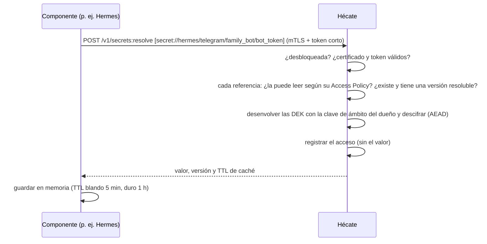

# Acceso en Hécate

Quién puede leer qué en Hécate. Este documento desarrolla la Access Policy de cada identidad (sus propios secretos por
defecto y las excepciones que el admin comparte, secreto a secreto), los permisos que salen de las declaraciones, la
resolución de secretos por la API con sus rechazos, que no se distinguen ni por su contenido ni por su tiempo, y el
permiso de estado. Es para quien quiere entender o revisar el diseño; cómo resuelve un componente está en la
[guía de integración](integracion.md).

## La Access Policy

- **Regla por defecto:** cada identidad resuelve solo `secret://<su identidad>/**`; lo demás está denegado. La regla no
  se guarda: una identidad sin cambios de política solo lee lo suyo.
- **Una identidad padre no lee los secretos de sus hijas:** cada [identidad hija](identidades.md#las-identidades-hijas)
  tiene su propio ámbito.
- **Excepciones por secreto concreto:** el admin concede a una identidad la lectura de un secreto de otra identidad,
  nombrado por su ruta, sin `@N`, sin prefijos ni comodines, y que tiene que existir al concederla. Vale hasta que la
  retira. No se conceden a `hecate` ni a `admin`, ni para los secretos de la propia identidad, que ya lee por la regla
  por defecto; sí a una identidad que aún no se ha dado de alta.
- **Permiso de estado:** deja a una identidad consultar el [estado agregado](#el-permiso-de-estado).

| Aggregate | Qué es | Estados |
|---|---|---|
| **Access Policy** | Lo que una identidad puede usar además de sus propios secretos: sus excepciones y el permiso de estado | Versionada: cada cambio, con quién y cuándo |

- Es un aggregate event-sourced por identidad, en el stream `policy/<identidad>`, con los eventos `ReadGranted` y
  `ReadRevoked` (la ruta y quién) y `StatusGranted` y `StatusRevoked` (quién). Su versión es la del stream, y su
  historial dice quién compartió qué y cuándo, y qué podía leer una identidad en cualquier momento pasado.
- Las órdenes del admin van por el canal local y no llevan versión esperada: una que no cambia nada, como retirar una
  excepción que no existe, no escribe eventos. Todas exigen Hécate desbloqueada y dejan su fila en el
  [registro de accesos](auditoria.md#el-registro-de-accesos), también si no cambian nada.
- El diseño y sus alternativas están en el [ADR 0010](../adr/0010-access-policy-hecate.md).

## Los permisos que salen de las declaraciones

Al registrar una instancia de Hermes o una integración de Hades, las referencias `secret://` de su declaración dan
permiso de lectura a su identidad. Una referencia fuera de su ámbito se rechaza. El valor lo introduce el admin aparte.

## La resolución

Los secretos los resuelven las identidades por la API, con `POST /v1/secrets:resolve`, autenticadas con el certificado
de la conexión y un token corto, como el resto de la API ([identidades](identidades.md)). El canal local es del admin,
que no lee valores.

- **Referencias:** `secret://<ruta>` resuelve la versión activa; `secret://<ruta>@7`, una concreta (de 1 a 9 cifras,
  sin ceros a la izquierda). Una versión `deprecated` dentro de su periodo de gracia solo se resuelve pidiéndola así
  ([ciclo de vida](secretos.md#el-ciclo-de-vida-de-un-secreto)).
- **Varias a la vez**, de 1 a 100, todo o nada: cada una vuelve con su valor, su versión y los tiempos de caché, 300 s
  (blando) y 3600 s (duro); qué hace el componente con ellos está en la [guía de integración](integracion.md).
- **Qué puede leer:** sus propios secretos y los que una excepción de su Access Policy le comparte. La política se lee
  una vez por petición, así que retirar una excepción vale desde la petición siguiente.
- **En dos fases:** Hécate comprueba cada referencia, en el orden pedido (permiso, existencia, versión resoluble y
  material guardado), antes de descifrar ninguna; después las descifra todas. Un rechazo no abre ninguna clave.
- **Un único rechazo:** un secreto que no existe, uno de otra identidad sin excepción y uno sin versión resoluble dan
  el mismo `not_found`, con el mismo mensaje, que nunca se responde antes de 250 ms desde que la petición llega a la
  operación; la duración que indica la respuesta incluye la espera.
- **Un secreto compartido** se descifra con la clave de ámbito de su dueño y sigue sus reglas de versiones. La
  caducidad es informativa: un secreto caducado se sigue resolviendo, y el estado lo cuenta.
- **Memoria:** el valor viaja en búferes que se borran al enviar la respuesta, también si falla.
- **Filas:** la resolución deja una fila por referencia si se atiende, y una con la primera que falla si se rechaza
  ([auditoría](auditoria.md#el-registro-de-accesos)).

## El permiso de estado

Una identidad con el permiso de estado consulta `GET /v1/status`, que responde también con Hécate sellada: ni la
autenticación, ni la política ni los recuentos tocan material cifrado.

| Campo | Qué dice |
|---|---|
| `sealed` | Si Hécate está sellada |
| `secrets_expired` | Secretos con versiones vivas cuya `expires_at` ya pasó |
| `secrets_expiring_soon` | Secretos con versiones vivas que caducan en los próximos 7 días |
| `secrets_due_rotation` | Secretos cuya versión activa ya cumple su `rotate_every` |
| `identities_expiring_24h` | Identidades habilitadas cuyo certificado más reciente caduca en 24 horas |
| `suspicious_renewals_24h` | Segundos intentos de renovación de las últimas 24 horas |
| `intermediate_days_left` | Los días que le quedan a la intermedia que emite, solo si son menos de 30 |
| `enrollment_throttled` | Si las altas están frenadas |

- Son los mismos recuentos que el `status` del admin, que además da el trust domain, la huella de la CA raíz y la serie
  y la caducidad del certificado de Hécate ([CLI](cli.md#sellado)). Nunca rutas, nombres ni metadatos de un secreto
  concreto.
- Una consulta atendida no deja fila; un rechazo, sí.

## Los avisos

Un cronjob de Hades consulta el estado con el permiso de estado, también con Hécate sellada, y emite señales: Hécate
sellada, secretos por rotar o caducar, certificados por caducar, renovaciones sospechosas y altas frenadas. Un Playbook
secundario avisa al admin. Así, rotar un secreto según su `rotate_every` o antes de su `expires_at` empieza por un
aviso. La integridad de la auditoría la vigila su propia [verificación periódica](auditoria.md#la-firma-de-checkpoints).

## Relacionado

- [Hécate](../hecate.md): el documento de alto nivel.
- [Secretos](secretos.md): cómo se guarda lo que se resuelve.
- [Identidades](identidades.md): cómo se autentica quien resuelve.
- [Integrar un componente](integracion.md): la resolución y el estado desde el lado del componente.
