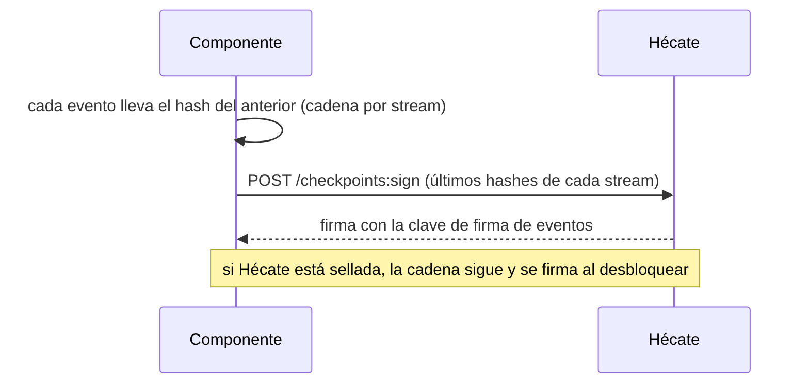

# Auditoría de Hécate

Qué queda registrado en Hécate y cómo se protege ese registro. Este documento desarrolla el registro de accesos (qué
operaciones dejan fila y cuáles no), su retención y la firma de checkpoints, con la que Hécate sella la historia de cada
componente. Es para quien quiere entender o revisar el diseño, o consultar el registro.

## Dos historias

- **Los eventos** de los aggregates (secretos, claves, identidades, certificados y políticas) son la historia de cada
  cambio: qué cambió, cuándo y, en las políticas, quién. Ningún evento lleva un valor
  ([dónde se guardan](secretos.md#dónde-se-guarda)).
- **El registro de accesos** recoge cada uso y cada intento: resoluciones, altas, renovaciones, órdenes del admin,
  intentos de desbloqueo y rechazos. Va aparte, append-only, para que los aggregates no crezcan con cada lectura.

## El registro de accesos

Vive en la tabla `access_log` de la base de datos de Hécate, con triggers que rechazan `UPDATE` y `DELETE`. Cada fila
tiene:

| Columna | Qué dice |
|---|---|
| `at` | Cuándo |
| `operation` | La operación, p. ej. `unseal`, `secret_resolve`, `identity_enroll` o `policy_grant` |
| `method` | Cómo se pidió: `passphrase`, `recovery`, `local` (el admin por el canal local), `identity` (un componente autenticado), `enrollment_token` o `internal` (la propia Hécate) |
| `result` | `success`, `failure`, `rejected_rate_limited`, `rejected_conflict`, `invalid_input` o `not_found` |
| `detail` | El paso o la variante, p. ej. `begin` o `confirm` de una ceremonia |
| `subject` | Quién: `admin`, el SPIFFE ID de un componente o `hecate` |
| `path` y `version` | El secreto y la versión que toca, si toca uno |
| `identity` y `certificate` | La identidad y la serie del certificado que toca, si toca uno |

**Nunca lleva un valor ni una huella**, ni ningún otro secreto: ni la frase, ni las partes, ni los tokens.

### Qué deja fila

| Qué | Fila |
|---|---|
| Inicializar, desbloquear, sellar, cambiar la frase o repartir las partes | Una por intento, atendido o rechazado |
| Las órdenes del admin sobre secretos | Una por orden, con `subject: admin`, la ruta y la versión |
| Las ceremonias de la CA y las órdenes sobre tokens, identidades y certificados | Una por paso u orden, con `subject: admin`, la identidad y, si la hay, la serie |
| Las órdenes de la Access Policy | Una por orden, con `subject: admin` y la identidad de la política, también si no cambia nada |
| Una resolución | Una por referencia si se atiende, o una con la primera que falla si se rechaza, con el SPIFFE ID, la identidad y la serie |
| Un alta o una renovación | Una por intento; las altas rechazadas por el freno, una sola por tanda (`identity_enroll_throttled`) |
| Lo que hace Hécate sola | Una por acción, con `method: internal`: renovar o reemitir su certificado y revocar las identidades de un segundo intento de renovación |
| Una operación de la API rechazada, también con Hécate sellada | Una por rechazo, sin quién si no se llegó a autenticar |
| Una petición a una ruta o un método que no es una operación de la API | Ninguna |
| Las consultas atendidas de la API: lista de revocación, claves publicadas, `capabilities` y estado | Ninguna |
| El `status` del admin y los recuentos de caducidad | Ninguna |

Un fallo interno, como un disco lleno, no deja fila: la fila es de lo que Hécate atiende o rechaza.

### Retención

El registro de accesos no se purga: guarda toda la historia, independiente de los datos. Destruir un secreto no borra
sus eventos ni sus filas. Viaja en la misma base de datos que el resto, así que se copia con ella
([seguridad](seguridad.md#los-datos)).

## La firma de checkpoints

Hécate firma la auditoría de todos los componentes de Cerbero, para que nadie pueda reescribir lo que pasó:

- cada componente encadena sus eventos por stream y pide a Hécate que firme los últimos hashes, con
  `POST /v1/checkpoints:sign`;
- modificar o borrar un evento rompe la cadena o la firma, y se detecta;
- la clave de firma de eventos (Ed25519) nunca sale de Hécate: un componente comprometido no puede reescribir su
  historia ya firmada;
- cada cambio guarda el token corto de quien lo pidió, y Hécate conserva las claves de firma de llamadas antiguas para
  verificar firmas pasadas ([identidades](identidades.md#la-revocación));
- un cronjob de Hades lanza la verificación periódica, y si algo no cuadra emite la señal `AuditIntegrityBroken`.

Hécate firma también sus propios checkpoints, y eso solo lo cubre un anclaje externo
([riesgo aceptado](../../DECISIONS.md#riesgos-aceptados)).

## Relacionado

- [Hécate](../hecate.md): el documento de alto nivel.
- [Seguridad](seguridad.md): por qué ningún valor ni huella llega al registro.
- [Acceso](acceso.md): las filas de las resoluciones y del estado.
