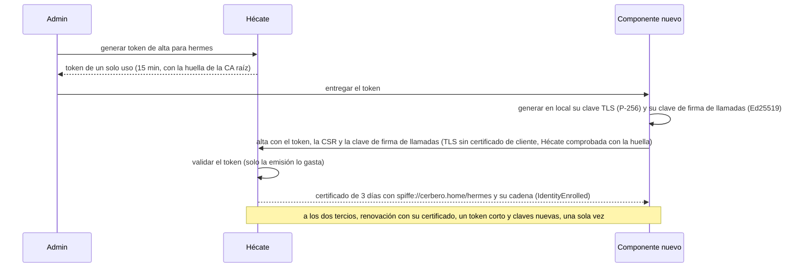

# Identidades de Hécate

Cómo da Hécate identidad a los componentes de Cerbero. Este documento desarrolla su CA en dos niveles y las ceremonias
con las que se crea, se renueva la intermedia y se sustituye; el alta con un token de un solo uso; los certificados
SPIFFE de tres días, que se renuevan una sola vez; la revocación; el freno de altas; el certificado propio de Hécate; y
las identidades hijas. Es para quien quiere entender o revisar el diseño; cómo lo vive un componente está en la
[guía de integración](integracion.md).

## Identity y Certificate

| Aggregate | Qué es | Estados |
|---|---|---|
| **Identity** | Un componente o una identidad hija (`spiffe://<trust domain>/<identidad>`), con sus tokens de alta | Sin alta (solo tokens), `enrolled`, `disabled` |
| **Certificate** | Un certificado emitido a una identidad: su emisión, su única renovación y su revocación | `valid`, `revoked`, `expired` |

- El nombre de una identidad son letras minúsculas, cifras y `-`, empezando por una letra y hasta 63 caracteres.
  `hecate` es la identidad de la propia Hécate, y `hecate` y `admin` están reservadas: no admiten tokens.
- Las órdenes del admin sobre identidades, certificados y tokens no llevan versión esperada: su resultado no depende de
  lo que leyó antes, y repetir una que no cambia nada no escribe eventos.
- El formato SPIFFE, los trust domains y el token corto ligado al canal, comunes a todo Cerbero, están en
  [Identidad y seguridad](../../ARCHITECTURE.md#6-identidad-y-seguridad).

## La CA en dos niveles

| Nivel | Dónde vive su clave | Duración |
|---|---|---|
| **CA raíz** (ECDSA P-256) | Nunca en Hécate: solo en la memoria de la CLI durante cada ceremonia y en una copia protegida con la frase de la CA, que el admin guarda en dos soportes | 10 años |
| **CA intermedia** (ECDSA P-256) | En Hécate, envuelta por la raíz de cifrado; solo se descifra para la operación que firma | Un año, sin pasar de la raíz |

La CA tiene una generación, que cambia al sustituirla, y cada intermedia una versión dentro de su generación. Sus
estados son los de una [Key](secretos.md#secret-y-key): la intermedia `active` emite, la `verify_only` solo firma la
lista de revocación de sus certificados, y la `retired` ya no tiene clave.

### Las ceremonias

Las tres pasan por el canal local, con Hécate desbloqueada, y siguen el mismo esquema: Hécate prepara la clave de una
intermedia nueva y su petición de certificado, y la CLI, que tiene la clave de la CA raíz, la firma. Una ceremonia
caduca a los 15 minutos, solo hay una a la vez y pertenece al desbloqueo en que empezó: si Hécate se sella, se pierde.

| Ceremonia | Qué hace |
|---|---|
| **Crear la CA** | El admin elige el trust domain y una frase de la CA, de 12 caracteres o más, que Hécate comprueba que no es la de desbloqueo. La CLI genera la CA raíz, firma la intermedia y escribe la copia de su clave. La CA no existe hasta que el admin devuelve una copia guardada y la CLI consigue abrirla: entonces Hécate guarda, en una sola transacción, la CA, la clave de la intermedia envuelta por la raíz y su propio primer certificado |
| **Renovar la intermedia** | La CLI abre la copia de la clave de la CA raíz con la frase de la CA y firma la intermedia nueva, que pasa a emitir; la anterior pasa a `verify_only`. Funciona también con la intermedia ya caducada |
| **Sustituir la CA** | Exige la prueba de sellado (la frase de desbloqueo actual o dos partes, con el [freno de intentos](sellado.md#el-freno-de-intentos)) y una frase de la CA nueva; sigue como la creación, con una generación nueva. Hécate destruye las claves de las intermedias anteriores y solo acepta la CA nueva: cada componente vuelve a darse de alta con un token nuevo |

- La frase de la CA solo llega a Hécate al crear o sustituir la CA, para comprobar que no es la de desbloqueo; esa
  comprobación no cuenta en el freno de intentos.
- **La copia de la clave de la CA raíz** es un bloque PEM `HECATE ROOT CA KEY`: una cabecera con los parámetros de
  Argon2id, la sal y el nonce, y la clave cifrada con AES-256-GCM. Sus datos asociados incluyen la huella de la CA raíz,
  así que solo se abre junto al certificado de su CA.
- **Retirar una intermedia:** la clave de una `verify_only` se destruye cuando caduca el último certificado que firmó.
  Una tarea de Hécate lo comprueba cada minuto, también sellada, porque no descifra nada.
- El estado avisa cuando a la intermedia activa le quedan menos de 30 días. Como ningún certificado dura más que la
  intermedia que lo firma, cuando caduca ya han caducado el de Hécate y los de los componentes: la API deja de escuchar
  aunque Hécate esté desbloqueada, y los componentes ya no pueden renovar. Hasta que se renueva, Hécate no emite
  certificados ni crea tokens; al renovarla, renueva su propio certificado al momento, y cada componente vuelve a
  darse de alta con un token nuevo.

## El alta y la renovación

- **El token de alta** vale para una identidad y una CA raíz: lleva la identidad, un identificador, un secreto
  aleatorio de 32 bytes y la huella de la CA raíz, con la que el componente comprueba a Hécate antes de enviar nada. Se
  muestra una sola vez, Hécate solo guarda el SHA-256 de su secreto, y caduca a los 15 minutos por defecto (de 1 a 60,
  configurable). Solo la emisión del certificado lo gasta: un alta fallida no lo consume.
- **El certificado** dura 3 días por defecto (de 1 a 72 horas, configurable), con la identidad SPIFFE como único nombre
  y válido como servidor y como cliente. Empieza un minuto antes de emitirse, para absorber pequeñas diferencias de
  reloj, y nunca dura más que la intermedia que lo firma.
- **Darse de alta otra vez** con un token nuevo abre una época nueva de la identidad: sus certificados anteriores dejan
  de poder renovarse.
- **Renovación única:** cada certificado válido, de la época actual y con la identidad habilitada se renueva una vez,
  con claves nuevas (otra clave TLS y otra clave de firma de llamadas). El componente renueva a los dos tercios de la
  vida de su certificado. Un segundo intento distinto con un certificado ya renovado se trata como un robo de clave:
  Hécate revoca con urgencia todos los certificados válidos de esa identidad, y el estado cuenta el intento como
  sospechoso.
- **Repetición:** cada alta y cada renovación llevan una `Idempotency-Key`. La repetición exacta de la petición
  devuelve el mismo certificado sin efectos, para que un componente que no recibió la respuesta la recupere. Otra
  petición no es una repetición: con un token ya gastado responde `auth`, y con un certificado ya renovado es un
  segundo intento. Si otra petición de la misma identidad ya obtuvo un certificado con esa `Idempotency-Key`,
  responde `conflict`.

### El freno de altas

Tras 10 altas fallidas seguidas, las siguientes esperan 1, 2, 4 y 8 minutos, y después 15, con un contador propio,
distinto del de sellado. Mientras dura la espera, las altas responden `rate_limited` sin comprobar nada, y no cuentan
como fallos; cada tanda de espera deja una sola fila en el [registro de accesos](auditoria.md#el-registro-de-accesos).
Un alta emitida pone el contador a cero, y el estado dice si las altas están frenadas.

## La revocación

| Revocación | Qué hace |
|---|---|
| **Pasiva** (por defecto) | Solo quita la renovación: el certificado y su clave de firma de llamadas valen hasta que caduca |
| **Urgente** | Deja de valer al momento, entra en la lista de revocación hasta que caduca y su clave de firma de llamadas deja de firmar llamadas nuevas |

- **Deshabilitar una identidad** le quita la renovación, saca sus claves de las publicadas, anula sus tokens
  pendientes e impide crearle otros; con la opción urgente, además revoca con urgencia sus certificados válidos.
  Habilitada de nuevo, solo vuelve a tener certificado con un alta y un token nuevo. La identidad `hecate` no se
  deshabilita.
- **Lo que publica Hécate**, solo para los componentes autenticados:
  - la lista de revocación: una CRL X.509 por cada intermedia no retirada de la CA actual, con las revocaciones
    urgentes de los certificados que firmó y que aún no han caducado, también los de Hécate;
  - las claves de firma de llamadas que valen para llamadas nuevas (las de un certificado válido con la identidad
    habilitada).

  Las dos valen 5 minutos y los componentes las refrescan. Una clave concreta se puede pedir siempre, también si ya
  solo verifica firmas pasadas.

## El certificado propio de Hécate

Hécate presenta en su API su propio certificado (`spiffe://<trust domain>/hecate`):

- se emite al crear o sustituir la CA, y Hécate lo renueva sola, con clave nueva, a los dos tercios de su vida, mientras
  está desbloqueada;
- solo admite la revocación urgente, que lo reemite al momento con otra clave, y el anterior entra en la lista de
  revocación;
- su clave se guarda en claro ([riesgo aceptado](../../DECISIONS.md#riesgos-aceptados)), para que la API siga
  respondiendo con el certificado vigente mientras Hécate está sellada.

## Dónde se guarda

Los eventos de la CA, de las identidades y de los certificados van a la tabla `events` (streams `ca`,
`identity/<nombre>` y `certificate/<identidad>/<serie>`, ver [secretos](secretos.md#dónde-se-guarda)); el material va
aparte:

| Tabla (SQLite) | Contenido | Se borra |
|---|---|---|
| `ca_material` | Por generación y versión de intermedia: los certificados de la CA raíz y de la intermedia, y la clave de la intermedia envuelta por la raíz | Al retirar la intermedia |
| `hecate_tls` | La clave propia de Hécate, en claro, con la serie de su certificado | Se sustituye con cada certificado nuevo |
| `enroll_attempts` | El freno de altas: los fallos seguidos, hasta cuándo dura la espera y cuántas altas se rechazaron en ella | Nunca |

## Las identidades hijas

Cada integración de Hades tiene su propia identidad, hija de la de Hades
(`spiffe://cerbero.home/hades/integration/<nombre>`): Hades la pide con su certificado, solo bajo su ruta, y Hécate la
emite como al resto. Una identidad padre no lee los secretos de sus hijas (ver [acceso](acceso.md#la-access-policy)).

## Relacionado

- [Hécate](../hecate.md): el documento de alto nivel.
- [Integrar un componente](integracion.md): el alta y la renovación desde el lado del componente.
- [Operación](operacion.md): las ceremonias de la CA y qué hacer ante una clave comprometida.
- [Seguridad](seguridad.md): frente a qué protegen las identidades.
