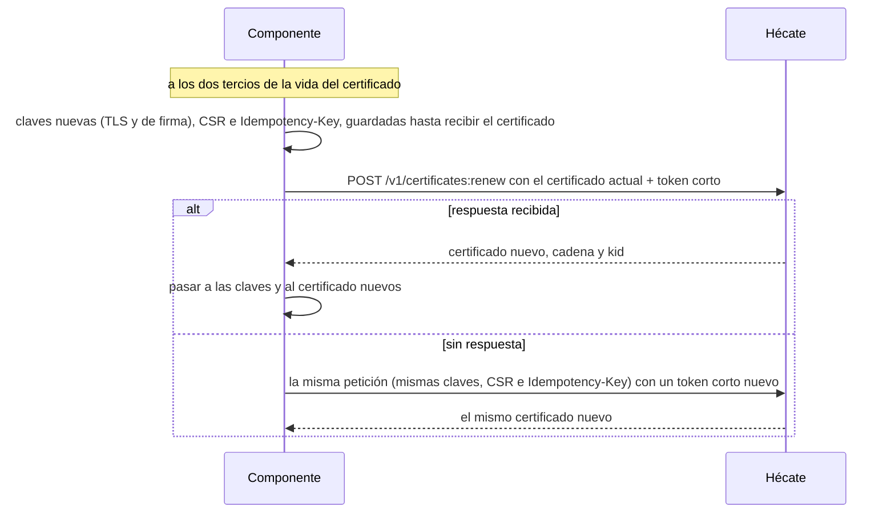

# Integrar un componente con Hécate

Lo que tiene que hacer un componente de Cerbero para usar Hécate: qué genera y guarda, cómo se da de alta con su token,
cómo autentica cada llamada, cuándo renueva su certificado, qué refresca, cómo resuelve sus secretos y los guarda en
caché, cómo consulta el estado y qué hace ante cada error o con Hécate sellada. Es para quien desarrolla otro
componente. No lleva código: los esquemas exactos están en el
[contrato de la API](../../shared/contracts/src/cerbero_contracts/openapi/hecate.v1.json), y el componente de prueba de
Hécate es un cliente de referencia completo.

## Qué tiene y qué guarda un componente

| Qué | Para qué |
|---|---|
| Su **clave TLS** (ECDSA P-256) | La del certificado con el que se identifica en cada conexión |
| Su **clave de firma de llamadas** (Ed25519), distinta de la TLS | Firmar el token corto de cada llamada |
| Su **certificado** y su **cadena** (la intermedia y la CA raíz) | Presentarse en mTLS, con la intermedia, y reconocer a Hécate y a los demás componentes por la CA raíz |
| La **huella de la CA raíz** que trae el token de alta | Comprobar a Hécate antes de enviarle nada |
| La última **lista de revocación** y las **claves publicadas** | Comprobar a quien le llama |

- Además necesita la dirección de la API de Hécate, la que configura el admin (`127.0.0.1:8443` por defecto, ver
  [CLI y configuración](cli.md)).
- Las claves se generan en el equipo del componente y nunca salen de él; se guardan, con sus certificados, en un
  directorio que solo lee su usuario.
- Mientras una renovación está en curso, el componente guarda también sus claves nuevas, su solicitud y su
  `Idempotency-Key`, hasta que recibe el certificado nuevo ([la renovación](#la-renovación)).

## El flujo completo

```mermaid
sequenceDiagram
    participant O as Admin
    participant C as Componente
    participant K as Hécate
    O->>C: token de alta (HET1..., con la huella de la CA raíz)
    C->>C: generar la clave TLS (P-256), la de firma de llamadas (Ed25519) y la CSR
    C->>K: TLS 1.3 sin certificado de cliente
    K-->>C: su cadena: certificado de Hécate, intermedia y CA raíz
    C->>C: ¿la CA raíz tiene la huella del token? ¿el certificado es spiffe://<td>/hecate?
    C->>K: POST /v1/identities:enroll (token, CSR, clave de firma de llamadas)
    K-->>C: certificado, cadena, caducidad y kid de la clave de firma
    loop mientras viva su certificado
        C->>K: POST /v1/secrets:resolve (certificado + token corto)
        K-->>C: valores con sus tiempos de caché
        C->>K: GET /v1/revocations y GET /v1/keys, antes de que caduquen
    end
    C->>K: POST /v1/certificates:renew a los dos tercios (claves nuevas)
    K-->>C: certificado nuevo; vuelta al bucle
```

## El alta

1. **Comprobar a Hécate antes de enviar nada.** El componente abre una conexión TLS 1.3 sin certificado de cliente.
   Hécate presenta su cadena entera, y el componente la acepta solo si encadena con una CA raíz cuyo SHA-256 del DER es
   la huella del token, es válida según su reloj y el certificado de Hécate tiene como único nombre un SPIFFE ID cuya
   identidad es `hecate` (`spiffe://<trust domain>/hecate`).
2. **Enviar el alta:** `POST /v1/identities:enroll` con una `Idempotency-Key` y un cuerpo con tres campos:
   - `token`: el token de alta, `HET1.<identidad>.<id>.<secreto>.<huella>`;
   - `csr`: una solicitud PKCS#10 en PEM con la clave P-256. Puede no pedir ningún nombre; si pide uno, tiene que ser
     exactamente el SPIFFE ID de la identidad del token;
   - `call_key`: la clave pública Ed25519 de firma de llamadas, en PEM `PUBLIC KEY`.
3. **Guardar la respuesta:** el SPIFFE ID, la serie, el certificado, la cadena (`chain`: la intermedia y la CA raíz,
   en ese orden), su caducidad (`not_after`) y el `kid` de la clave de firma de llamadas (`call_key_id`). Desde aquí,
   el componente reconoce a Hécate por esa CA raíz, y el trust domain de su SPIFFE ID es el del `aud` de sus tokens
   cortos.

- La identidad la decide el token, que vale una sola vez, durante el tiempo que configure el admin (15 minutos por
  defecto), y solo con la CA que lo emitió. Solo la emisión del certificado lo gasta: un alta rechazada lo deja sin
  usar.
- **Repetición:** si el componente no recibe la respuesta, repite exactamente la misma petición (el mismo token, la
  misma CSR, la misma clave de firma de llamadas y la misma `Idempotency-Key`) y recibe el mismo certificado. Otra
  petición con el token ya gastado responde `auth`, y una `Idempotency-Key` con la que otra petición de la misma
  identidad ya obtuvo un certificado, `conflict`.
- **Freno:** tras 10 altas fallidas seguidas, Hécate frena las altas y responde `rate_limited` con `Retry-After`.
- El certificado dura 3 días por defecto, válido como servidor y como cliente, con el SPIFFE ID como único nombre. El
  diseño del alta está en [identidades](identidades.md#el-alta-y-la-renovación).

## Cada llamada autenticada

Todas las operaciones salvo el alta se autentican con dos cosas a la vez:

- **El certificado de cliente**, en la conexión TLS 1.3, junto con la intermedia que lo firmó (`chain[0]`), porque
  quien lo recibe solo confía en la CA raíz.
- **Un token corto** en `Authorization: Bearer <token>`: un JWT compacto con la cabecera
  `{"alg": "EdDSA", "typ": "JWT"}`, firmado con la clave de firma de llamadas registrada con ese certificado.

| Claim | Regla |
|---|---|
| `iss` | El SPIFFE ID del componente, el mismo que el del certificado de la conexión |
| `aud` | El SPIFFE ID de Hécate: `spiffe://<trust domain>/hecate` |
| `iat`, `exp` | Segundos Unix; `exp - iat` de 300 s como mucho |
| `jti` | De 1 a 128 caracteres ASCII imprimibles, distinto en cada llamada: Hécate no acepta dos veces el mismo `jti` del mismo `iss` |

Hécate ignora cualquier otro claim. Al recibir la llamada comprueba, en este orden:

1. que la cadena del certificado llega a la CA raíz vigente a la hora de su reloj, y que el certificado lo emitió
   Hécate con esa CA;
2. que el certificado es válido (ni revocado con urgencia ni caducado) y que su identidad está habilitada;
3. la firma del token con la clave de firma de llamadas registrada con ese certificado, su `iss` y su `aud`;
4. sus tiempos, con 30 segundos de margen entre los relojes, y que su `jti` no se ha usado.

Cualquier fallo responde `auth` y deja una fila en el [registro de accesos](auditoria.md#el-registro-de-accesos).

```mermaid
sequenceDiagram
    participant C as Componente
    participant K as Hécate
    C->>C: token corto: iss, aud, iat, exp (300 s como mucho), jti nuevo; firma Ed25519
    C->>K: TLS 1.3 con certificado + intermedia; Authorization: Bearer <token>
    K->>K: cadena hasta la CA raíz vigente, certificado emitido por Hécate y válido, identidad habilitada
    K->>K: firma con la clave registrada con el certificado, iss, aud, tiempos y jti de un solo uso
    K-->>C: respuesta en el sobre común (o auth)
```

## La renovación



- **Cuándo:** hacia los dos tercios de la vida del certificado, una sola vez por certificado. Si recibe `unavailable`
  o Hécate no acepta la conexión, conserva el certificado actual y reintenta más tarde.
- **Cómo:** `POST /v1/certificates:renew` con el certificado actual y un token corto firmado con su clave de firma
  actual, una `Idempotency-Key` y un cuerpo con `csr` y `call_key`, las dos claves nuevas: Hécate rechaza con
  `validation` una clave que repite la actual. La respuesta tiene los mismos campos que la del alta.
- **Repetir, nunca reintentar distinto:** si no recibe la respuesta, repite exactamente la misma petición (las mismas
  claves, la misma CSR y la misma `Idempotency-Key`) con un token corto nuevo, y recibe el mismo certificado. Una
  petición distinta con un certificado ya renovado es un segundo intento: Hécate lo trata como un robo de clave,
  responde `auth` y revoca con urgencia todos los certificados válidos de la identidad.
- **Si el certificado caduca** sin renovarse, o la identidad se deshabilita y se vuelve a habilitar, ya no se puede
  renovar: el componente necesita un token de alta nuevo.
- **Si Hécate sustituye la CA**, el certificado del componente deja de valer y Hécate se presenta con otra CA raíz: el
  componente necesita un token de alta nuevo, con la huella de la CA nueva.

## Lo que publica Hécate

| Publicación | Operación | Para qué | Refresco |
|---|---|---|---|
| **Lista de revocación** | `GET /v1/revocations` | Una CRL X.509 por cada intermedia no retirada de la CA actual, firmada por ella, con los certificados revocados con urgencia que aún no han caducado, también los de Hécate | Antes de su `expires_at`, 300 s después de generarse |
| **Claves de firma de llamadas** | `GET /v1/keys` | La lista de permitidas: las claves que valen para llamadas nuevas, como JWK de RFC 8037 con `kid`, la identidad (`cerbero_identity`), su estado (`cerbero_status`) y la caducidad de su certificado (`cerbero_not_after`) | Antes de su `expires_at`, 300 s |
| **Una clave concreta** | `GET /v1/keys/{kid}` | Cualquier clave registrada, también una que ya solo verifica firmas pasadas (`verify_only`), o `not_found` | A demanda |

- Las tres exigen una llamada autenticada, así que la lista no revela qué componentes existen fuera de Cerbero.
- Si Hécate no responde, el componente sigue con su última copia.
- **Al recibir una llamada de otro componente**, el componente comprueba la cadena hasta la CA raíz y la lista de
  revocación; que el SPIFFE ID del certificado es el `iss` del token; y que la clave del token está entre las
  permitidas.
- La lista de revocación incluye también los certificados revocados de Hécate: tras una revocación urgente, Hécate se
  presenta al momento con un certificado nuevo, y el anterior ya no se debe aceptar.

## Resolver secretos

`POST /v1/secrets:resolve`, con un cuerpo `references`: de 1 a 100 referencias `secret://<identidad>/<ruta>`, cada
una con `@<versión>` opcional (de 1 a 9 cifras, sin ceros a la izquierda). No lleva `Idempotency-Key`: no cambia nada
salvo el registro de accesos.

- **Respuesta:** `secrets`, uno por referencia y en el orden pedido, cada uno con `reference`, `version` (la resuelta),
  `value` (el valor en texto UTF-8, tal como se guardó, sea cual sea su tipo) y los tiempos de caché.
- **Versiones:** sin `@N`, la activa; con `@N`, una activa o una anterior dentro de su periodo de gracia de 24 horas.
- **Todo o nada:** si una referencia falla, no vuelve ningún valor. Un secreto que no existe, uno de otra identidad que
  no le han compartido y uno sin versión resoluble dan el mismo `not_found`, con el mismo mensaje y nunca antes de
  250 ms. Las reglas de quién lee qué están en [acceso](acceso.md#la-resolución).
- **Caché:** el componente guarda cada valor en memoria, nunca en disco ni en logs.

| Tiempo | Valor | Qué hace el componente |
|---|---|---|
| `cache_ttl_soft_s` | 300 s | Usa el valor guardado sin preguntar; pasado este tiempo, lo refresca con la siguiente resolución |
| `cache_ttl_hard_s` | 3600 s | Si Hécate no responde o está sellada, sigue con el valor guardado hasta este tiempo; después deja de usarlo, y lo que lo necesita falla con `internal` |

- Un secreto rotado llega al componente al refrescar su caché: la versión nueva pasa a ser la activa.
- Un secreto caducado (`expires_at`) se sigue resolviendo: la caducidad es un aviso para el admin.

## Consultar el estado

`GET /v1/status` responde solo a una identidad con el permiso de estado, que concede el admin; sin él, responde
`auth`. Responde también con Hécate sellada: es la única operación que lo hace. Devuelve si Hécate está sellada y
recuentos agregados (secretos caducados, por caducar y por rotar, identidades por caducar, renovaciones sospechosas,
días de la intermedia y si las altas están frenadas), nunca nombres. El significado de cada campo está en
[acceso](acceso.md#el-permiso-de-estado).

## Errores y Hécate sellada

Toda respuesta va en el sobre común de Cerbero:

```json
{
  "status": "completed | failed",
  "data": { },
  "error": { "code": "rate_limited", "message": "...", "retryable": true, "retry_after_s": 30 },
  "meta": { "request_id": "...", "duration_ms": 12 }
}
```

- Con `completed`, `error` es `null` y `data` lleva el resultado; con `failed`, `error` dice el código, un mensaje sin
  secretos y si vale reintentar.
- `meta.request_id` repite la cabecera `X-Request-Id` si la envía el componente (de 1 a 128 caracteres ASCII
  imprimibles) o lo genera Hécate; `meta.duration_ms` es lo que tardó la petición, con la espera de los rechazos.

| Código | HTTP | Cuándo | ¿Reintentar? | Qué hace el componente |
|---|---|---|---|---|
| `validation` | 400 | El cuerpo no es JSON estándar o pasa de 64 KiB, faltan o sobran campos, un valor está mal formado, la CSR pide otra identidad, una clave repite la actual, o `X-Request-Id` no sigue su regla | No | Corregir la petición |
| `auth` | 401 | El token de alta, el certificado o el token corto no valen; la identidad está deshabilitada; el certificado está revocado, caducado o es de otra CA; un segundo intento de renovar; el estado sin el permiso de estado | No | Revisar sus credenciales; si su certificado ya no vale, pedir al admin un token de alta nuevo |
| `not_found` | 404 | Una referencia que no se resuelve, un `kid` que no existe, o una ruta o un método que no es una operación | No | No reintentar la misma petición |
| `conflict` | 409 | Una `Idempotency-Key` reutilizada con otra petición en la misma identidad | No | Usar otra clave para una petición distinta |
| `rate_limited` | 429 | Las altas están frenadas; lleva `retry_after_s` y la cabecera `Retry-After` | Sí | Esperar esos segundos |
| `unavailable` | 503 | Hécate está sellada | Sí | Seguir con su caché y su certificado, y reintentar más tarde |
| `internal` | 500 | Un fallo inesperado | Sí | Reintentar más tarde |

**Hécate sellada:** mientras escucha con su certificado vigente, responde `unavailable` a todo salvo al estado, sin
emitir, renovar, publicar ni resolver nada; un alta así no gasta el token ni cuenta en el freno. Si su certificado
caduca estando sellada, deja de escuchar y la conexión falla, como con Hécate caída. En los dos casos el componente
sigue con su caché hasta el tiempo duro, con sus listas publicadas y con su certificado mientras no caduque (3 días por
defecto), y reintenta.

## Límites

| Límite | Valor |
|---|---|
| Transporte | TLS 1.3, HTTP/1.1 o HTTP/2 |
| Cuerpo de una petición | JSON estándar en UTF-8, hasta 64 KiB |
| Referencias por resolución | De 1 a 100 |
| `Idempotency-Key`, `X-Request-Id` y `jti` | De 1 a 128 caracteres ASCII imprimibles |
| Vida del token corto | 300 s como mucho, con 30 s de margen entre relojes |
| Rechazo de una resolución | Nunca antes de 250 ms |
| Lista de revocación y claves publicadas | Valen 300 s |
| Tiempos de caché de un secreto | 300 s blando, 3600 s duro |
| Token de alta | Un solo uso; 15 minutos por defecto, de 1 a 60 |
| Certificado | 3 días por defecto, de 1 a 72 horas, sin pasar de la intermedia |
| Saludo TLS y cabeceras | 10 s cada uno |

## Operaciones

Las ocho de la versión 1, que `GET /v1/capabilities` lista; los esquemas de cada una están en el
[contrato de la API](../../shared/contracts/src/cerbero_contracts/openapi/hecate.v1.json).

| Operación | Propósito | Autenticación | `Idempotency-Key` | Sellada |
|---|---|---|---|---|
| `POST /v1/identities:enroll` | Primer certificado de una identidad | Token de alta en el cuerpo, sin certificado de cliente | Obligatoria | `unavailable` |
| `POST /v1/certificates:renew` | Renovar, una vez, el certificado de quien llama | Certificado + token corto | Obligatoria | `unavailable` |
| `GET /v1/revocations` | La lista de revocación | Certificado + token corto | — | `unavailable` |
| `GET /v1/keys` | Las claves de firma de llamadas que valen para llamadas nuevas | Certificado + token corto | — | `unavailable` |
| `GET /v1/keys/{kid}` | Una clave concreta, también antigua | Certificado + token corto | — | `unavailable` |
| `POST /v1/secrets:resolve` | Resolver hasta 100 secretos, todo o nada | Certificado + token corto | — | `unavailable` |
| `GET /v1/status` | El estado agregado | Certificado + token corto, con el permiso de estado | — | Responde |
| `GET /v1/capabilities` | El componente (`hecate`), la versión (`v1`) y sus operaciones | Certificado + token corto | — | `unavailable` |

## Probar un componente contra Hécate

- **Una Hécate de pruebas:** con su propio directorio de datos y su propio trust domain, inicializada y con su CA
  creada como en la [puesta en marcha](operacion.md), y con secretos de prueba. Sirve para los entornos funcionales
  completos y para la CI de los demás componentes; ninguna clave ni ningún secreto de la de verdad pasa a ella. La
  dirección de su API es la de su configuración ([CLI y configuración](cli.md)).
- **El cliente de referencia:** el componente de prueba de Hécate
  ([`testing.rs`](../../hecate/crates/infrastructure/src/testing.rs)) habla con la API como lo haría un componente real,
  y lo usan las suites de Hécate. Hace todo lo de esta guía: genera sus claves, comprueba a Hécate con la huella, se da
  de alta, firma cada llamada, renueva repitiendo la misma petición si no recibe respuesta, consulta las claves
  publicadas y guarda la lista de revocación, con la que comprueba el certificado de quien le llama.
- **El ejemplo `component`** ([`component.rs`](../../hecate/crates/infrastructure/examples/component.rs)) lo usa
  desde la línea de órdenes, con sus claves en el directorio que se le dé (`--state`): `enroll`, `renew`, `keys`,
  `key`, `revocations`, `resolve` y `status`. Cómo se compila y se ejecuta está en el
  [README de desarrollo](../../hecate/README.md).

## Relacionado

- [Hécate](../hecate.md): el documento de alto nivel.
- [Identidades](identidades.md): el diseño del alta, la renovación y la revocación.
- [Acceso](acceso.md): el diseño de la resolución y del permiso de estado.
- [Contrato de la API](../../shared/contracts/src/cerbero_contracts/openapi/hecate.v1.json): el OpenAPI de Hécate.
