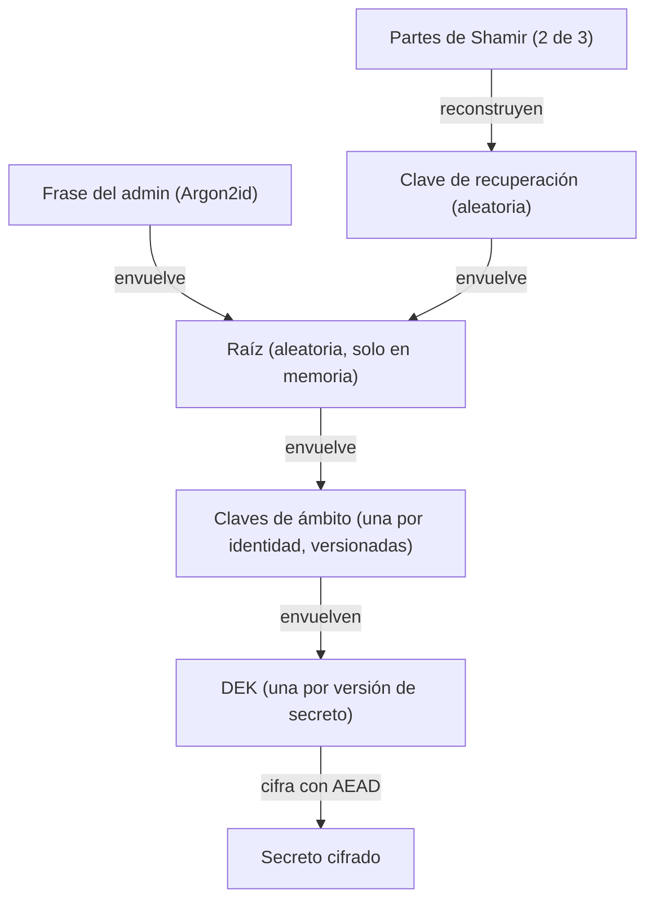
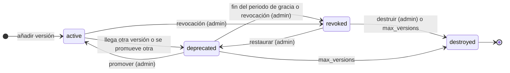

# Secretos de Hécate

Cómo guarda Hécate los secretos de terceros de Cerbero. Este documento desarrolla el cifrado por sobre (la raíz, una
clave de ámbito por identidad y una clave por versión), el formato de un secreto cifrado, las versiones y su ciclo de
vida, la huella con la que el admin comprueba lo que escribió, los metadatos, la rotación de las claves de ámbito y
`wrap`/`unwrap`. Es para quien quiere entender o revisar el diseño; quién puede resolver cada secreto está en
[acceso](acceso.md).

## Secret y Key

| Aggregate | Qué es | Estados |
|---|---|---|
| **Secret** | Un secreto en una ruta `secret://<identidad>/<resto>`, con sus metadatos y sus versiones | Por versión: `active`, `deprecated`, `revoked`, `destroyed` |
| **Key** | Una clave propia de Hécate: la clave de ámbito de una identidad, la CA con sus intermedias ([identidades](identidades.md#la-ca-en-dos-niveles)) o la clave de firma de eventos ([auditoría](auditoria.md#la-firma-de-checkpoints)) | Por versión: `active`, `decrypt_only` (las de cifrado) o `verify_only` (las de firma), `retired` |

- Los dos son event-sourced y **ningún evento lleva un valor**: solo metadatos, versiones, huellas y fechas.
- **Las escrituras llevan la versión esperada** del secreto (como el *check-and-set* de OpenBao), para que dos cambios
  simultáneos no se pisen: si otro cambio llegó antes, la escritura responde `conflict` con la versión actual. Crear un
  secreto en una ruta que ya existe también responde `conflict`.
- **El admin escribe valores pero nunca los lee.** Para comprobar lo que escribió ve la [huella](#la-huella) de cada
  versión; el valor solo sale por la [resolución](acceso.md#la-resolución), que es de las identidades.

## Las rutas

- `secret://<identidad>/<resto>`: el primer tramo es la identidad dueña del secreto (letras minúsculas, cifras y `-`,
  empezando por una letra, hasta 63 caracteres), y el resto, uno o más tramos de 1 a 64 caracteres de `a-z`, `0-9`,
  `_` y `-`.
- Las identidades `hecate` y `admin` están reservadas: no admiten secretos ni versiones nuevas. Lo que guardaron antes
  de la reserva se puede seguir revocando y destruyendo.
- Los secretos de cualquier otra identidad se pueden preparar antes de que se dé de alta.

## La jerarquía de claves

La raíz y sus dos protecciones están en [sellado](sellado.md#la-raíz-y-sus-dos-protecciones).

| Nivel | Qué cifra | Rotación | Coste de rotar |
|---|---|---|---|
| **Raíz** | Solo las claves de ámbito | A petición del admin | Volver a envolver unas pocas claves de ámbito |
| **Clave de ámbito** | Las DEK de su ámbito | Periódica (90 días por defecto) y manual | Volver a envolver las DEK; los secretos no se tocan |
| **DEK** | Una versión de un secreto | No se rota: cada versión tiene la suya, aleatoria | — |

- **El ámbito es la identidad:** el ámbito de cifrado coincide con el de acceso, así que una clave de ámbito
  comprometida solo expone los secretos de esa identidad. La clave de ámbito de una identidad se crea con su primer
  secreto.
- **Una clave, un uso:** AES-256-GCM para cifrar; Ed25519 para firmar (los tokens cortos de las llamadas y los
  checkpoints); ECDSA P-256 para la CA y los certificados.
- **Agilidad criptográfica:** cada versión guarda la versión de la clave de ámbito que envolvió su DEK, y la
  configuración de sellado guarda el algoritmo y los límites con que se protegió la raíz; así se puede cambiar de clave
  o de parámetros sin migrar todo de golpe. Todas las capas cifran con AES-256-GCM.

## El formato de un secreto cifrado

Cada capa es un cifrado AES-256-GCM con su nonce y con datos asociados que la atan a su sitio:

| Capa | Qué cifra | Con qué | Datos asociados |
|---|---|---|---|
| Clave de ámbito | La clave de ámbito de una identidad | La raíz | `purpose: scope_key`, la identidad y la versión de la clave |
| DEK | La clave de una versión | La clave de ámbito de su dueño | `purpose: dek`, la ruta, la versión, el ámbito (la identidad) y la versión de la clave de ámbito |
| Valor | El valor de una versión | Su DEK | `purpose: secret`, la ruta, la versión y el ámbito |

Los datos asociados son JSON con las claves ordenadas y sin espacios, p. ej. para el valor
`{"path":"secret://hermes/telegram/family_bot/bot_token","purpose":"secret","scope":"hermes","version":7}`. Si alguien
mueve un dato cifrado a otra ruta, a otra versión o a otro ámbito, no se descifra.

## Dónde se guarda

| Tabla (SQLite) | Contenido | Se borra |
|---|---|---|
| `events` | Los eventos de todos los aggregates, por stream: `secret/<identidad>/<resto>`, `key/<identidad>`, `ca`, `identity/<nombre>`, `certificate/<identidad>/<serie>` y `policy/<identidad>`. Solo metadatos, fechas y huellas. Append-only (triggers que rechazan `UPDATE` y `DELETE`) y con la versión esperada del stream en cada escritura | Nunca |
| `secret_material` | Por versión: la versión de la clave de ámbito, el valor cifrado con su DEK y la DEK envuelta por la clave de ámbito, cada uno con su nonce | Al destruir la versión |
| `key_material` | Por identidad y versión: la clave de ámbito envuelta por la raíz, con su nonce | Nunca |

- **El material va fuera de los eventos** porque el borrado criptográfico exige poder eliminar la DEK de una versión, y
  un registro append-only no lo permite.
- Los eventos y el material de un cambio se escriben en una sola transacción: un corte deja el secreto como estaba.
- SQLite trabaja con `secure_delete`, así que una DEK borrada tampoco queda en páginas libres de las copias.
- Las tablas de la CA y de las identidades están en [identidades](identidades.md#dónde-se-guarda); la de sellado, en
  [sellado](sellado.md#lo-que-se-guarda); y el registro de accesos, en [auditoría](auditoria.md).

## La huella

- HMAC-SHA256 del valor con una clave derivada de la clave de ámbito (HKDF-SHA256), truncado a 8 bytes y mostrado en
  hexadecimal en grupos de cuatro: `ab12-cd34-ef56-7890`.
- Al llevar clave, solo Hécate la calcula: quien vea la lista no puede adivinar valores débiles por fuerza bruta.
- Se guarda en el evento de la versión y aparece solo en las respuestas de crear un secreto, añadirle una versión y
  consultarlo; nunca en la resolución ni en el registro de accesos.

## Los metadatos

Cada secreto los fija al crearse:

- **owner:** la identidad de su ruta.
- **Tipo del valor:** `string`, `json` o `pem`, validado al escribir cada versión (un JSON válido, bloques PEM válidos).
  El valor no puede estar vacío ni pasar de 64 KiB.
- **`max_versions`:** cuántas versiones vivas guarda, de 2 a 100; 10 por defecto.
- **`rotate_every`:** cada cuánto debe rotarse, una duración ISO 8601 en días o en semanas, en mayúsculas y sin signo
  ni ceros a la izquierda: `P90D` (de 1 a 3650 días) o `P12W` (de 1 a 520 semanas). El secreto debe rotarse cuando su
  versión activa la cumple.
- **`expires_at`:** una fecha y hora ISO 8601 en la que caduca lo que guarda, p. ej. un token con fecha de fin.

`rotate_every` y `expires_at` son avisos: el [estado](acceso.md#el-permiso-de-estado) cuenta los secretos por rotar,
caducados y por caducar, y la resolución no los mira.

## El ciclo de vida de un secreto

- **Periodo de gracia** de 24 horas: la versión anterior aún se resuelve si se pide explícitamente (`@N`). Se calcula al
  leer, sin procesos en segundo plano: una `deprecated` pasada su gracia cuenta como `revoked`. Restaurar una `revoked`
  la deja `deprecated` con una gracia nueva.
- **`max_versions`:** cuando una versión nueva lo supera, la versión viva más antigua se destruye, sea cual sea su
  estado. El mínimo de 2 deja su gracia a la versión que se acaba de sustituir.
- **Volver a la anterior** (p. ej. si las credenciales nuevas no funcionan): el admin promueve una `deprecated` a
  `active`, como evento, y la activa pasa a `deprecated`; una `revoked` se restaura antes.
- **Revocar** deja de resolver una versión al momento, sin periodo de gracia.
- **`destroy` es borrado criptográfico:** se borran la DEK y el valor cifrado de esa versión; los eventos siguen y el
  dato ya no se puede descifrar. Solo se destruye una versión `revoked`, y el admin lo demuestra de nuevo con la frase
  actual o dos partes, con el mismo [freno de intentos](sellado.md#el-freno-de-intentos) que el desbloqueo. Revocar,
  restaurar y promover no piden prueba, y la destrucción por `max_versions` tampoco.
- **Rotación de un secreto de terceros:** el admin rota en el proveedor y añade la versión nueva desde Ténaro o desde la
  CLI; los componentes la recogen al refrescar su caché. Después, la prueba de conexión de la instancia (en Hermes) lo
  confirma, y si falla se vuelve a la anterior.
- **En una fuga:** se revoca sin periodo de gracia y se rota en el proveedor.

## Rotar una clave de ámbito

Cada clave de ámbito rota periódicamente (90 días por defecto, configurable) y a petición del admin:

1. La versión nueva cifra lo nuevo; las anteriores pasan a `decrypt_only`.
2. Un proceso de Hécate vuelve a envolver las DEK antiguas con la versión nueva (el equivalente a `rewrap`, sin tocar
   los secretos).
3. Cuando ninguna DEK depende de una versión antigua, pasa a `retired` y se puede destruir. **No se puede destruir una
   versión de la que aún depende una DEK.**

## `wrap` / `unwrap`

Un componente que cifra datos propios, como las copias de seguridad de Hermes, le pide a Hécate que envuelva o
desenvuelva su DEK con la clave de su ámbito (`POST /v1/keys/{id}:wrap` y `:unwrap`), al estilo de Transit de OpenBao.
La clave de ámbito nunca sale de Hécate, y cada operación deja una fila en el
[registro de accesos](auditoria.md#el-registro-de-accesos).

## Relacionado

- [Hécate](../hecate.md): el documento de alto nivel.
- [Sellado](sellado.md): la raíz que envuelve las claves de ámbito.
- [Acceso](acceso.md): quién resuelve cada secreto.
- [Integrar un componente](integracion.md): cómo resuelve sus secretos un componente.
- [Auditoría](auditoria.md): lo que queda registrado de cada operación.
