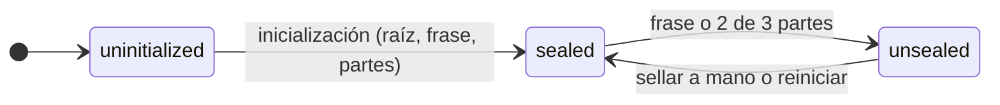

# Sellado de Hécate

Cómo protege Hécate la raíz de la que depende todo lo que cifra. La raíz solo vive en memoria mientras Hécate está
desbloqueada, la protegen la frase del admin y tres partes de recuperación, de las que bastan dos, y Hécate arranca
siempre sellada. Este documento desarrolla la inicialización, el desbloqueo (con la CLI local o desde Ténaro), el
sellado, el freno de intentos y lo que se guarda para poder desbloquear. Es para quien quiere entender o revisar el
diseño.

## La raíz y sus dos protecciones

La raíz es una clave aleatoria de 256 bits que solo cifra las claves de ámbito; de ellas cuelga el resto de la
[jerarquía de claves](secretos.md#la-jerarquía-de-claves). Nunca se guarda en claro: se guarda cifrada dos veces, y
cualquiera de las dos copias basta para recuperarla.

| Protección | Para qué | Cómo se abre |
|---|---|---|
| **Frase del admin** | El día a día | Una clave derivada de la frase con Argon2id descifra la raíz |
| **Recuperación** | Recuperarla si se olvida la frase | Una clave aleatoria, repartida en tres partes de Shamir de las que bastan dos, descifra la raíz |

- Las dos cifran con AES-256-GCM. Sus datos asociados atan cada copia cifrada a su propósito (la raíz), a su protección
  y a la versión de la configuración de sellado: una copia no se puede hacer pasar por la otra ni por una anterior.
- **Cambiar la frase** sustituye solo la protección de la frase, y **repartir de nuevo las partes** genera otra clave de
  recuperación y otras tres partes, que se confirman con dos de ellas; las anteriores dejan de valer. La raíz y los
  secretos no se tocan. Las dos operaciones exigen Hécate desbloqueada y demostrarlo de nuevo, con la frase actual o con
  dos partes, y cada una sube la versión de la configuración.

## Los estados

- **Sin inicializar** solo admite la inicialización y la consulta del estado.
- **Sellada** solo admite desbloquear y consultar el estado; el resto de órdenes del canal local responde `conflict`.
  La API sigue escuchando con el certificado vigente de Hécate y responde `unavailable` a todo salvo al estado
  agregado, para las identidades con el [permiso de estado](acceso.md#el-permiso-de-estado): no emite, renueva, publica
  ni resuelve nada. Si ese certificado caduca, la API deja de escuchar hasta que Hécate se desbloquea y lo renueva
  ([riesgo aceptado](../../DECISIONS.md#riesgos-aceptados)).
- **Desbloqueada**, la raíz está en memoria y Hécate atiende todas sus operaciones.
- Al arrancar o reiniciar, Hécate siempre queda sellada. El admin puede sellarla a mano con una sola acción, p. ej.
  ante una intrusión.
- Cada desbloqueo abre una época nueva: lo que estaba a medias en la anterior, como una ceremonia de la CA o un reparto
  de partes sin confirmar, se pierde al sellar.

## Inicialización

Se hace una sola vez, en dos pasos:

1. El admin fija la frase, de 12 caracteres o más. Hécate genera la raíz, la clave de recuperación y sus tres partes,
   las muestra una sola vez y avisa de que, sin la frase y sin dos de las tres partes, los datos no se pueden
   recuperar.
2. El admin confirma con dos de las partes, como mucho 15 minutos después. Hasta confirmar no se guarda nada: una
   inicialización abandonada no deja rastro.

Tras inicializar, Hécate queda sellada. La CA se crea después, en su propia
[ceremonia](identidades.md#la-ca-en-dos-niveles). Una vez inicializada, no hay operación para borrarlo todo: volver a
empezar es un procedimiento manual (parar Hécate y borrar sus datos, ver [operación](operacion.md)).

## Las partes de recuperación

Cada parte es un texto con el prefijo `HEC2` y grupos de cuatro caracteres separados por guiones, en Base32 de
Crockford. Lleva la versión del formato, su índice, el identificador de su juego de partes, sus 32 valores en GF(256) y
una suma de comprobación de 4 bytes (SHA-256), que detecta un error al teclearla.

- Al leerla, Hécate ignora los espacios y los guiones, acepta minúsculas y lee la O, la I y la L como 0, 1 y 1.
- Una parte de otro juego, como una anterior a repartirlas de nuevo, se rechaza; la misma parte dos veces, también.

## Desbloquear

- **Con la frase o con dos partes**, desde la [CLI](cli.md) local en el equipo de Hécate o desde Ténaro, con la
  passkey del admin y la frase, por mTLS.
- Con las partes, Hécate recomienda fijar una frase nueva, y el estado lo recuerda hasta que se cambia o se sella.
- Ténaro también muestra el estado de Hécate, para saber si está sellada.

## El freno de intentos

Un contador de fallos seguidos protege la frase y las partes frente a la fuerza bruta:

- es común al desbloqueo y a las pruebas que piden la frase actual o dos partes (cambiar la protección,
  [destruir una versión](secretos.md#el-ciclo-de-vida-de-un-secreto) y sustituir la CA);
- hasta el segundo fallo no hay espera; desde el tercero, la espera es de 1, 2, 4 y 8 minutos, y después de 15;
- mientras dura, cada intento responde `rate_limited` con los segundos que faltan, sin comprobar nada;
- se guarda en disco, así que sobrevive a los reinicios, y un acierto lo pone a cero;
- comprobar que la frase de una CA nueva no es la de desbloqueo no cuenta como intento: que no lo sea es lo normal.

Cada intento de inicializar, desbloquear, sellar o cambiar la protección deja una fila en el
[registro de accesos](auditoria.md#el-registro-de-accesos).

## Lo que se guarda

| Tabla (SQLite) | Contenido |
|---|---|
| `seal_config` | Una sola fila: la versión de la configuración, sus fechas y las dos protecciones. La de la frase guarda el algoritmo (Argon2id), sus límites de coste, la sal de 16 bytes, el nonce y la raíz cifrada; la de recuperación, el identificador del juego de partes, el umbral (2 de 3), el nonce y la raíz cifrada |
| `attempts` | El contador de fallos seguidos y cuándo se puede volver a intentar |

- Las partes no se guardan en ningún sitio: solo las tiene el admin.
- **Perfiles de Argon2id:** `sensitive` (4 pasadas y 1 GiB), el de por defecto, o `moderate` (3 pasadas y 256 MiB);
  nunca uno más débil. Se elige con una variable de entorno de la [CLI](cli.md), y los límites se guardan con cada
  protección de la frase, así que valen los del momento en que se fijó.

## La raíz en memoria

- La raíz solo existe en la memoria del proceso mientras Hécate está desbloqueada. Sellar o parar Hécate la borra, y
  cada operación usa una copia que se borra al terminar.
- El proceso desactiva los volcados de memoria y bloquea su memoria para que la raíz no llegue al swap; lo que
  necesita del sistema para hacerlo está en la [CLI](cli.md).

## Hardware

El cifrado pasa por un port, `CryptoProvider`, con un adapter de software. Un adapter de hardware (TPM o YubiKey) encaja
en el mismo port, para desbloquear sin intervención y para que las claves no salgan del dispositivo.

## Relacionado

- [Hécate](../hecate.md): el documento de alto nivel.
- [Secretos](secretos.md): la jerarquía de claves que cuelga de la raíz.
- [CLI y configuración](cli.md): las órdenes de sellado y el perfil de Argon2id.
- [Operación](operacion.md): la puesta en marcha, el arranque tras un reinicio y la frase olvidada.
