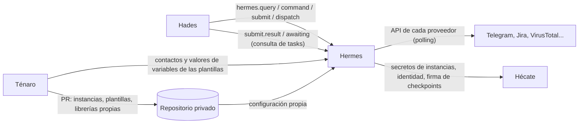
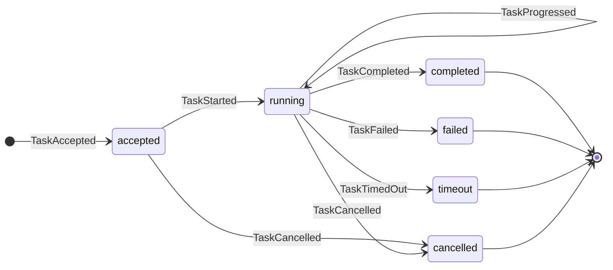
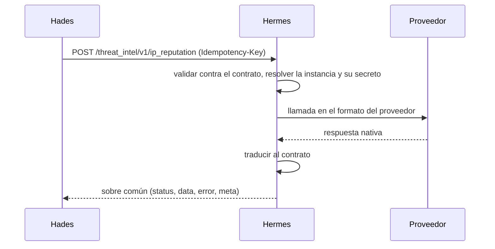
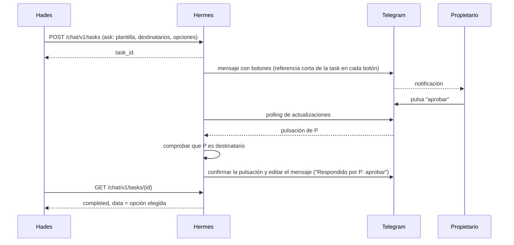

# Hermes — librerías de terceros con contrato

*En la mitología, el mensajero que viaja entre los mundos.* · Estado: diseñado · Última revisión: 2026-11-01

Ver también: [ARCHITECTURE](../ARCHITECTURE.md) (visión transversal) · [GLOSSARY](../GLOSSARY.md) · [DECISIONS](../DECISIONS.md) · [Hades](hades.md)

---

## 1. Propósito y frontera

Hermes reúne las librerías que envuelven servicios de terceros (mensajería, ticketing, threat intel, control de red...) detrás de **contratos estándar por tipología**. Un Playbook que usa el contrato de un tipo de servicio funciona igual con cualquier proveedor: cambiar Telegram por otro chat no lo toca, y un cambio en la API del proveedor se arregla en su librería sin que los Playbooks se enteren.

| Hace | No hace |
|---|---|
| Definir y mantener los contratos de cada tipo de servicio y de cada proveedor | Orquestar ni decidir (es de Hades) |
| Ejecutar llamadas síncronas y tasks contra los proveedores | Escuchar a Hades ni avisarle: Hades consulta |
| Gestionar instancias, contactos y plantillas | Controlar el ruido (el control de avalanchas está aguas arriba) |
| Reintentar de forma segura, garantizar idempotencia | Custodiar secretos (los custodia Hécate) |
| Auditar lo que cambia fuera y los datos que salen de casa | Ser paso obligatorio: una integración de Hades puede hablar con un tercero directamente |

**Por qué es una pieza aparte:** cada proveedor tiene su API, sus errores, sus límites y sus formas de responder. Concentrar todo eso en un sitio con contratos propios protege a los Playbooks de los cambios externos y obliga a seguir las mismas buenas prácticas en todas las integraciones.

---

## 2. Contexto



| Con quién | Qué recibe Hermes | Qué entrega Hermes |
|---|---|---|
| **Hades** (Responses, Jobs, cronjobs) | Llamadas síncronas, tasks, consultas de tasks, cancelaciones, `/capabilities` | El sobre común con los datos del contrato; el estado de las tasks |
| **Ténaro** | Prueba de conexión de una instancia (los cambios de configuración van por PR al repositorio privado) | Estado de instancias y librerías |
| **Repositorio privado** | Lo propio: instancias, plantillas y librerías de proveedor propias (sin secretos, contactos ni valores de variables) | — |
| **Proveedores** | Sus respuestas (y lo que llega en las tasks, por polling) | Las llamadas traducidas a su API |
| **Hécate** | Secretos de las instancias, certificado, firma de checkpoints | — |

Toda la comunicación es por API, con el contrato común de Cerbero. Hades nunca lee los streams de Hermes: consulta.

---

## 3. Conceptos

### Taxonomía

```text
categoría (para qué sirve)          communication, enrichment, containment... (lista abierta)
└─ tipo de servicio (contrato común) chat, email, ticketing, threat_intel, network_control...
   └─ función (operación)            chat.ask, ticketing.create, threat_intel.ip_reputation...
      └─ proveedor (librería)        telegram, jira, virustotal, pihole...
         └─ instancia (configurada)   family_bot, admin_bot...
```

Ejemplos de tipos de servicio y funciones:

| Categoría | Tipo de servicio | Funciones (ejemplos) |
|---|---|---|
| `communication` | `chat` | `send_message`, `ask` |
| `communication` | `email` | `send`, `ask` |
| `communication` | `ticketing` | `create`, `comment`, `close`, `get`, `watch` |
| `enrichment` | `threat_intel` | `ip_reputation`, `domain_reputation`, `hash_reputation`, `url_scan` |
| `containment` | `network_control` | `block_device` / `unblock_device`, `block_ip` / `unblock_ip`, `block_domain` / `unblock_domain` |

`reputation` es la opinión del proveedor sobre un indicador; no es el Verdict de Hades.

### Tres capas de datos

Todas las capas las define y mantiene Hermes, en la petición y en la respuesta:

```text
sobre común: status, data, error, meta, ids, idempotencia
└─ contrato del tipo de servicio (p. ej. chat): campos comunes del tipo
   └─ contrato del proveedor (p. ej. telegram): lo propio de ese proveedor
```

Nada en el formato nativo del proveedor llega al Playbook.

### Task

Una petición asíncrona en curso, event-sourced:



Los estados terminales no cambian. Hermes guarda el estado de una task solo cuando quien llama la va a seguir (`submit`); un `dispatch` no deja estado consultable.

### Instancia y contacto

- **Instancia:** una librería configurada con sus parámetros y referencias a secretos (nunca el valor). Puede haber varias por proveedor (p. ej. un bot para la familia y otro para el administrador); quien llama elige por nombre.
- **Contacto:** persona con sus canales (servicio, proveedor, instancia, dirección, verificado), o grupo con miembros y entrega `shared_chat` (un mensaje al grupo) o `fan_out` (uno por miembro). Hades solo maneja referencias.

---

## 4. Cómo funciona

### Llamada síncrona



### Task

```text
API ─ persiste TaskAccepted (+ outbox) ─▶ cola ─▶ worker: adapter ─▶ TaskStarted / TaskProgressed
                                                   polling al proveedor ─▶ TaskCompleted | TaskFailed | TaskTimedOut
GET /{service}/v1/tasks/{id} ◀── proyección task-status
```

- `POST /{service}/v1/tasks` devuelve `{ task_id, stream, status: accepted }`; `GET /{service}/v1/tasks/{task_id}` devuelve el sobre con el estado.
- La cola vive sobre la propia base de datos. Al reiniciar se retoman las tasks no terminales.
- **Cancelación:** `DELETE /{service}/v1/tasks/{id}` → `TaskCancelled` (p. ej. al cerrarse el Case).

### Ejemplo: preguntar al propietario por Telegram



### Idempotencia y reintentos

- **Idempotencia:** Hades envía la cabecera `Idempotency-Key`. La misma clave devuelve el mismo resultado o la misma task, sin repetir el efecto; con otro cuerpo, error `validation`.
- **Reintentos seguros:** Hermes reintenta los fallos de transporte con backoff exponencial y jitter, respetando `429` / `Retry-After`, **solo si es seguro**: el fallo garantiza que no se ejecutó, o la función es idempotente en el proveedor.
- **Resultado ambiguo** (p. ej. timeout después de enviar algo con efecto): no reintenta; devuelve `timeout` con `retryable: false` y `outcome_unknown: true`.
- **Hades** solo reintenta un bloque si el sobre dice `retryable`.

### Timeouts

Cada función declara su timeout técnico: segundos en las síncronas, duración máxima en las tasks (un `chat.ask` puede durar días). Si vence, `TaskTimedOut`. El SLA es solo de Hades, y el `timeout` de un `submit.result` de Hades no cancela la task.

---

## 5. Contratos

### Sobre común

```json
{
  "status": "completed | failed",
  "data": { "...": "según el contrato" },
  "error": { "code": "provider_unavailable", "message": "...", "retryable": true },
  "meta": { "request_id": "...", "service": "chat", "provider": "telegram", "idempotency_key": "...", "duration_ms": 120 }
}
```

- **Códigos de error** cerrados y comunes: `validation`, `auth`, `not_found`, `conflict` (operación no permitida en el estado actual), `rate_limited`, `provider_unavailable`, `timeout`, `internal`, con `retryable`.
- **Es error** un fallo de infraestructura o una respuesta 4XX / 5XX del proveedor (y 3XX problemáticas). Un resultado de negocio (p. ej. reputación `unknown`) va en `data`.
- Los errores HTTP de Hermes son solo para fallos del propio Hermes o de la petición; un fallo del proveedor va dentro del sobre.

### Contrato de una función

```json
{
  "block_url": {
    "kind": "command",
    "mode": "sync",
    "side_effect": "Bloquea la URL ${input.url} en el proxy",
    "compensation": "unblock_url",
    "input": "...",
    "output": "..."
  },
  "url_scan": {
    "kind": "query",
    "mode": "task",
    "discloses_data": "Publica la URL ${input.url} en VirusTotal, visible para su comunidad",
    "input": "...",
    "output": "..."
  }
}
```

- **`kind`:** consulta (`query`) o cambio (`command`). Hades valida con él el verbo del bloque.
- **`mode`:** el nativo del proveedor (`sync` o `task`), sin conversiones. Cambiar de proveedor puede cambiar el API Contract (campos o modo): es major.
- **`side_effect`** describe qué cambia, con la entrada; va con su `compensation` o `non_reversible`.
- **`discloses_data`** describe qué datos salen a un tercero y dejan de ser privados. Hades avisa al registrar un Playbook que la use.
- El texto resuelto de las dos descripciones aparece en el aviso, en el timeline y en el registro de auditoría.

### API

| Ruta | Para qué |
|---|---|
| `POST /{service}/v1/{function}` | Llamada síncrona |
| `POST /{service}/v1/tasks` · `GET` · `DELETE /{service}/v1/tasks/{id}` | Enviar, consultar y cancelar una task |
| `GET /capabilities` | Por tipo de servicio: proveedores, instancias, funciones de cada uno y su estado |
| `POST /instances/{id}/test` | Prueba de conexión de una instancia |
| Configuración propia | Instancias, plantillas y librerías propias, cargadas del repositorio privado (se editan desde Ténaro con una PR) |
| Contactos y variables | Contactos y valores de las variables de las plantillas, en la base de datos de Hermes (gestión desde Ténaro) |
| `/health/live`, `/health/ready` | Salud |

- **Formato:** contratos en JSON Schema; API publicada en OpenAPI 3.1, de la que se generan los clientes de Hades.
- **Versionado:** major en la ruta (`/chat/v1/...`). Hermes sirve a la vez las majors en uso y no retira una mientras algo la use; las deprecadas avisan con el mismo patrón que el resto de Cerbero.

---

## 6. Configuración y extensión

### Añadir un proveedor: una librería

Una librería implementa uno o varios tipos de servicio para un proveedor. Las oficiales son código de Hermes en el repositorio de Cerbero: se añaden por PR con CI, siguen las convenciones de calidad y de API Contracts, y se despliegan con Hermes. Las propias viven en el repositorio privado (ruta `hermes/`) y llegan por una PR desde Ténaro que pasa su batería de pruebas.

```text
infrastructure/providers/telegram/
├── manifest.json
├── contract/      # la capa del proveedor
├── adapter.py     # las llamadas de salida
├── polling.py     # consulta al proveedor hasta tener el resultado de una task
└── tests/
```

```json
{
  "provider": "telegram",
  "version": "1.2.0",
  "maintainer": "...",
  "implements": [
    { "service": "chat", "contract": "1",
      "functions": {
        "send_message": { "mode": "sync", "timeout": "10s" },
        "ask":          { "mode": "task", "poll_interval": "5s", "max_duration": "7d" }
      } }
  ],
  "capabilities": { "max_length": 4096, "formats": ["text", "markdown"], "options": true, "edit": true, "correlation_max_bytes": 64 },
  "limits": { "requests_per_minute": 30 },
  "permissions": ["mínimos que necesita en el proveedor"],
  "instance_config": {
    "bot_token": { "type": "secret" },
    "parse_mode": { "type": "string", "default": "MarkdownV2" }
  }
}
```

- **Versión propia**, separada del contrato: adaptarse a un cambio de la API del proveedor es minor o fix y no afecta a Hades.
- **Polling** para todo lo que llega del proveedor.

### Instancias

Viven en el repositorio privado y se editan desde Ténaro con una PR: parámetros y referencias `secret://hermes/...`. Al registrarlas, Hécate da a Hermes permiso de lectura sobre esas rutas. La prueba de conexión confirma que las credenciales funcionan.

### Comunicación: contactos y plantillas

Criterio inicial para la categoría de comunicación:

- **Verificación del canal** con un código de un solo uso; un canal sin verificar no recibe mensajes.
- **Modelo neutral de mensaje**, que rellenan las plantillas (id, versión, schema de datos) y que cada proveedor dibuja según sus capacidades, recortando el detalle si no cabe y conservando el enlace al Case:
  ```json
  { "title": "Dispositivo desconocido en la red", "severity": "high", "summary": "...",
    "facts": [{ "label": "MAC", "value": "..." }], "actions_done": ["..."],
    "expected": "Aprobar o denegar el bloqueo", "link": "https://.../cases/case-1234" }
  ```
- **`ask`:** opciones cerradas; responden solo los destinatarios; **la primera respuesta válida completa la task** con la opción, el contacto y la hora; las siguientes reciben "ya respondido por X"; al resolverse, cancelarse o caducar se edita el mensaje o se envía uno de seguimiento.
- La identidad de quien responde se traduce a su contacto. Cada librería declara los permisos mínimos que necesita en el proveedor.

---

## 7. Organización interna

```text
hermes/
├── domain/
│   ├── shared/          # sobre, códigos de error, ids, clave de idempotencia, referencias a contactos
│   ├── task/            # aggregate Task (event-sourced)
│   └── services/        # un módulo por tipo de servicio: contrato común + port
├── application/         # casos de uso: llamada síncrona, enviar task, consultar task, capabilities
└── infrastructure/
    ├── api/             # FastAPI: /{service}/v1/{function}, /{service}/v1/tasks, /capabilities
    └── providers/       # una librería por proveedor (adapters)
```

| Patrón | Dónde | Por qué |
|---|---|---|
| Hexagonal | Tipo de servicio = port; proveedor = adapter; FastAPI = adapter de entrada | Cambiar de proveedor no toca el dominio |
| DDD | Lo común: sobre, contratos, Task, contactos | Mismo lenguaje y mismas reglas en todos los proveedores |
| Event Sourcing + CQRS | La Task y su proyección `task-status` | El stream de la task es su historia; Hades consulta la proyección |

---

## 8. Datos

| Dato | Dónde | Copia |
|---|---|---|
| Registro append-only de llamadas con `side_effect` o `discloses_data` | Base de datos de Hermes | Sí, lo más importante (auditoría) |
| Event store de las tasks y claves de idempotencia | Base de datos de Hermes | Sí |
| Instancias, plantillas y librerías propias | Repositorio privado (ruta `hermes/`), como código, sin secretos, contactos ni valores de variables; se cambian por PR desde Ténaro | Es el propio repositorio |
| Contactos, grupos y valores de las variables de las plantillas | Base de datos de Hermes; se gestionan desde Ténaro; nunca en el repositorio | Sí, dentro de la copia de la base de datos |
| Estado de verificación de los canales | Base de datos de Hermes | Sí |
| Proyecciones, cachés, cursores del polling | — | No: se reconstruyen o se empieza desde "ahora" |
| Código, contratos y manifiestos de las librerías oficiales | Repositorio de Cerbero; no se editan desde Ténaro | Es el propio repositorio |

- **Retención** configurable de las tasks terminadas (30 días como punto de partida); el resultado queda también en el stream de la Response de Hades.
- **Datos personales:** las direcciones de los contactos solo viven en la base de datos de Hermes; nunca en el repositorio ni en Hades.
- **Copias:** regla 3-2-1, cifradas con una clave de Hécate (`wrap`), restauración probada.

---

## 9. Seguridad

- **Identidad:** `spiffe://cerbero.home/hermes`, con mTLS y JWT ligado al canal (ver [Identidad y seguridad](../ARCHITECTURE.md#6-identidad-y-seguridad)).
- **Superficies:** la API de servicios solo para los componentes internos; la gestión desde Ténaro. Nada de Hermes se expone directamente a internet.
- **Secretos** como referencias `secret://hermes/<proveedor>/<instancia>/<campo>`, resueltos al ejecutar por cada instancia y nunca en logs, eventos ni streams.
- **Auditoría:** el registro append-only guarda el contexto que propaga Hades (`source`, Response, Playbook o Job, owner / maintainer o la persona). La gestión también queda registrada con quién la hizo. Los checkpoints de la auditoría los firma Hécate.
- **Logs** con secretos y datos personales enmascarados.

---

## 10. Operación

| Qué falla | Efecto | Recuperación |
|---|---|---|
| Hermes | Hades no puede llamar a los servicios con contrato: el bloque falla y se reintenta según el Playbook. Las tasks ya aceptadas no se pierden | Hermes retoma las tasks no terminales desde su event store |
| Un proveedor | Hermes reintenta lo seguro; si no, devuelve `provider_unavailable`, `rate_limited` o `timeout` | El estado de la instancia lo refleja en `/capabilities` |
| Hécate | Hermes sigue con la caché de secretos (hasta 1 h); después, las llamadas que necesitan un secreto fallan con `internal` | Desbloquear Hécate |

- **Salud:** `/health/live` y `/health/ready`; estado por instancia (`healthy / degraded / unavailable`) en `/capabilities`, calculado de las últimas llamadas y de la prueba de conexión.
- **Observabilidad con OpenTelemetry:** trazas Hades → Hermes → proveedor; métricas por servicio, función, proveedor e instancia (latencia, errores, reintentos, límites alcanzados, duración de las tasks); logs con `correlation_id`, `causation_id`, `task_id` y clave de idempotencia.
- **Avisos:** un cronjob de Hades consulta `/capabilities` y emite señales (instancia caída, versión deprecada); un Playbook secundario avisa al maintainer.
- **Límites de uso** por instancia (cubo de tokens con los valores de la librería, ajustables en la instancia).

---

## 11. Pruebas

- **Conformidad por tipo de servicio:** todo proveedor de `chat` pasa la misma batería contra el contrato común.
- **Por librería:** respuestas grabadas del proveedor.
- **Proveedores `fake`** por tipo de servicio para los entornos funcionales completos y la CI: los Playbooks se prueban sin tocar los servicios reales.
- **API:** contra el OpenAPI publicado.

---

## 12. Decisiones y riesgos

Resumen; el detalle y el porqué están en [DECISIONS](../DECISIONS.md#hermes-frente-a-secops-soar-integraciones).

- **Frente a SecOps:** contratos estándar por tipología (en SecOps cada integración devuelve su propia salida); las librerías viven en un componente aparte, recomendado pero no obligatorio; integraciones de Hades que usan o extienden clases de Hermes en lugar de duplicarlas; `side_effect` y `discloses_data` descritos en cada contrato.
- **Descartado:** Hermes como frontera obligatoria; payload nativo del proveedor en el Playbook; convertir modos; webhooks; control de ruido en Hermes; ejecución remota.

---

## 13. Preguntas frecuentes

**¿Qué pasa si cambio de proveedor de chat?**
Si el Playbook solo usa el contrato del tipo de servicio, nada. Si el nuevo proveedor tiene otro modo o campos distintos, cambia el API Contract (major) y el registro de Playbooks señala los que hay que adaptar.

**¿Por qué el Playbook no puede usar la respuesta original del proveedor?**
Porque lo ataría a ese proveedor y a su API: cualquier cambio externo lo rompería sin aviso. Si hace falta un dato, se añade al contrato.

**¿Qué pasa si el proveedor tarda mucho?**
Si su función es síncrona, vence el timeout técnico y el sobre lo dice. Si es una task, Hades la consulta hasta que termina, vence su `timeout` o se cancela.

**¿Y si Hermes se cae a mitad de una task?**
La task está en el event store: al volver, Hermes la retoma.

**¿Puede repetirse un bloqueo por un reintento?**
No: la clave de idempotencia lo evita, y Hermes no reintenta cuando no sabe si la petición se ejecutó (`outcome_unknown`).

**¿Por qué no hay webhooks?**
No se prevén; todo lo que llega del proveedor se obtiene por polling.

**¿Qué pasa si dos personas pulsan a la vez?**
La primera respuesta válida completa la task; la segunda recibe "ya respondido por X".

**¿Dónde están los tokens de los bots?**
En Hécate. La instancia solo guarda la referencia `secret://`.

---

## 14. Referencias

- Google SecOps SOAR: [Support multiple instances](https://docs.cloud.google.com/chronicle/docs/soar/respond/integrations-setup/supporting-multiple-instances) · [Use the IDE](https://docs.cloud.google.com/chronicle/docs/soar/respond/ide/using-the-ide) · [Build custom integrations](https://docs.cloud.google.com/chronicle/docs/soar/respond/ide/building-a-custom-integration) · [Create custom actions](https://docs.cloud.google.com/chronicle/docs/soar/respond/ide/creating-a-custom-action)
- [Shuffle python-apps](https://github.com/Shuffle/python-apps) (categorías de apps)
- OpenC2: [Actuator Profile for Packet Filtering](https://docs.oasis-open.org/openc2/ap-pf/v1.0/ap-pf-v1.0.html) (acción + objetivo, descubrimiento de capacidades)
- [Telegram Bot API](https://core.telegram.org/bots/api)
