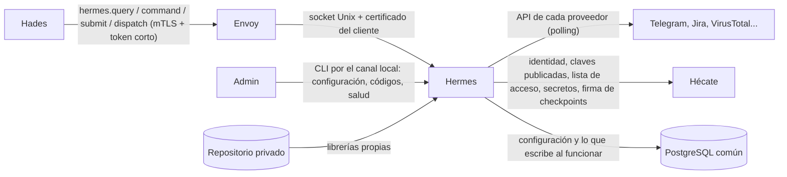
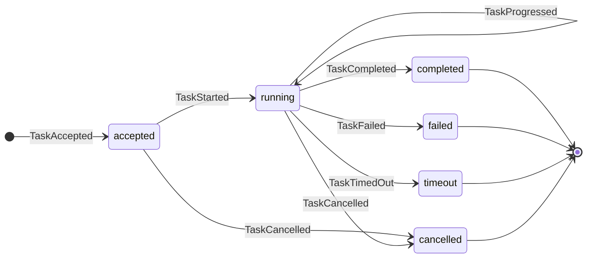
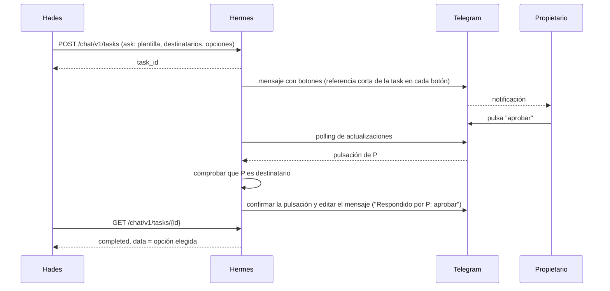

# Hermes — librerías de terceros con contrato

*En la mitología, el mensajero que viaja entre los mundos.* · Última revisión: 2026-11-16

Ver también: [ARCHITECTURE](../ARCHITECTURE.md) (visión transversal) · [GLOSSARY](../GLOSSARY.md) · [DECISIONS](../DECISIONS.md) · [Hades](hades.md) · [Hécate](hecate.md)

---

## 1. Propósito y frontera

Hermes reúne las librerías que envuelven servicios de terceros (mensajería, ticketing, threat intel, control de red...) detrás de **contratos estándar por tipología**. Un Playbook que usa el contrato de un tipo de servicio funciona igual con cualquier proveedor: cambiar Telegram por otro chat no lo toca, y un cambio en la API del proveedor se arregla en su librería sin que los Playbooks se enteren.

| Hace | No hace |
|---|---|
| Definir y mantener los contratos de cada tipo de servicio y de cada proveedor | Orquestar ni decidir (es de Hades) |
| Ejecutar llamadas síncronas y tasks contra los proveedores | Escuchar a Hades ni avisarle: Hades consulta |
| Guardar su configuración (instancias, plantillas, variables y contactos) y verificar los canales | Controlar el ruido (el control de avalanchas está aguas arriba) |
| Reintentar de forma segura, garantizar idempotencia y respetar los límites de cada instancia | Custodiar secretos (los custodia Hécate) |
| Auditar lo que cambia fuera y los datos que salen de casa | Ser paso obligatorio: una integración de Hades puede hablar con un tercero directamente |

**Por qué es una pieza aparte:** cada proveedor tiene su API, sus errores, sus límites y sus formas de responder. Concentrar todo eso en un sitio con contratos propios protege a los Playbooks de los cambios externos y obliga a seguir las mismas buenas prácticas en todas las integraciones.

---

## 2. Contexto



| Con quién | Qué recibe Hermes | Qué entrega Hermes |
|---|---|---|
| **Hades** (Responses, Jobs, cronjobs), y cualquier componente con acceso | Llamadas síncronas, tasks, consultas de tasks, cancelaciones, capacidades y pruebas de conexión, siempre a través de Envoy | El sobre común con los datos del contrato; el estado de las tasks y de las instancias |
| **Envoy** | Las llamadas con el TLS ya terminado y el certificado del cliente en `X-Forwarded-Client-Cert` | El certificado de Hermes, que Envoy presenta |
| **Admin** (CLI de Hermes, en su equipo) | La configuración entera, las peticiones de códigos de verificación y las consultas de salud | Los cambios, la configuración exportada, el código y si está listo |
| **Repositorio privado** | Las librerías de proveedor propias | — |
| **Proveedores** | Sus respuestas, y lo que llega a sus bots por polling | Las llamadas traducidas a su API |
| **Hécate** | Su certificado y sus renovaciones, las listas de revocación, las claves de firma de llamadas, su lista de acceso, los secretos de las instancias y de su base, la firma de checkpoints | — |
| **PostgreSQL común** | — | Su configuración, la verificación de los canales, las claves de idempotencia, los `jti` usados y la auditoría, en su propia base |

Toda la comunicación entre componentes es por API, con el contrato común de Cerbero. Hades nunca lee los streams de Hermes: consulta. La gestión no va por la API: va por el canal local.

---

## 3. Conceptos

### Taxonomía

```text
categoría (para qué sirve)          communication, enrichment, containment... (lista abierta)
└─ tipo de servicio (contrato común) chat, email, ticketing, threat_intel, network_control...
   └─ función (operación)            chat.send_message, chat.ask, ticketing.create, threat_intel.ip_reputation...
      └─ proveedor (librería)        telegram, jira, virustotal, pihole...
         └─ instancia (configurada)   family_bot, admin_bot...
```

Ejemplos de tipos de servicio y funciones:

| Categoría | Tipo de servicio | Funciones (ejemplos) |
|---|---|---|
| `communication` | `chat` | `send_message`, `ask` |
| `communication` | `email` | `send`, `ask` |
| `communication` | `ticketing` | `create`, `comment`, `close`, `get`, `watch` |
| `enrichment` | `threat_intel` | `ip_reputation`, `domain_reputation`, `hash_reputation`, `url_scan` |
| `containment` | `network_control` | `block_device` / `unblock_device`, `block_ip` / `unblock_ip`, `block_domain` / `unblock_domain` |

`reputation` es la opinión del proveedor sobre un indicador; no es el Verdict de Hades.

### Tres capas de datos

Todas las capas las define y mantiene Hermes, en la petición y en la respuesta:

```text
sobre común: status, data, error, meta, ids, idempotencia
└─ contrato del tipo de servicio (p. ej. chat): campos comunes del tipo
   └─ contrato del proveedor (p. ej. telegram): lo propio de ese proveedor
```

Nada en el formato nativo del proveedor llega al Playbook.

### Task

Una petición asíncrona en curso, event-sourced:



Los estados terminales no cambian. Hermes guarda el estado de una task solo cuando quien llama la va a seguir (`submit`); un `dispatch` no deja estado consultable.

### Instancia, contacto y configuración

- **Instancia:** una librería configurada con sus parámetros y referencias a secretos (nunca el valor). Puede haber varias por proveedor (p. ej. un bot para la familia y otro para el administrador); quien llama elige por nombre.
- **Contacto:** persona con sus canales (servicio, proveedor, instancia, dirección, verificado), o grupo con miembros y entrega `shared_chat` (un mensaje al grupo) o `fan_out` (uno por miembro). Hades solo maneja referencias. `chat.send_message` va a un solo contacto por petición.
- **Plantilla:** un id con versiones; cada versión, un JSON Schema de sus datos y los textos del mensaje neutral con `${data.<ruta>}` y `${vars.<variable>}`. Una versión no cambia una vez creada: para cambiarla se añade otra.
- **Variable de plantilla:** un valor de la configuración, como la URL de la consola, que las plantillas usan sin que quien llama lo envíe.
- **Configuración:** las instancias, las plantillas, las variables y los contactos, en la base de Hermes. El admin la aplica entera desde un fichero con la CLI ([Configuración y extensión](#6-configuración-y-extensión)).

---

## 4. Cómo funciona

### Llamada síncrona

```mermaid
sequenceDiagram
    participant H as Hades
    participant E as Envoy
    participant M as Hermes
    participant P as Proveedor
    H->>E: POST /chat/v1/send_message (mTLS, token corto, Idempotency-Key)
    E->>M: la petición por el socket Unix, con el certificado de H
    M->>M: autenticar y comprobar el acceso; clave de idempotencia; validar contra el contrato
    M->>M: límite de la instancia; resolver su secreto; reservar la clave
    M->>P: llamada en el formato del proveedor
    P-->>M: respuesta nativa
    M->>M: traducir al contrato; # completar la clave y la auditoría
    M-->>H: sobre común (status, data, error, meta)
```

### Task

```text
API ─ persiste TaskAccepted (+ outbox) ─▶ cola ─▶ worker: adapter ─▶ TaskStarted / TaskProgressed
                                                   polling al proveedor ─▶ TaskCompleted | TaskFailed | TaskTimedOut
GET /{service}/v1/tasks/{id} ◀── proyección task-status
```

- `POST /{service}/v1/tasks` devuelve `{ task_id, stream, status: accepted }`; `GET /{service}/v1/tasks/{task_id}` devuelve el sobre con el estado.
- La cola vive sobre la propia base de datos. Al reiniciar se retoman las tasks no terminales.
- **Cancelación:** `DELETE /{service}/v1/tasks/{id}` → `TaskCancelled` (p. ej. al cerrarse el Case).

### Ejemplo: preguntar al propietario por Telegram



### Idempotencia y reintentos

- **Idempotencia:** quien llama envía la cabecera `Idempotency-Key` (de 1 a 128 caracteres ASCII imprimibles), que es suya: Hermes la guarda con su identidad. La misma clave con el mismo cuerpo devuelve la misma respuesta, también si llegan a la vez, sin repetir el efecto; con otro cuerpo, `conflict`, como fija el contrato común. La clave se reserva justo antes de llamar al proveedor y se completa con la respuesta en la misma transacción que la entrada de auditoría: una petición que falla antes de llegar al proveedor no deja clave y se puede repetir. Si un corte deja una clave a medias, la repetición responde `timeout` con `outcome_unknown` sin volver a enviar. La reserva guarda la entrada de auditoría del envío con ese resultado, así que el envío queda atribuido aunque el corte se lleve su registro: la escribe la repetición o, si nadie repite la petición, la limpieza de las claves, que se conservan 24 horas.
- **Reintentos seguros:** Hermes reintenta **solo si es seguro**: el fallo garantiza que no se ejecutó (no conecta, o el proveedor limita sin actuar), o la función es idempotente en el proveedor. Espera de forma exponencial con jitter completo (base de 0,2 s y tope de 2 s), respeta el tiempo que pida el proveedor y no pasa del timeout técnico de la función. Si la espera del proveedor no cabe, responde `rate_limited` con ese tiempo; si se acaba el tiempo sin conectar, `provider_unavailable`.
- **Resultado ambiguo** (p. ej. un corte después de enviar algo con efecto, o un 5xx al enviar): no reintenta; devuelve `timeout` con `retryable: false` y `outcome_unknown: true`.
- **Hades** solo reintenta un bloque si el sobre dice `retryable`.

### Timeouts

Cada función declara su timeout técnico: segundos en las síncronas (10 s en `chat.send_message`), duración máxima en las tasks (un `chat.ask` puede durar días). Si vence, `TaskTimedOut`. El SLA es solo de Hades, y el `timeout` de un `submit.result` de Hades no cancela la task.

---

## 5. Contratos

El contrato de la API se publica como OpenAPI 3.1 en `shared/contracts` (`hermes.v1.json`), con el sobre común de `common.v1.json`, y cada respuesta, también las de error, lo cumple.

### Sobre común

```json
{
  "status": "completed | failed",
  "data": { "...": "según el contrato" },
  "error": { "code": "provider_unavailable", "message": "...", "retryable": true },
  "meta": { "request_id": "...", "duration_ms": 120, "service": "chat", "provider": "telegram", "idempotency_key": "..." }
}
```

- **`meta`** lleva siempre `request_id` (el `X-Request-Id` de la petición, o uno nuevo) y `duration_ms`, y `service`, `provider` e `idempotency_key` cuando aplican.
- **Códigos de error** cerrados y comunes: `validation`, `auth`, `not_found`, `conflict` (operación no permitida en el estado actual, o una clave de idempotencia con otro cuerpo), `rate_limited`, `provider_unavailable`, `timeout`, `unavailable` (el componente no puede atender ahora), `internal`, con `retryable`.
- **Es error** un fallo de infraestructura o una respuesta 4XX / 5XX del proveedor (y 3XX problemáticas). Un resultado de negocio (p. ej. reputación `unknown`) va en `data`.
- **Estado HTTP:** toda respuesta que llegó al proveedor, se completara o fallara, lleva 200, y su fallo va dentro del sobre; los fallos de antes llevan el estado de su código (400, 401, 404, 409, 429 con `Retry-After`, 500 o 503).

### Contrato de una función

```json
{
  "block_url": {
    "kind": "command",
    "mode": "sync",
    "side_effect": "Bloquea la URL ${input.url} en el proxy",
    "compensation": "unblock_url",
    "input": "...",
    "output": "..."
  },
  "url_scan": {
    "kind": "query",
    "mode": "task",
    "discloses_data": "Publica la URL ${input.url} en VirusTotal, visible para su comunidad",
    "input": "...",
    "output": "..."
  }
}
```

- **`kind`:** consulta (`query`) o cambio (`command`). Hades valida con él el verbo del bloque.
- **`mode`:** el nativo del proveedor (`sync` o `task`), sin conversiones. Cambiar de proveedor puede cambiar el API Contract (campos o modo): es major.
- **`side_effect`** describe qué cambia, con la entrada; va con su `compensation` o `non_reversible`.
- **`discloses_data`** describe qué datos salen a un tercero y dejan de ser privados. Hades avisa al registrar un Playbook que la use.
- El texto resuelto de las dos descripciones aparece en el aviso, en el timeline y en el registro de auditoría.
- En el OpenAPI, el contrato de cada función va en la extensión `x-cerbero-function` de su operación.

### `chat.send_message`

Envía un mensaje a un contacto por un canal de chat verificado: `command`, síncrona, `non_reversible`, con timeout de 10 s.

- **Petición:** `recipients` (una lista con exactamente un contacto), `template` (`id` y `version` opcional, sin ella la última), `data` (que cumple el esquema de esa versión) e `instance` (opcional; sin ella, el único canal de chat del contacto).
- **Respuesta:** `recipient`, `instance`, `provider_message_ref`, `sent_at` y `truncated` (si se recortó el detalle); nunca la dirección del contacto.
- **Orden de las comprobaciones:** autenticación y acceso (`auth`); cuerpo y clave (`validation`); clave de idempotencia (`conflict`, la misma respuesta o `timeout`); plantilla, versión, instancia y contacto (`not_found`, o `validation` si los datos no cumplen); canal sin verificar (`conflict`); límite de la instancia (`rate_limited`); secreto pasado su tiempo duro (`internal`); proveedor. Sin estar listo, `unavailable` antes de todo; con su base caída, la autenticación comprueba el certificado, el token y el acceso pero no puede guardar el `jti`, así que una llamada válida responde `unavailable` sin llegar al proveedor, y una que no se autentica, `auth`.

### Autenticación

Todas las operaciones exigen el certificado de cliente de un componente de Cerbero, que Envoy reenvía, y un token corto en `Authorization: Bearer`, con el formato de la [guía de integración de Hécate](hecate/integracion.md#cada-llamada-autenticada) y `aud` igual al SPIFFE ID de Hermes. Hermes comprueba, por orden:

1. que la cadena llega a la CA raíz vigente de Hécate, que el certificado tiene como único nombre un SPIFFE ID de su trust domain, que no ha caducado y que su serie no está en la lista de revocación de su intermedia;
2. que el token lo firmó una clave de firma de llamadas activa de la identidad del certificado, de las que publica Hécate; si aún no la tiene, porque el componente se acaba de dar de alta o de renovar, se la pide a Hécate;
3. que `iss` es el SPIFFE ID del certificado y `aud` el de Hermes, y que vive 300 s como mucho, con 30 s de margen entre relojes;
4. que la identidad del certificado está en su lista de acceso, que guarda Hécate; si no está en su copia, se la vuelve a pedir a Hécate antes de responder, con una sola petición para las llamadas que llegan a la vez, así que una concesión vale en la llamada siguiente; si Hécate no responde, `unavailable`;
5. y que su `jti` no se ha usado antes, también tras reiniciar: quien no tiene acceso no deja su `jti` guardado.

Cualquier fallo responde `auth` con el mismo mensaje; el motivo solo va al log (`auth.refused`, con el `request_id` de la petición; `not_allowed` si quien llama no tiene acceso). El token puede llevar el contexto de auditoría en `cerbero_audit` (hasta 16 claves de texto con valores de texto, 2 KiB como mucho), que Hermes guarda tal cual en la auditoría. Hermes no toma ningún permiso del token: lo que diga sobre permisos, roles o accesos no cuenta, y decide con la lista de Hécate ([ADR 0013](adr/0013-acceso-por-app.md)). Sin nadie en ella, no atiende a nadie.

### API

| Ruta | Para qué |
|---|---|
| `POST /{service}/v1/{function}` | Llamada síncrona, como `POST /chat/v1/send_message` |
| `POST /{service}/v1/tasks` · `GET` · `DELETE /{service}/v1/tasks/{id}` | Enviar, consultar y cancelar una task |
| `GET /v1/capabilities` | Por tipo de servicio: proveedores, instancias, funciones de cada uno y el estado de cada instancia |
| `POST /v1/instances/{name}/test` | Prueba de conexión de una instancia; no cambia nada fuera, así que no lleva `Idempotency-Key` |

- **Fuera de la API:** la configuración, los códigos de verificación y la salud van por el canal local de administración, como en Hécate: ninguna API interna acepta llamadas sin autenticar.
- **Formato:** contratos en JSON Schema; API publicada en OpenAPI 3.1, de la que se generan los clientes de Hades.
- **Versionado:** major en la ruta (`/chat/v1/...`, `/v1/capabilities`). Hermes sirve a la vez las majors en uso y no retira una mientras algo la use; las deprecadas avisan con el mismo patrón que el resto de Cerbero.

---

## 6. Configuración y extensión

### Añadir un proveedor: una librería

Una librería implementa uno o varios tipos de servicio para un proveedor. Las oficiales son código de Hermes en el repositorio de Cerbero: se añaden por PR con CI, siguen las convenciones de calidad y de API Contracts, pasan la batería de conformidad de su tipo y se despliegan con Hermes. Las propias viven en el repositorio privado (ruta `hermes/`) y llegan por una PR desde Ténaro que pasa su batería de pruebas.

```text
infrastructure/providers/telegram/
├── manifest.json
├── adapter.py     # las llamadas de salida y la prueba de conexión
├── rendering.py   # el mensaje neutral en el formato del proveedor
├── errors.py      # la traducción de cada respuesta del proveedor
└── polling.py     # lo que llega al bot
```

```json
{
  "provider": "telegram",
  "version": "1.0.0",
  "implements": [
    { "service": "chat", "contract": "1",
      "functions": { "send_message": { "kind": "command", "mode": "sync", "timeout": "10s" } } }
  ],
  "capabilities": { "max_length": 4096, "formats": ["text", "html"] },
  "limits": { "requests_per_minute": 30 },
  "permissions": ["Recibir los mensajes privados que se envían al bot (getUpdates)", "Enviar mensajes a los chats privados que han escrito al bot (sendMessage)"],
  "instance_config": { "bot_token": { "type": "secret", "required": true } }
}
```

- **Versión propia**, separada del contrato: adaptarse a un cambio de la API del proveedor es minor o fix y no afecta a Hades.
- **Polling** para todo lo que llega del proveedor.
- **Proveedor `fake`** por tipo de servicio, para las pruebas: guarda lo que envía, simula cada fallo y, con `HERMES_FAKE_DIR`, deja lo que envía y recoge lo que le llega en ficheros. Solo se carga con `HERMES_FAKE_PROVIDERS=enabled`; sin ella, una configuración que lo usa se rechaza al aplicarla y al arrancar.

### Instancias

Viven en la configuración, en la base de Hermes: parámetros y referencias `secret://hermes/<proveedor>/<instancia>/<campo>`, del ámbito de Hermes en Hécate. Al aplicarlas, Hermes comprueba que cada referencia nueva o cambiada se resuelve. La prueba de conexión confirma que las credenciales funcionan, y cada instancia tiene un límite de uso con el valor de su librería, ajustable de 1 a 600 por minuto.

### La configuración y la CLI

El admin escribe la configuración entera en un fichero YAML (`version: 1`, con `variables`, `instances`, `templates` y `contacts`) y la aplica con la CLI de Hermes, en el equipo de Hermes, por el canal local. El fichero nunca va a un repositorio: lleva contactos y valores de variables, aunque ni secretos (solo referencias) ni direcciones (las pone la verificación).

- **Lectura estricta:** UTF-8, 1 MiB como mucho, sin alias, anclas ni claves repetidas, sin conversiones implícitas y sin campos desconocidos; los nombres siguen `^[a-z][a-z0-9_]{0,62}$`.
- **Validación completa antes de escribir nada:** el proveedor de cada instancia, sus campos según el manifiesto y que cada referencia de secreto sea la de su instancia; los esquemas de datos y cada `${...}` de los textos; los canales contra sus instancias; que una versión de plantilla existente no cambie; y que cada referencia `secret://` nueva o cambiada se resuelva en Hécate. Un fallo dice su ruta en el fichero, sin valores, y no aplica nada.
- **Plan y aplicación:** la CLI enseña un cambio por línea (`+` crear, `~` cambiar, `-` borrar, en ese orden: borrar, cambiar, crear) y pide confirmación. Hermes aplica en una sola transacción, con un bloqueo, y solo si la base no cambió desde el plan; si no, `conflict`. Un canal que no cambia conserva su verificación; uno que se borra o cambia de instancia la pierde, y la CLI lo dice. Aplicar dos veces el mismo fichero no cambia nada, y cada aplicación deja su entrada de auditoría con los cambios.
- **Exportar:** el mismo formato, ordenado, con las referencias de los secretos y sin direcciones, códigos ni estado de verificación; aplicarlo no cambia nada.

| Orden | Qué hace |
|---|---|
| `hermes serve` | Ejecuta Hermes en primer plano hasta SIGINT o SIGTERM |
| `hermes enroll` | Da de alta a Hermes en Hécate con un token de alta, que pide sin eco o lee de la entrada estándar |
| `hermes config apply <fichero> [--yes]` | Enseña los cambios y, con `yes`, los aplica |
| `hermes config export [--out <fichero>]` | Escribe la configuración vigente; con `--out`, en un fichero nuevo con permisos 0600 que nunca sobrescribe |
| `hermes contacts code <contacto> --instance <instancia>` | Da un código de un solo uso para el canal del contacto en esa instancia |
| `hermes health [--live]` | Sale con 0 si Hermes está listo y con 1 si no, con el motivo; con `--live`, con 0 si el proceso responde |

Las órdenes salen con 0 si se hicieron, con 1 si la operación falló, se canceló o no llegan al socket, y con 2 ante un uso incorrecto o una variable que no vale.

| Variable | Por defecto | Para qué |
|---|---|---|
| `HERMES_STATE_DIR` | Obligatoria en `serve` | La identidad de Hermes |
| `HERMES_PROXY_DIR` | Obligatoria en `serve` | El certificado y la clave que lee Envoy |
| `HERMES_RUN_DIR` | `/run/hermes` | El socket de la API |
| `HERMES_ADMIN_DIR` | `/run/hermes-admin` | El socket del canal local; lo usan todas las órdenes |
| `HERMES_HECATE_URL` | Obligatoria en `serve` | La API de Hécate |
| `HERMES_DATABASE_URL` | Obligatoria en `serve` | La base, sin contraseña |
| `HERMES_DATABASE_PASSWORD_REF` | `secret://hermes/postgres/password` | La referencia de la contraseña de la base en Hécate, que es un secreto de Hermes (`secret://hermes/...`) |
| `HERMES_VERIFICATION_CODE_MINUTES` | `30` | Lo que vale un código, de 5 a 1440 |
| `HERMES_FAKE_PROVIDERS` | `disabled` | `enabled` permite el proveedor `fake` |
| `HERMES_FAKE_DIR` | Ninguno | Con el fake activado, el directorio de sus ficheros |
| `HERMES_LOG_LEVEL` | `info` | `debug`, `info`, `warning` o `error` |

Ninguna lleva secretos.

### Comunicación: contactos y plantillas

- **Verificación del canal** con un código de un solo uso: el admin lo pide con `hermes contacts code`, que deja el canal sin verificar y sin dirección. El código tiene 8 caracteres del alfabeto de Crockford (se enseña como `XXXX-XXXX` y se compara sin mayúsculas, espacios ni guiones), solo se guarda su SHA-256 y vale 30 minutos. La persona lo envía al bot desde su cuenta; el polling de la instancia lo recoge en un chat privado, liga el canal a ese chat, lo marca verificado y Hermes le contesta «Canal verificado.». Un código caducado, usado o desconocido no hace nada ni recibe respuesta. Un canal sin verificar no recibe mensajes (`conflict`).
- **Modelo neutral de mensaje**, que rellenan las plantillas y que cada proveedor dibuja según sus capacidades, recortando el detalle si no cabe (primero los hechos, después las acciones y por último el resumen) y conservando el título y el enlace al Case; la respuesta dice si recortó (`truncated`). Telegram lo dibuja en HTML escapado:
  ```json
  { "title": "Dispositivo desconocido en la red", "severity": "high", "summary": "...",
    "facts": [{ "label": "MAC", "value": "..." }], "actions_done": ["..."],
    "expected": "Aprobar o denegar el bloqueo", "link": "https://.../cases/case-1234" }
  ```
- **`ask`:** opciones cerradas; responden solo los destinatarios; **la primera respuesta válida completa la task** con la opción, el contacto y la hora; las siguientes reciben "ya respondido por X"; al resolverse, cancelarse o caducar se edita el mensaje o se envía uno de seguimiento.
- La identidad de quien responde se traduce a su contacto. Cada librería declara los permisos mínimos que necesita en el proveedor.

---

## 7. Organización interna

```text
hermes/src/hermes/
├── domain/
│   ├── shared/          # códigos de error, secretos enmascarados, referencias, reloj
│   ├── configuration/   # modelo de la configuración, validación, plan y huella
│   ├── messages/        # mensaje neutral y sustitución de plantillas
│   ├── services/        # un módulo por tipo de servicio: contrato común + port (chat)
│   ├── idempotency/     # clave, huella de la petición y estado de una clave
│   ├── instances/       # estado de una instancia
│   └── verification/    # código de verificación
├── application/         # casos de uso: enviar, configurar, verificar, identidad, secretos, autenticación,
│                        # idempotencia, límites, capacidades, salud y arranque
└── infrastructure/
    ├── api/             # FastAPI de red: /{service}/v1/{function}, /v1/capabilities, /v1/instances/{name}/test
    ├── admin/           # canal local y CLI
    ├── config_file/     # el fichero de configuración (YAML estricto)
    ├── persistence/     # SQLAlchemy Core y migraciones de Alembic
    ├── hecate/          # cliente de Hécate, TLS fijado a su raíz y almacén de la identidad
    └── providers/       # una librería por proveedor (adapters), reintentos y registro
```

| Patrón | Dónde | Por qué |
|---|---|---|
| Hexagonal | Tipo de servicio = port; proveedor = adapter; FastAPI y la CLI = adapters de entrada | Cambiar de proveedor no toca el dominio |
| DDD | Lo común: sobre, contratos, configuración, Task, contactos | Mismo lenguaje y mismas reglas en todos los proveedores |
| Event Sourcing + CQRS | La Task y su proyección `task-status` | El stream de la task es su historia; Hades consulta la proyección |

Un solo proceso asyncio con la API, el canal local y las tareas de fondo: la renovación del certificado, el refresco de las publicaciones de Hécate cada 240 s (la lista de revocación, las claves publicadas y su lista de acceso), el de la contraseña de la base, la limpieza de las claves de idempotencia y de los `jti`, y un polling por instancia ([ADR 0011](adr/0011-pila-hermes.md)).

---

## 8. Datos

| Dato | Dónde | Copia |
|---|---|---|
| Registro append-only de llamadas con `side_effect` o `discloses_data`, aplicaciones de la configuración, códigos pedidos y canales verificados | Base de datos de Hermes; un trigger rechaza cambiar o borrar sus filas | Sí, lo más importante (auditoría) |
| Configuración: instancias, plantillas, variables y contactos | Base de datos de Hermes, en el PostgreSQL común ([ADR 0012](adr/0012-persistencia-postgresql-comun.md)); la aplica el admin con la CLI | Sí, dentro de la copia de la base de datos |
| Estado de verificación de los canales y sus direcciones | Base de datos de Hermes | Sí |
| Claves de idempotencia y `jti` usados | Base de datos de Hermes; las claves, 24 horas, y cada `jti`, hasta que caduca su token | Sí |
| Event store de las tasks | Base de datos de Hermes | Sí |
| Librerías propias | Repositorio privado (ruta `hermes/`); se cambian por PR desde Ténaro | Es el propio repositorio |
| Identidad: clave de firma de llamadas, metadatos, renovación en curso y últimas publicaciones de Hécate | Directorio de estado (`HERMES_STATE_DIR`), 0700 con ficheros 0600 | Se recupera con un alta nueva |
| Copia de su lista de acceso: las identidades que pueden llamarlo, la versión y cuándo la obtuvo (`access.json`) | Directorio de estado, 0600 | Se vuelve a pedir a Hécate |
| Certificado, cadena, clave TLS y CA raíz | Directorio del proxy (`HERMES_PROXY_DIR`), en `gen-<n>/` con el enlace `current`; lo lee Envoy | Se recupera con un alta nueva |
| Secretos resueltos, estado de las instancias, fichas de los límites, cerrojos de las claves, cursores del polling | Memoria | No: se reconstruyen o se empieza desde "ahora" |
| Código, contratos y manifiestos de las librerías oficiales | Repositorio de Cerbero; no se editan desde Ténaro | Es el propio repositorio |

- **Retención** configurable de las tasks terminadas (30 días como punto de partida); el resultado queda también en el stream de la Response de Hades.
- **Datos personales:** las direcciones de los contactos solo viven en la base de datos de Hermes; nunca en el repositorio, en lo exportado, en las respuestas ni en Hades.
- **Copias:** regla 3-2-1, cifradas con una clave de Hécate (`wrap`), restauración probada.

---

## 9. Seguridad

- **Identidad:** `spiffe://cerbero.home/hermes`, con un alta con token de un solo uso (`hermes enroll`), renovación a los dos tercios repitiendo la misma petición si se pierde la respuesta, y las listas de revocación, las claves publicadas y su lista de acceso refrescadas cada 240 s; la última copia vale mientras Hécate no responde. Hermes habla con Hécate con TLS fijado a la CA raíz guardada y comprueba que el servidor es `spiffe://<trust domain>/hecate` antes de enviar nada. Ver [Identidad y seguridad](../ARCHITECTURE.md#6-identidad-y-seguridad).
- **Proxy:** Envoy termina el mTLS (TLS 1.3), pide el certificado de cliente sin rechazar ninguno y se lo reenvía a Hermes en `X-Forwarded-Client-Cert`, sustituyendo la que traiga la petición; Hermes valida la cadena, la revocación y el token y responde `auth` en el sobre. Hermes no escucha en ningún puerto: su API es un socket Unix 0600 que solo alcanza Envoy, y el token se liga a la identidad que declara el proxy ([riesgo aceptado](../DECISIONS.md#riesgos-aceptados), [ADR 0011](adr/0011-pila-hermes.md)).
- **Acceso:** tras autenticar cada llamada, Hermes solo atiende a las identidades de su lista de acceso, que guarda Hécate; sin nadie en ella, no atiende a nadie ([Autenticación](#autenticación), [ADR 0013](adr/0013-acceso-por-app.md)). El canal local no usa la lista: su seguridad es el acceso local.
- **Superficies:** la API de servicios, solo para los componentes internos y a través de Envoy; la gestión y la salud, por el canal local, un socket en un directorio 0700 sin superficie de red. Nada de Hermes se expone directamente a internet.
- **Secretos** como referencias `secret://hermes/<proveedor>/<instancia>/<campo>`, y la contraseña de su base como `secret://hermes/postgres/password`, resueltos al ejecutar y nunca en logs, eventos, la base ni lo exportado. La caché los refresca a los 5 minutos y los olvida a la hora: con Hécate sin responder, Hermes sigue con el último valor hasta entonces, y después falla con `internal` sin llegar al proveedor.
- **Auditoría:** el registro append-only guarda el contexto que propaga quien llama (`cerbero_audit`: `source`, Response, Playbook o Job, owner / maintainer o la persona) y la clave de idempotencia. La gestión también queda registrada, con `actor: admin`. Cada entrada va en la misma transacción que el cambio que registra: si no se puede escribir, el cambio no queda. Los checkpoints de la auditoría los firma Hécate.
- **Logs** estructurados en JSON a la salida estándar, con secretos, tokens, certificados, códigos y direcciones enmascarados. Cada petición a la API deja al terminar una línea `api.request` con su `request_id`, la operación, quien llama, la clave de idempotencia, el resultado y el estado HTTP, y el canal local deja una línea por operación. Toda línea que deja una petición lleva su `request_id`, así que el que recibe quien llama lleva a todo lo que pasó.

---

## 10. Operación

| Qué falla | Efecto | Recuperación |
|---|---|---|
| Hermes | Hades no puede llamar a los servicios con contrato: el bloque falla y se reintenta según el Playbook. Las tasks ya aceptadas no se pierden | Hermes retoma las tasks no terminales desde su event store |
| Un proveedor | Hermes reintenta lo seguro; si no, devuelve `provider_unavailable`, `rate_limited` o `timeout` | El estado de la instancia lo refleja en `/v1/capabilities` |
| Hécate | Hermes sigue con la caché de secretos (hasta 1 h) y con las últimas publicaciones, su lista de acceso incluida: nadie gana el acceso ni lo pierde por ello, y quien no está en su copia recibe `unavailable`. Pasada la hora, las llamadas que necesitan un secreto fallan con `internal` | Desbloquear Hécate |
| Su base de datos | Hermes no está listo y los envíos responden `unavailable`: no envía nada que no pueda registrar | Nada: vuelve en cuanto la base responde |
| Su identidad (caducada, revocada o con otra CA) | Hermes no está listo y lo dice | Un token de alta nuevo y `hermes enroll` |

- **Arranque:** abre sus dos sockets, así que la salud responde desde el principio; después sigue sus pasos (identidad, publicaciones de Hécate con su lista de acceso, contraseña de la base, conexión, migraciones, configuración, prueba de cada instancia y polling) y no está listo hasta terminarlos. Un paso que falla se reintenta, y sin identidad espera a `hermes enroll`.
- **Salud:** por el canal local, fuera de la API: `hermes health` dice si está listo o por qué no (`needs a new enrollment token`, `access list not loaded`, `database unavailable` o `configuration not loaded`), y `hermes health --live`, que el proceso responde, para el healthcheck del contenedor.
- **Accesos:** antes de que un componente llame a Hermes, el admin le concede el acceso en Hécate (`hecate access grant <identidad> hermes`); sin nadie en su lista, Hermes no atiende a nadie. Una concesión vale en la llamada siguiente, y una retirada (`hecate access revoke`), en el siguiente refresco, como mucho a los 240 s.
- **Estado por instancia** (`healthy`, `degraded` o `unavailable`) en `/v1/capabilities`, calculado de las últimas diez llamadas y de la última prueba de conexión: `unavailable` si falló la última prueba, si el proveedor rechazó las credenciales (hasta que una prueba funcione) o si fallaron las tres últimas llamadas; `degraded` si falló alguna de las diez. Al arrancar, Hermes prueba cada instancia.
- **Observabilidad con OpenTelemetry:** trazas Hades → Hermes → proveedor; métricas por servicio, función, proveedor e instancia (latencia, errores, reintentos, límites alcanzados, duración de las tasks); logs con `correlation_id`, `causation_id`, `task_id` y clave de idempotencia.
- **Avisos:** un cronjob de Hades consulta `/v1/capabilities` y emite señales (instancia caída, versión deprecada); un Playbook secundario avisa al maintainer.
- **Límites de uso** por instancia: un cubo de fichas con los valores de la librería (30 por minuto en Telegram), ajustables en la instancia de 1 a 600; sin fichas, `rate_limited` con el tiempo hasta la siguiente (HTTP 429 con `Retry-After`) sin llegar al proveedor.

---

## 11. Pruebas

- **Conformidad por tipo de servicio:** todo proveedor de `chat` pasa la misma batería contra el contrato común (envío, recorte, escape del formato, reintentos, límites, corte tras enviar, credenciales rechazadas, persona que no admite el bot, prueba de conexión y mensajes que llegan): el `fake` con sus fallos simulados y Telegram con respuestas grabadas.
- **Por librería:** respuestas grabadas del proveedor.
- **Proveedores `fake`** por tipo de servicio para los entornos funcionales completos y la CI: los Playbooks se prueban sin tocar los servicios reales.
- **API:** cada respuesta que reciben las pruebas, también las de error, se valida contra el OpenAPI publicado.
- **Hécate real:** las pruebas del cliente de Hécate y el E2E usan el binario compilado del repositorio.
- **E2E en contenedores:** el compose de `hermes/deploy/`, con PostgreSQL, una Hécate de pruebas, Hermes con el fake y Envoy, y un cliente de referencia que se da de alta y llama como un componente, con el acceso que le concede el admin. Es un entorno de pruebas: no fija cómo corre Hermes en el home lab.
- **Fugas:** una prueba busca tokens, códigos, direcciones y certificados, en claro y codificados, en los logs, las respuestas, la auditoría, lo exportado y la base.

---

## 12. Decisiones y riesgos

Resumen; el detalle y el porqué están en [DECISIONS](../DECISIONS.md#hermes-frente-a-secops-soar-integraciones).

- **Frente a SecOps:** contratos estándar por tipología (en SecOps cada integración devuelve su propia salida); las librerías viven en un componente aparte, recomendado pero no obligatorio; integraciones de Hades que usan o extienden clases de Hermes en lugar de duplicarlas; `side_effect` y `discloses_data` descritos en cada contrato.
- **Tomadas:** FastAPI detrás de Envoy, con la base en SQLAlchemy Core y Alembic ([ADR 0011](adr/0011-pila-hermes.md)); un PostgreSQL común con una base por app ([ADR 0012](adr/0012-persistencia-postgresql-comun.md)); el acceso por app en Hécate, sin permisos en el token ([ADR 0013](adr/0013-acceso-por-app.md)).
- **Riesgos aceptados:** el token ligado a la identidad que declara el proxy, y los secretos en la memoria de Python, que no se pueden borrar ([riesgos aceptados](../DECISIONS.md#riesgos-aceptados)).
- **Descartado:** Hermes como frontera obligatoria; payload nativo del proveedor en el Playbook; convertir modos; webhooks; control de ruido en Hermes; ejecución remota.

---

## 13. Preguntas frecuentes

**¿Qué pasa si cambio de proveedor de chat?**
Si el Playbook solo usa el contrato del tipo de servicio, nada. Si el nuevo proveedor tiene otro modo o campos distintos, cambia el API Contract (major) y el registro de Playbooks señala los que hay que adaptar.

**¿Por qué el Playbook no puede usar la respuesta original del proveedor?**
Porque lo ataría a ese proveedor y a su API: cualquier cambio externo lo rompería sin aviso. Si hace falta un dato, se añade al contrato.

**¿Qué pasa si el proveedor tarda mucho?**
Si su función es síncrona, vence el timeout técnico y el sobre lo dice. Si es una task, Hades la consulta hasta que termina, vence su `timeout` o se cancela.

**¿Y si Hermes se cae a mitad de una task?**
La task está en el event store: al volver, Hermes la retoma.

**¿Puede repetirse un bloqueo por un reintento?**
No: la clave de idempotencia lo evita, y Hermes no reintenta cuando no sabe si la petición se ejecutó (`outcome_unknown`).

**¿Por qué no hay webhooks?**
No se prevén; todo lo que llega del proveedor se obtiene por polling.

**¿Qué pasa si dos personas pulsan a la vez?**
La primera respuesta válida completa la task; la segunda recibe "ya respondido por X".

**¿Dónde están los tokens de los bots?**
En Hécate. La instancia solo guarda la referencia `secret://`.

**¿Cómo cambio un contacto o una plantilla?**
Editando el fichero de la configuración y aplicándolo con `hermes config apply`: la CLI enseña los cambios antes de aplicarlos. Una versión de plantilla no cambia: se añade otra.

**¿Por qué la salud no está en la API?**
Porque ninguna API interna acepta llamadas sin autenticar, y un healthcheck no tiene certificado: va por el canal local, como en Hécate.

---

## 14. Referencias

- Google SecOps SOAR: [Support multiple instances](https://docs.cloud.google.com/chronicle/docs/soar/respond/integrations-setup/supporting-multiple-instances) · [Use the IDE](https://docs.cloud.google.com/chronicle/docs/soar/respond/ide/using-the-ide) · [Build custom integrations](https://docs.cloud.google.com/chronicle/docs/soar/respond/ide/building-a-custom-integration) · [Create custom actions](https://docs.cloud.google.com/chronicle/docs/soar/respond/ide/creating-a-custom-action)
- [Shuffle python-apps](https://github.com/Shuffle/python-apps) (categorías de apps)
- OpenC2: [Actuator Profile for Packet Filtering](https://docs.oasis-open.org/openc2/ap-pf/v1.0/ap-pf-v1.0.html) (acción + objetivo, descubrimiento de capacidades)
- [Telegram Bot API](https://core.telegram.org/bots/api)
- Envoy: [`X-Forwarded-Client-Cert`](https://www.envoyproxy.io/docs/envoy/latest/configuration/http/http_conn_man/headers#x-forwarded-client-cert)
