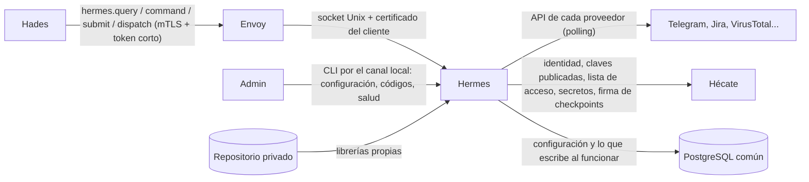
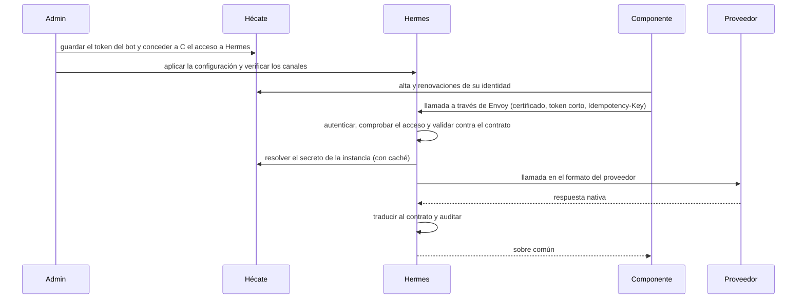

# Hermes — librerías de terceros con contrato

*En la mitología, el mensajero que viaja entre los mundos.* · Última revisión: 2026-11-16

Ver también: [ARCHITECTURE](../ARCHITECTURE.md) (visión transversal) · [GLOSSARY](../GLOSSARY.md) ·
[DECISIONS](../DECISIONS.md) · [Hades](hades.md) · [Hécate](hecate.md)

---

## Por qué existe

Los Playbooks de Hades necesitan servicios de terceros: avisar por un chat, abrir un ticket, consultar la reputación de
una IP o bloquear un dispositivo. Cada proveedor tiene su API, sus errores, sus límites y sus formas de responder. Si
cada Playbook hablara con cada proveedor, un cambio externo lo rompería, y cada integración resolvería a su manera los
reintentos, la idempotencia y los secretos.

Hermes reúne las librerías que envuelven esos servicios detrás de **contratos estándar por tipo de servicio**. Un
Playbook que usa el contrato de un tipo de servicio funciona igual con cualquier proveedor: cambiar Telegram por otro
chat no lo toca, y un cambio en la API del proveedor se arregla en su librería sin que los Playbooks se enteren.

**Por qué es una pieza aparte:** concentrar a los proveedores en un sitio con contratos propios protege a los Playbooks
de los cambios externos y obliga a seguir las mismas buenas prácticas en todas las integraciones.

## Qué hace y qué no hace

| Hace | No hace |
|---|---|
| Definir y mantener los contratos de cada tipo de servicio y de cada proveedor | Orquestar ni decidir (es de Hades) |
| Ejecutar llamadas síncronas y tasks contra los proveedores | Escuchar a Hades ni avisarle: Hades consulta |
| Guardar su configuración (instancias, plantillas, variables y contactos) y verificar los canales | Controlar el ruido (el control de avalanchas está aguas arriba) |
| Reintentar de forma segura, garantizar idempotencia y respetar los límites de cada instancia | Custodiar secretos (los custodia Hécate) |
| Auditar lo que cambia fuera y los datos que salen de casa | Ser paso obligatorio: una integración de Hades puede hablar con un tercero directamente |

## Quién lo usa

| Con quién | Qué hace con Hermes |
|---|---|
| **Hades** (Responses, Jobs, cronjobs), y cualquier componente con acceso | Llama a sus funciones, envía, consulta y cancela tasks, y pide las capacidades y la prueba de conexión de una instancia, siempre a través de Envoy; recibe el sobre común, con los datos del contrato, el estado de sus tasks o el de las instancias |
| **Envoy** | Presenta el certificado de Hermes, termina el TLS y le pasa cada llamada con el certificado del cliente en `X-Forwarded-Client-Cert` |
| **El admin** | Aplica y exporta la configuración entera, pide los códigos de verificación y consulta la salud, con la CLI de Hermes en su equipo |
| **Hécate** | Le da su certificado y sus renovaciones, las listas de revocación, las claves de firma de llamadas, su lista de acceso, los secretos de las instancias y de su base, y la firma de checkpoints |
| **El PostgreSQL común** | Guarda, en la base de Hermes, su configuración, la verificación de los canales, las claves de idempotencia, los `jti` usados y la auditoría |
| **Los proveedores** | Reciben las llamadas traducidas a su API; lo que llega a sus bots se recoge por polling |
| **El repositorio privado** | Trae las librerías de proveedor propias |

Hermes tiene dos superficies. La **API de servicios**, con el contrato común de Cerbero y su
[OpenAPI](../shared/contracts/src/cerbero_contracts/openapi/hermes.v1.json), solo se alcanza a través de Envoy. El
**canal local de administración** es un socket Unix en el equipo de Hermes, que usa la CLI `hermes`. Toda la
comunicación entre componentes es por API: Hades nunca lee los streams de Hermes, consulta.

## Cómo encaja todo

1. El admin guarda en Hécate los secretos de las instancias, como el token de un bot, da de alta a Hermes y concede el
   acceso a Hermes a cada componente que va a llamarlo.
2. Aplica la configuración entera con la CLI de Hermes y verifica cada canal: pide un código, y la persona se lo envía
   al bot.
3. Un componente dado de alta en Hécate llama a una función a través de Envoy, con su certificado, un token corto y una
   `Idempotency-Key`.
4. Hermes lo autentica, comprueba que está en su lista de acceso y valida la petición contra el contrato. Después, con
   el límite de la instancia y su secreto resuelto, llama al proveedor.
5. Traduce la respuesta al contrato, la deja en la auditoría con la clave de idempotencia y responde con el sobre común;
   un fallo del proveedor va dentro del sobre.

**Al arrancar,** Hermes abre sus dos sockets, así que la salud responde desde el principio, y sigue sus pasos: su
identidad, las publicaciones de Hécate con su lista de acceso, la contraseña de su base, la conexión, las migraciones,
la configuración, la prueba de cada instancia y el polling. No está listo hasta terminarlos; un paso que falla se
reintenta, y sin identidad espera a `hermes enroll`.

## Conceptos

- **[Contratos](hermes/contratos.md).** Hermes ordena los servicios en categoría, tipo de servicio, función, proveedor
  e instancia, con tres capas de datos: el sobre común, el contrato del tipo de servicio y el del proveedor. Nada del
  formato nativo del proveedor llega al Playbook. Cada función declara si consulta o cambia, su modo, qué cambia fuera
  y qué datos salen de casa, y la API se publica en OpenAPI 3.1, con la major en la ruta.
- **[Llamadas](hermes/llamadas.md).** Cada función tiene el modo nativo de su proveedor: síncrona, o una task
  event-sourced que Hades envía y consulta. Quien llama envía una clave de idempotencia, así que repetir una petición no
  repite su efecto; Hermes solo reintenta cuando es seguro, y ante un resultado ambiguo responde `outcome_unknown` en
  lugar de reintentar.
- **[Comunicación](hermes/comunicacion.md).** Los contactos, personas o grupos, con sus canales; las plantillas
  versionadas, que rellenan un mensaje neutral que cada proveedor dibuja a su manera; la verificación de cada canal con
  un código de un solo uso; y `chat.ask`, que pregunta con opciones cerradas y se completa con la primera respuesta
  válida.
- **[Configuración](hermes/configuracion.md).** Las instancias, las plantillas, las variables y los contactos viven en
  la base de Hermes, y el admin los aplica enteros desde un fichero YAML con la CLI: lectura estricta, validación
  completa antes de escribir nada, un plan que se confirma y una sola transacción. Cada instancia es una librería
  configurada, con referencias a sus secretos y su límite de uso.
- **[Proveedores](hermes/proveedores.md).** Cada proveedor lo implementa una librería, oficial en el repositorio de
  Cerbero o propia en el repositorio privado. Su manifiesto declara las funciones que implementa, sus capacidades, sus
  límites y los permisos que necesita, y la librería pasa la batería de conformidad de su tipo de servicio; un
  proveedor `fake` por tipo de servicio sirve para las pruebas.
- **[Seguridad](hermes/seguridad.md).** Frente a qué protege Hermes (alguien sin certificado, un componente sin acceso,
  un token robado, una petición que se salta el proxy, una fuga de secretos o de datos personales) y con qué: Envoy
  delante de un socket Unix, el certificado y el token corto de cada llamada, la lista de acceso que guarda Hécate, los
  secretos solo en memoria, la auditoría append-only y los logs enmascarados.

## Usarlo y desarrollarlo

- **[Integrar un componente](hermes/integracion.md).** Lo que hace un componente para llamar a Hermes sin leer su
  código: lo que necesita, cada llamada a través de Envoy, el token corto, la `Idempotency-Key`, el sobre y qué hacer
  con cada error, las capacidades, la prueba de conexión, los límites y cómo probar contra Hermes.
- **[CLI y variables de entorno](hermes/cli.md).** Cómo se lanza Hermes, qué necesita, cada variable de entorno y cada
  orden de la CLI, con sus argumentos, su salida y sus códigos de salida.
- **[Operación](hermes/operacion.md).** La puesta en marcha con Hécate, Envoy y el PostgreSQL común, la salud y un
  procedimiento paso a paso para cada situación: conceder el acceso, verificar un canal, rotar el token de un bot,
  Hécate sellada o caída, PostgreSQL caído, una instancia que falla, la identidad que deja de valer y restaurar una
  copia.
- **[Desarrollo](../hermes/README.md).** Las herramientas, la suite con Hécate real y Docker, el E2E, las
  comprobaciones de calidad, los ayudantes de pruebas y cómo se organiza el paquete.

## Ante fallos

| Qué falla | Efecto | Recuperación |
|---|---|---|
| Hermes | Hades no puede llamar a los servicios con contrato: el bloque falla y se reintenta según el Playbook. Las tasks ya aceptadas no se pierden | Hermes retoma las tasks no terminales desde su event store |
| Un proveedor | Hermes reintenta lo seguro; si no, devuelve `provider_unavailable`, `rate_limited` o `timeout` | El estado de la instancia lo refleja en `/v1/capabilities` |
| Hécate | Hermes sigue con la caché de secretos (hasta 1 h) y con las últimas publicaciones, su lista de acceso incluida: nadie gana el acceso ni lo pierde por ello, y quien no está en su copia recibe `unavailable`. Pasada la hora, las llamadas que necesitan un secreto fallan con `internal` | Desbloquear Hécate |
| Su base de datos | Hermes no está listo y los envíos responden `unavailable`: no envía nada que no pueda registrar | Nada: vuelve en cuanto la base responde |
| Su identidad (caducada, con otra CA o rechazada por Hécate, como tras una revocación urgente) | Hermes no está listo y lo dice. Nota el rechazo en la primera llamada que Hécate le rechaza, como mucho a los 240 s, y deja de llamar a Hécate con esa identidad | Un token de alta nuevo y `hermes enroll`, sin pararlo ([operación](hermes/operacion.md#la-identidad-de-hermes-deja-de-valer)) |

- El procedimiento de cada situación está en [operación](hermes/operacion.md). La salud dice si Hermes está listo o por
  qué no, y va por el canal local.
- **Avisos:** un cronjob de Hades consulta `/v1/capabilities` y emite señales (instancia caída, versión deprecada); un
  Playbook secundario avisa al maintainer.

## Decisiones y riesgos

Resumen; el detalle y el porqué están en [DECISIONS](../DECISIONS.md#hermes-frente-a-secops-soar-integraciones).

- **Frente a SecOps:** contratos estándar por tipología (en SecOps cada integración devuelve su propia salida); las
  librerías viven en un componente aparte, recomendado pero no obligatorio; integraciones de Hades que usan o extienden
  clases de Hermes en lugar de duplicarlas; `side_effect` y `discloses_data` descritos en cada contrato.
- **La clave de idempotencia** (SecOps SOAR no la tiene): el criterio de Stripe, guardar solo lo que se envió o pudo
  enviarse; frente al borrador de la IETF, otro cuerpo con la misma clave responde `conflict`, y una repetición con la
  primera en curso la espera
  ([DECISIONS](../DECISIONS.md#la-clave-de-idempotencia-de-hermes-frente-a-stripe-y-al-borrador-de-la-ietf)).
- **Tomadas:** FastAPI detrás de Envoy, con la base en SQLAlchemy Core y Alembic
  ([ADR 0011](adr/0011-pila-hermes.md)); un PostgreSQL común con una base por app
  ([ADR 0012](adr/0012-persistencia-postgresql-comun.md)); el acceso por app en Hécate, sin permisos en el token
  ([ADR 0013](adr/0013-acceso-por-app.md)); lo que guarda la clave de idempotencia, solo lo que se envió o pudo
  enviarse ([ADR 0014](adr/0014-clave-de-idempotencia-hermes.md)).
- **Riesgos aceptados:** el token ligado a la identidad que declara el proxy, y los secretos en la memoria de Python,
  que no se pueden borrar ([seguridad](hermes/seguridad.md#lo-que-no-cubre-y-los-riesgos-aceptados)).
- **Descartado:** Hermes como frontera obligatoria; payload nativo del proveedor en el Playbook; convertir modos;
  webhooks; control de ruido en Hermes; ejecución remota.
- **Observabilidad** con OpenTelemetry: trazas Hades → Hermes → proveedor; métricas por servicio, función, proveedor e
  instancia (latencia, errores, reintentos, límites alcanzados, duración de las tasks); logs con `correlation_id`,
  `causation_id`, `task_id` y clave de idempotencia. La decisión común está entre las
  [abiertas](../DECISIONS.md#abiertas).

## Preguntas frecuentes

**¿Qué pasa si cambio de proveedor de chat?**
Si el Playbook solo usa el contrato del tipo de servicio, nada. Si el nuevo proveedor tiene otro modo o campos
distintos, cambia el API Contract (major) y el registro de Playbooks señala los que hay que adaptar
([contratos](hermes/contratos.md#el-contrato-de-una-función)).

**¿Por qué el Playbook no puede usar la respuesta original del proveedor?**
Porque lo ataría a ese proveedor y a su API: cualquier cambio externo lo rompería sin aviso. Si hace falta un dato, se
añade al contrato ([las tres capas](hermes/contratos.md#las-tres-capas-de-datos)).

**¿Qué pasa si el proveedor tarda mucho?**
Si su función es síncrona, vence el timeout técnico y el sobre lo dice. Si es una task, Hades la consulta hasta que
termina, vence su `timeout` o se cancela ([timeouts](hermes/llamadas.md#los-timeouts)).

**¿Y si Hermes se cae a mitad de una task?**
La task está en el event store: al volver, Hermes la retoma ([la task](hermes/llamadas.md#la-task)).

**¿Puede repetirse un bloqueo por un reintento?**
No: la clave de idempotencia lo evita, y Hermes no reintenta cuando no sabe si la petición se ejecutó
(`outcome_unknown`) ([idempotencia](hermes/llamadas.md#la-idempotencia)).

**¿Por qué no hay webhooks?**
Se descartaron: todo lo que llega del proveedor se obtiene por polling
([descartado](../DECISIONS.md#descartado-en-hermes)).

**¿Qué pasa si dos personas pulsan a la vez?**
La primera respuesta válida completa la task; la segunda recibe «ya respondido por X»
([`chat.ask`](hermes/comunicacion.md#preguntar-con-opciones-cerradas-chatask)).

**¿Dónde están los tokens de los bots?**
En Hécate. La instancia solo guarda la referencia `secret://` ([instancias](hermes/configuracion.md#las-instancias)).

**¿Cómo cambio un contacto o una plantilla?**
Editando el fichero de la configuración y aplicándolo con `hermes config apply`: la CLI enseña los cambios antes de
aplicarlos. Una versión de plantilla no cambia: se añade otra
([configuración](hermes/configuracion.md#el-plan-y-la-aplicación)).

**¿Por qué la salud no está en la API?**
Porque ninguna API interna acepta llamadas sin autenticar, y un healthcheck no tiene certificado: va por el canal
local, como en Hécate ([la salud](hermes/cli.md#las-órdenes)).

## Referencias

- Google SecOps SOAR: [Support multiple instances][soar-1] · [Use the IDE][soar-2] ·
  [Build custom integrations][soar-3] · [Create custom actions][soar-4]
- [Shuffle python-apps](https://github.com/Shuffle/python-apps) (categorías de apps)
- OpenC2: [Actuator Profile for Packet Filtering](https://docs.oasis-open.org/openc2/ap-pf/v1.0/ap-pf-v1.0.html)
  (acción + objetivo, descubrimiento de capacidades)
- [Telegram Bot API](https://core.telegram.org/bots/api)
- Envoy: [`X-Forwarded-Client-Cert`][xfcc]

[soar-1]: https://docs.cloud.google.com/chronicle/docs/soar/respond/integrations-setup/supporting-multiple-instances
[soar-2]: https://docs.cloud.google.com/chronicle/docs/soar/respond/ide/using-the-ide
[soar-3]: https://docs.cloud.google.com/chronicle/docs/soar/respond/ide/building-a-custom-integration
[soar-4]: https://docs.cloud.google.com/chronicle/docs/soar/respond/ide/creating-a-custom-action
[xfcc]: https://www.envoyproxy.io/docs/envoy/latest/configuration/http/http_conn_man/headers#x-forwarded-client-cert
