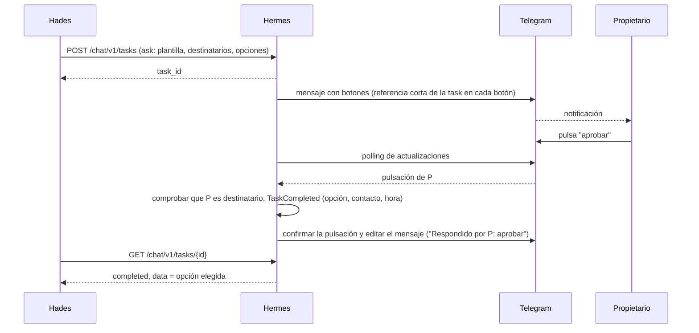

# Comunicación en Hermes

Cómo habla Hermes con las personas: los contactos y sus canales, las plantillas y sus variables, el mensaje neutral, la
verificación de un canal y `chat.ask`. Es para quien quiere entender o revisar el diseño; el fichero que lo aplica está
en [configuración](configuracion.md), y cómo dibuja cada proveedor el mensaje, en [proveedores](proveedores.md).

## Los contactos y sus canales

- **Una persona:** un contacto con sus canales. Cada canal dice su servicio, su proveedor, su instancia, su dirección y
  si está verificado ([la verificación](#la-verificación-de-un-canal)).
- **Un grupo:** un contacto con miembros y una entrega `shared_chat` (un mensaje al grupo) o `fan_out` (uno por
  miembro).
- **Hades solo maneja referencias:** nombra al contacto, nunca su dirección.
- `chat.send_message` va a un solo contacto por petición, aunque su contrato recibe una lista
  ([contratos](contratos.md#chatsend_message)).

## Las plantillas y sus variables

- **Plantilla:** un id con versiones. Cada versión es un JSON Schema de sus datos y los textos del mensaje neutral, con
  `${data.<ruta>}` y `${vars.<variable>}`.
- **Una versión no cambia** una vez creada: para cambiarla se añade otra. Quien llama elige la versión, o la última si
  no dice ninguna.
- **Variable de plantilla:** un valor de la configuración, como la URL de la consola, que las plantillas usan sin que
  quien llama lo envíe.

## El mensaje neutral

Las plantillas rellenan un modelo neutral de mensaje, que cada proveedor dibuja según sus capacidades:

```json
{ "title": "Dispositivo desconocido en la red", "severity": "high", "summary": "...",
  "facts": [{ "label": "MAC", "value": "..." }], "actions_done": ["..."],
  "expected": "Aprobar o denegar el bloqueo", "link": "https://.../cases/case-1234" }
```

- **`severity`** es `info`, `low`, `medium`, `high` o `critical`.
- **Si no cabe**, el proveedor recorta el detalle: primero los hechos, desde el último; después las acciones, desde la
  última; y por último acorta el resumen. Conserva siempre el título y el enlace al Case.
- **La respuesta dice si recortó** (`truncated`).
- Telegram lo dibuja en HTML escapado ([proveedores](proveedores.md)).

## La verificación de un canal

Un canal no recibe mensajes hasta que la persona demuestra que es suyo; un envío a un canal sin verificar responde
`conflict`.

1. **El admin pide un código** para el canal de un contacto en una instancia, con `hermes contacts code`
   ([CLI](cli.md)). El canal queda sin verificar y sin dirección hasta que llega el código.
2. **El código** tiene 8 caracteres del alfabeto de Crockford sin I, L, O ni U, se enseña como `XXXX-XXXX` y se compara
   sin distinguir mayúsculas y sin espacios ni guiones. Hermes solo guarda su SHA-256, y vale 30 minutos por defecto
   (la variable `HERMES_VERIFICATION_CODE_MINUTES`).
3. **La persona lo envía al bot** desde su cuenta.
4. **El polling de la instancia** lo recoge en un chat privado, liga el canal a ese chat y lo marca verificado.
   Hermes le contesta «Canal verificado.».

- Un código caducado, usado o desconocido no hace nada ni recibe respuesta.
- Un canal que se borra o cambia de instancia en la configuración pierde su verificación
  ([configuración](configuracion.md#el-plan-y-la-aplicación)).
- La dirección solo vive en la base de Hermes ([seguridad](seguridad.md#los-datos-personales)).

## Preguntar con opciones cerradas (`chat.ask`)

`chat.ask` pregunta a uno o varios contactos con opciones cerradas, como una task ([llamadas](llamadas.md#la-task)):

- **Responden solo los destinatarios**, y la identidad de quien responde se traduce a su contacto.
- **La primera respuesta válida completa la task**, con la opción, el contacto y la hora, y las siguientes
  reciben «ya respondido por X».
- **Al resolverse, cancelarse o caducar** se edita el mensaje o se envía uno de seguimiento.

Un ejemplo: preguntar al propietario por Telegram.



## Relacionado

- [Hermes](../hermes.md): el documento de alto nivel.
- [Configuración](configuracion.md): el fichero con los contactos y las plantillas.
- [Proveedores](proveedores.md): cómo dibuja cada proveedor el mensaje.
- [Llamadas](llamadas.md): la task de `chat.ask`.
