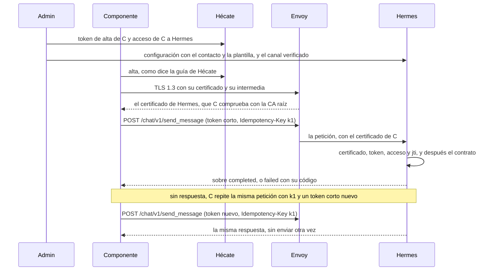

# Integrar un componente con Hermes

Lo que tiene que hacer un componente de Cerbero para llamar a Hermes: lo que necesita antes de la primera llamada, cada
llamada a través de Envoy con su token corto, la `Idempotency-Key`, el sobre y qué hacer ante cada error, las
capacidades y la prueba de conexión, los límites, las operaciones y cómo probarlo contra Hermes. Es para quien
desarrolla otro componente. No lleva código: los esquemas exactos están en el
[contrato de la API](../../shared/contracts/src/cerbero_contracts/openapi/hermes.v1.json), con el sobre común de
[`common.v1.json`](../../shared/contracts/src/cerbero_contracts/openapi/common.v1.json), y el cliente de referencia de
las pruebas hace lo que describe para enviar: el alta, el token corto de cada llamada y el envío con su clave
([cómo probarlo](#probar-un-componente-contra-hermes)).

## Lo que necesita antes de la primera llamada

| Qué | Para qué |
|---|---|
| Su **identidad de Hécate**: el certificado con su intermedia, su clave TLS y su clave de firma de llamadas, con el `kid` que le dio Hécate | Presentarse en mTLS y firmar el token corto de cada llamada. El alta, la renovación y lo que refresca están en la [guía de integración de Hécate](../hecate/integracion.md) |
| El **acceso a Hermes**, que le concede el admin en Hécate con `hecate access grant <identidad> hermes` ([CLI de Hécate](../hecate/cli.md#acceso-por-app)) | Sin él, Hermes responde `auth`. Una concesión vale desde la llamada siguiente, y una retirada, como mucho a los 240 s |
| La **CA raíz de Cerbero**, la de la cadena de su alta | Reconocer el certificado de Hermes, que presenta Envoy |
| La **dirección de Envoy** | La que fija el despliegue; en el compose de pruebas, `127.0.0.1:9443`, o `127.0.0.1:19443` con `compose.test.yaml` |
| Los **nombres que usa**: el contacto, la plantilla con su versión y el esquema de sus datos y, si hace falta, la instancia | Los pone el admin en la [configuración](configuracion.md) de Hermes, con el canal del contacto ya [verificado](comunicacion.md#la-verificación-de-un-canal) |

## El flujo completo



## Cada llamada

- **TLS 1.3**, con HTTP/1.1 o HTTP/2, a la dirección de Envoy, con su certificado y la intermedia que lo firmó. Antes
  de enviar nada, comprueba que el certificado que presenta Envoy encadena con la CA raíz de Cerbero y que su único
  nombre es el SPIFFE ID de Hermes, `spiffe://<trust domain>/hermes`.
- **Un token corto** nuevo en cada llamada, en `Authorization: Bearer <token>`: un JWT compacto con la cabecera
  `{"alg": "EdDSA", "typ": "JWT", "kid": "<call_key_id>"}`, firmado con su clave de firma de llamadas. El `kid` es el
  de esa clave, el que le dio Hécate con su certificado.

| Claim | Regla |
|---|---|
| `iss` | Su SPIFFE ID, el mismo que el del certificado de la conexión |
| `aud` | El SPIFFE ID de Hermes: `spiffe://<trust domain>/hermes` |
| `iat`, `exp` | Segundos Unix enteros; `exp - iat` de 300 s como mucho, con 30 s de margen entre relojes |
| `jti` | De 1 a 128 caracteres ASCII imprimibles, distinto en cada llamada: Hermes no acepta dos veces el mismo `jti` de una identidad, tampoco tras reiniciar |
| `cerbero_audit` | Opcional: el contexto de auditoría, un objeto de hasta 16 claves de texto (de 1 a 64 caracteres) con valores de texto (hasta 256 caracteres), de 2 KiB como mucho. Hermes lo guarda tal cual en la auditoría del envío; con otra forma, responde `validation` |

- **Hermes ignora el resto de claims:** lo que diga el token sobre permisos, roles o accesos no cuenta.
- **Lo que comprueba Hermes**, por orden: el certificado (la cadena, su nombre, su caducidad y la revocación), la firma
  del token con una clave activa de esa identidad, `iss`, `aud` y los tiempos, la lista de acceso y el `jti`. Si la
  clave es nueva, porque quien llama se acaba de dar de alta o de renovar, se la pide a Hécate. Cualquier fallo
  responde `auth`, con el mismo mensaje; el diseño está en [seguridad](seguridad.md#la-autenticación-y-el-acceso).
- **`X-Request-Id`**, opcional, de 1 a 128 caracteres ASCII imprimibles: Hermes lo repite en `meta.request_id`, o
  genera uno, y lo lleva cada línea de su log, así que basta para rastrear una llamada.
- **El cuerpo**, en JSON (`Content-Type: application/json`). El de `chat.send_message` lleva `recipients` (una
  lista con un solo contacto), `template` (`id` y, si se fija, `version`; sin ella, la última), `data` (que cumple el
  esquema de esa versión) e `instance` (si el contacto tiene varios canales de chat).

## La `Idempotency-Key`

Obligatoria en `POST /chat/v1/send_message`: de 1 a 128 caracteres ASCII imprimibles, una por envío. Sin ella, o con
otra forma, `validation`.

- **Es de quien llama:** Hermes la guarda con su identidad, así que dos componentes pueden usar la misma sin chocar.
- **La clave guarda lo que se envió o pudo enviarse:** un envío completado, o un `timeout` con `outcome_unknown`.
- **Repetir la misma petición** (la misma clave con el mismo cuerpo, que se compara como JSON, sin importar el orden de
  sus campos ni los espacios) devuelve esa respuesta, con el `request_id` y la duración de la repetición, sin volver a
  enviar; también si las dos llegan a la vez.
- **La misma clave con otro cuerpo** responde `conflict` mientras la clave guarda otra petición; tras un fallo sin
  envío o antes del proveedor, es una petición nueva.
- **Tras un corte** que dejó la petición a medias, la repetición responde `timeout` con `outcome_unknown: true`, sin
  volver a enviar: el mensaje puede haber llegado.
- **Una petición que falla sin enviar nada no deja la clave:** la que falla antes de llegar al proveedor (un contacto
  que faltaba, un canal sin verificar o el límite de la instancia) y la que el proveedor no llega a ejecutar (no
  conecta, pide esperar más de lo que cabe, rechaza las credenciales o la petición, o la persona no admite el bot). Se
  repite con la misma clave tras esperar lo que diga el error o tras corregir su causa, y cada intento que llega al
  proveedor deja su entrada de auditoría.
- **Hermes guarda cada clave 24 horas**; una repetición pasado ese tiempo es una petición nueva.
- Si quien llama corta antes de recibir la respuesta, no sabe si el mensaje llegó: repite la misma petición con la
  misma clave. El diseño está en [llamadas](llamadas.md#la-idempotencia).

## El sobre y los errores

Toda respuesta va en el sobre común. Un envío completado:

```json
{
  "status": "completed",
  "data": {
    "recipient": "propietario", "instance": "family_bot", "provider_message_ref": "4521",
    "sent_at": "2026-11-16T18:40:02.120000Z", "truncated": false
  },
  "error": null,
  "meta": {
    "request_id": "...", "duration_ms": 412, "service": "chat", "provider": "telegram", "idempotency_key": "..."
  }
}
```

- **Con `completed`**, `error` es `null` y `data` lleva el resultado. **Con `failed`**, `error` dice el código, un
  mensaje sin secretos y si vale reintentar (`retryable`), y además `retry_after_s` si hay que esperar y
  `outcome_unknown` con `timeout`. Si la petición no cumple su contrato, `data.errors` dice cada fallo con su ruta y su
  motivo.
- **Un fallo del proveedor** llega en un 200 con el sobre `failed`: el estado HTTP dice si la petición llegó al
  proveedor, y el sobre, cómo acabó. La espera de un `rate_limited` del proveedor va en `retry_after_s`, sin la
  cabecera `Retry-After`.

| Código | HTTP | Cuándo | ¿Reintentar? | Qué hace quien llama |
|---|---|---|---|---|
| `validation` | 400 | El cuerpo no es JSON estándar o pasa de 64 KiB, faltan o sobran campos, falta la `Idempotency-Key` o una cabecera no sigue su regla, `cerbero_audit` no sigue la suya, los datos no cumplen el esquema de la versión de la plantilla o un texto del mensaje no cumple su regla con ellos, el contacto tiene varios canales de chat y la petición no dice la instancia, o el nombre de la instancia que se prueba no es válido | No | Corregir la petición |
| `auth` | 401 | El certificado o el token corto no valen, o quien llama no está en la lista de acceso de Hermes | No | Revisar sus credenciales y pedir al admin el acceso; si su certificado ya no vale, pedirle un token de alta nuevo |
| `not_found` | 404 | La plantilla, la versión, la instancia o el contacto no existen, o el contacto no tiene canal en esa instancia; o la ruta o el método no son una operación | No | Revisar los nombres con el admin |
| `conflict` | 409 | El canal del contacto no está verificado, o la `Idempotency-Key` ya guarda otra petición | No | Pedir al admin que verifique el canal; usar otra clave para una petición distinta |
| `conflict` | 200 | La persona no admite mensajes del bot | No | Avisar al admin: la persona tiene que volver a admitir los mensajes del bot; después, repetir con la misma clave |
| `rate_limited` | 429, con `Retry-After` | La instancia agotó su límite de uso; la petición no llegó al proveedor | Sí | Esperar `retry_after_s` y repetir con la misma clave |
| `rate_limited` | 200 | El proveedor pide esperar más de lo que cabe en el timeout de la función | Sí | Esperar `retry_after_s` y repetir con la misma clave |
| `provider_unavailable` | 200 | El proveedor no responde o falla sin haber hecho nada, o rechaza la petición o las credenciales de la instancia | Según `retryable`: sí en el primer caso, no en el segundo | Con `retryable`, reintentar más tarde con la misma clave; sin él, avisar al admin y, arreglada la causa, repetir con la misma clave |
| `timeout` | 200 | No se sabe si el mensaje llegó (`outcome_unknown`), también tras un fallo inesperado de Hermes al llamar al proveedor | No | No reenviar sin más: con la misma clave recibe lo mismo, y con otra puede duplicar el mensaje |
| `unavailable` | 503 | Hermes no está listo, su base no responde, o Hécate no responde cuando Hermes la necesita para autenticar (una clave de firma nueva, o la lista de acceso cuando quien llama no está en su copia) | Sí | Reintentar más tarde con la misma clave |
| `internal` | 500 | Un fallo inesperado antes de llegar al proveedor, o el secreto de la instancia pasado su tiempo duro (Hécate lleva más de una hora sin responder) | Sí | Reintentar más tarde con la misma clave |

El orden en que Hermes hace estas comprobaciones está en [contratos](contratos.md#chatsend_message).

## Las capacidades y la prueba de conexión

`GET /v1/capabilities` dice, por tipo de servicio (con su categoría y la versión de su contrato), los proveedores con
su versión, las funciones de cada uno (`kind`, `mode` y `timeout_s`) y sus instancias con su estado; nunca contactos ni
direcciones.

| Estado | Qué dice |
|---|---|
| `healthy` | No falló ninguna de las diez llamadas últimas ni la última prueba de conexión |
| `degraded` | Falló alguna de las diez llamadas últimas |
| `unavailable` | Falló la última prueba, el proveedor rechazó sus credenciales (hasta que una prueba funcione) o fallaron las tres llamadas últimas |

- **Cuenta como fallo** que el proveedor no responda, no conteste a tiempo o rechace las credenciales; un límite del
  proveedor o una persona que no admite el bot no cuentan.
- **El estado vive en memoria:** Hermes prueba cada instancia al arrancar.
- **`POST /v1/instances/{name}/test`** prueba con el proveedor que las credenciales de la instancia funcionan, sin
  cambiar nada fuera, así que no lleva `Idempotency-Key`. Responde `instance`, `status` (el estado tras la prueba) y
  `checked_at`; un fallo del proveedor va dentro del sobre, en un 200, y deja la instancia en `unavailable`.
- **Cuándo probar:** cuando el estado de una instancia es `unavailable` porque el proveedor rechazó sus credenciales,
  que solo deja atrás una prueba que funciona, o tras rotar sus credenciales ([operación](operacion.md)).

## Límites

| Límite | Valor |
|---|---|
| Transporte | TLS 1.3, HTTP/1.1 o HTTP/2, a través de Envoy |
| Cuerpo de una petición | JSON estándar en UTF-8, hasta 64 KiB |
| `Idempotency-Key`, `X-Request-Id` y `jti` | De 1 a 128 caracteres ASCII imprimibles |
| Vida del token corto | 300 s como mucho, con 30 s de margen entre relojes |
| `cerbero_audit` | Hasta 16 claves de 1 a 64 caracteres, con valores de hasta 256, y 2 KiB en total |
| Destinatarios de `chat.send_message` | Exactamente uno por petición |
| Límite de uso de cada instancia | El de su librería (30 por minuto en Telegram), ajustable de 1 a 600 por minuto |
| Timeout técnico de `chat.send_message` | 10 s |
| Vida de una `Idempotency-Key` | 24 horas |

## Operaciones

Las tres de la versión 1; los esquemas de cada una están en el
[contrato de la API](../../shared/contracts/src/cerbero_contracts/openapi/hermes.v1.json).

| Operación | Propósito | Autenticación | `Idempotency-Key` |
|---|---|---|---|
| `POST /chat/v1/send_message` (`sendMessage`) | Enviar un mensaje a un contacto por un canal de chat verificado | Certificado + token corto, con acceso | Obligatoria |
| `GET /v1/capabilities` (`getCapabilities`) | Los tipos de servicio, los proveedores, sus funciones y sus instancias, con el estado de cada una | Certificado + token corto, con acceso | — |
| `POST /v1/instances/{name}/test` (`testInstance`) | Probar las credenciales de una instancia con su proveedor y actualizar su estado | Certificado + token corto, con acceso | — |

La salud de Hermes no está en la API: va por su canal local ([CLI](cli.md)).

## Probar un componente contra Hermes

- **El compose de `hermes/deploy/`:** PostgreSQL, una Hécate de pruebas, Hermes y Envoy. Con `compose.test.yaml`,
  Hermes carga el proveedor `fake` y deja sus bandejas en `HERMES_FAKE_DIR`. Es un entorno de pruebas: no fija cómo
  corre Hermes en el home lab. Cómo se pone en marcha está en [operación](operacion.md).
- **Las bandejas del fake** dejan ver lo que se envió y hacer de la persona que envía su código; su formato está en
  [proveedores](proveedores.md#el-proveedor-fake).
- **El cliente de referencia** de las pruebas (`hermes/tests/support/caller.py`) llama como un componente: se da de
  alta en la Hécate de pruebas con el token que lee de la entrada estándar (`enroll`), firma un token corto por llamada,
  con `cerbero_audit` si se le da, y comprueba que Envoy presenta el certificado de Hermes. `send` envía un mensaje con
  su clave y escribe el sobre, y `bench` envía varios, cada uno con su clave, y dice cuánto tardaron. Cómo se ejecuta
  en el compose está en [operación](operacion.md#el-compose-de-pruebas).

## Relacionado

- [Hermes](../hermes.md): el documento de alto nivel.
- [Contratos](contratos.md): el sobre, los códigos y el contrato de `chat.send_message`.
- [Llamadas](llamadas.md): la idempotencia y los reintentos desde el lado de Hermes.
- [Seguridad](seguridad.md): el diseño de la autenticación y el acceso.
- [Integrar un componente con Hécate](../hecate/integracion.md): la identidad que usa cada llamada.
