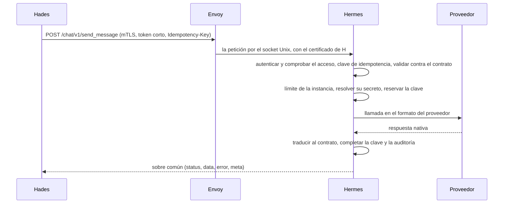
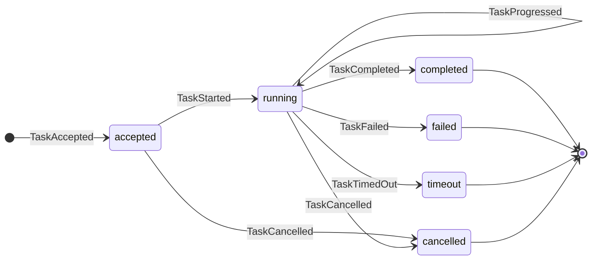

# Llamadas a Hermes

Cómo atiende Hermes una llamada: síncrona o como task, con su idempotencia, sus reintentos seguros, el resultado
desconocido y sus timeouts. Es para quien quiere entender o revisar el diseño; lo que hace quien llama está en la
[guía de integración](integracion.md), y el contrato de cada función, en [contratos](contratos.md).

## Síncrona o task

Cada función tiene el modo nativo de su proveedor, sin conversiones
([contratos](contratos.md#el-contrato-de-una-función)):

- **síncrona** (`sync`): Hermes responde cuando el proveedor ha contestado, dentro del timeout de la función;
- **task** (`task`): una petición asíncrona en curso, que Hades envía y consulta, para lo que tarda (una pregunta a una
  persona puede durar días).

## La llamada síncrona



La autenticación y el acceso están en [seguridad](seguridad.md#la-autenticación-y-el-acceso), el límite de cada
instancia en [configuración](configuracion.md#las-instancias), y la auditoría en
[seguridad](seguridad.md#la-auditoría).

## La task

Una petición asíncrona en curso, event-sourced: el stream de la task es su historia, y una proyección, `task-status`,
responde a las consultas (Event Sourcing y CQRS).



```text
API ─ persiste TaskAccepted (+ outbox) ─▶ cola ─▶ worker: adapter ─▶ TaskStarted / TaskProgressed
                                                   polling al proveedor ─▶ TaskCompleted | TaskFailed | TaskTimedOut
GET /{service}/v1/tasks/{id} ◀── proyección task-status
```

- **Enviar:** `POST /{service}/v1/tasks` devuelve `{ task_id, stream, status: accepted }`.
- **Consultar:** `GET /{service}/v1/tasks/{task_id}` devuelve el sobre con el estado.
- **Cancelar:** `DELETE /{service}/v1/tasks/{id}` deja `TaskCancelled` (p. ej. al cerrarse el Case).
- **Los estados terminales no cambian.** Hermes guarda el estado de una task solo cuando quien llama la va a seguir
  (`submit`); un `dispatch` no deja estado consultable.
- **La cola** vive sobre la propia base de datos. Al reiniciar se retoman las tasks no terminales.
- **Retención:** las tasks terminadas se conservan un tiempo configurable, 30 días por defecto; el resultado queda
  también en el stream de la Response de Hades.
- El ejemplo de una task con Telegram, preguntar al propietario, está en
  [comunicación](comunicacion.md#preguntar-con-opciones-cerradas-chatask).

## La idempotencia

Quien llama envía la cabecera `Idempotency-Key`, de 1 a 128 caracteres ASCII imprimibles, que es suya: Hermes la guarda
con su identidad, así que dos componentes pueden usar la misma clave sin chocar.

- **La misma clave con el mismo cuerpo** devuelve la misma respuesta, también si las dos peticiones llegan a la vez, sin
  repetir el efecto.
- **La misma clave con otro cuerpo** responde `conflict` mientras la clave guarda otra petición, como fija el contrato
  común; tras un fallo sin envío o antes del proveedor, es una petición nueva.
- **La reserva:** la clave se reserva justo antes de llamar al proveedor. Se completa con lo que se envió o pudo
  enviarse, un envío completado o un `timeout` con `outcome_unknown`, en la misma transacción que la entrada de
  auditoría. Un fallo que garantiza que no se envió nada la libera, también en la misma transacción que su entrada, y
  una petición que falla antes de llegar al proveedor no llega a reservarla: las dos se repiten con la misma clave
  ([ADR 0014](../adr/0014-clave-de-idempotencia-hermes.md)). Si la base no responde al liberarla, la clave sigue
  reservada, como tras un corte.
- **Un corte** que deja una clave a medias hace que la repetición responda `timeout` con `outcome_unknown`, sin volver a
  enviar. La reserva guarda la entrada de auditoría del envío con ese resultado, así que el envío queda atribuido aunque
  el corte se lleve su registro: la escribe la repetición o, si nadie repite la petición, la limpieza de las claves.
- **Las claves se conservan 24 horas**; después, la limpieza las borra.

## Los reintentos seguros

- **Solo si es seguro:** Hermes reintenta cuando el fallo garantiza que no se ejecutó (no conecta, o el proveedor limita
  sin actuar), o cuando la función es idempotente en el proveedor.
- **Las esperas:** exponenciales con jitter completo, con una base de 0,2 s y un tope de 2 s. Hermes respeta el tiempo
  que pida el proveedor y no pasa del timeout técnico de la función.
- **Si la espera del proveedor no cabe** en ese timeout, responde `rate_limited` con ese tiempo; si se acaba el tiempo
  sin conectar, `provider_unavailable`.
- **Hades** solo reintenta un bloque si el sobre dice `retryable`, y lo hace con la misma clave: un fallo `retryable`
  garantiza que no se envió nada, así que no deja la clave ([la idempotencia](#la-idempotencia)).

## El resultado desconocido

Ante un resultado ambiguo (p. ej. un corte después de enviar algo con efecto, un 5xx al enviar o un fallo inesperado de
Hermes mientras llama al proveedor), Hermes no reintenta: devuelve `timeout` con `retryable: false` y
`outcome_unknown: true`, y la clave lo guarda. Repetir la misma petición con la misma clave no vuelve a enviar: responde
lo mismo.

## Los timeouts

- Cada función declara su timeout técnico: segundos en las síncronas (10 s en `chat.send_message`), y una duración
  máxima en las tasks (un `chat.ask` puede durar días). Si vence el de una task, `TaskTimedOut`.
- El SLA es solo de Hades, y el `timeout` de un `submit.result` de Hades no cancela la task.

## Relacionado

- [Hermes](../hermes.md): el documento de alto nivel.
- [Contratos](contratos.md): el sobre y el contrato de cada función.
- [Comunicación](comunicacion.md): `chat.ask`, una task con personas.
- [Integrar un componente](integracion.md): las llamadas desde el lado de quien llama.
