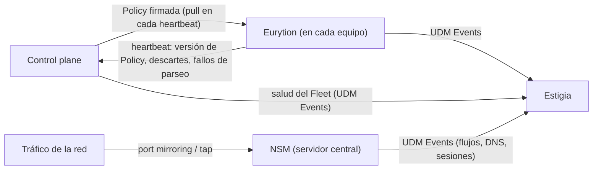
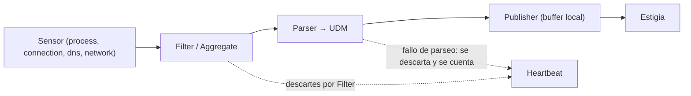
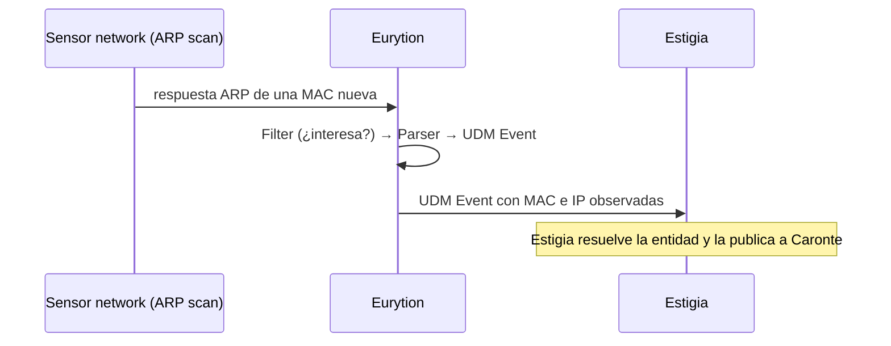

# Orthros — SIEM virtual (seguridad de red)

*En la mitología, el perro de dos cabezas, hermano de Cerbero, que guardaba el rebaño de Gerión junto al pastor Euritión.* · Estado: diseñado · Última revisión: 2026-11-01

Ver también: [ARCHITECTURE](../ARCHITECTURE.md) (visión transversal y [contrato UDM](../ARCHITECTURE.md#4-contrato-udm)) · [GLOSSARY](../GLOSSARY.md) · [DECISIONS](../DECISIONS.md) · [Estigia](estigia.md)

---

## 1. Propósito y frontera

Orthros vigila el dominio digital de la casa con sus dos cabezas: una mira **desde dentro de cada equipo** (los agentes Eurytion) y la otra mira **la red entera** (el NSM). Todo lo que observa lo reduce y lo parsea a UDM en origen, y lo entrega a Estigia.

| Hace | No hace |
|---|---|
| Gestionar el Fleet de agentes y sus Policies (control plane) | Detectar con Rules: eso es de Caronte |
| Observar procesos, conexiones, DNS y la red local en cada equipo | Decidir ni actuar |
| Analizar el tráfico de toda la red (NSM) | Enviar Raw Logs ni paquetes: solo viajan UDM Events |
| Filtrar, agregar y parsear a UDM en el borde | Reprocesar lo que no se parseó en su momento |
| Observar desde la red los equipos sin agente (móviles) | |
| Publicar en Estigia los hechos de salud del Fleet (control plane) | |

**Por qué es una pieza aparte (y la diferencia con SecOps):** las cabezas producen UDM de forma nativa en lugar de delegar el parseo a la plataforma. Reducir en origen ahorra red y almacenamiento, y deja el dato normalizado desde el principio.

---

## 2. Contexto



| Pieza | Qué recibe | Qué entrega |
|---|---|---|
| **Control plane** | Heartbeats de los Eurytion | Policies firmadas por Profile; hechos de salud del Fleet a Estigia (UDM Events) |
| **Eurytion** | Su Policy; lo que observan sus Sensors | UDM Events a Estigia; heartbeat al control plane |
| **NSM** | Una copia del tráfico de la red | UDM Events a Estigia |

Relación con Estigia: **Published Language** (UDM). El parser de cada cabeza es su frontera de traducción.

---

## 3. Conceptos

| Concepto | Qué es |
|---|---|
| **Eurytion** (Agent) | Proceso residente en un equipo que recolecta, filtra, parsea y envía UDM Events a Estigia. En la mitología, el pastor del rebaño junto a Orthros |
| **Sensor** | Capacidad de observación enchufable (process, connection, dns, network...), con una implementación por sistema operativo |
| **Profile** | Tipología de equipo (Linux, macOS, Windows, Android, iOS, IoT...). Determina qué Policy recibe un Agent |
| **Policy** | Configuración versionada y firmada para un Profile: Flags, Filters, Aggregations y Parsers |
| **Flag** | Activa o desactiva un Sensor dentro de una Policy |
| **Filter / Aggregation** | Descartar en el Agent datos de bajo valor / resumir eventos repetidos en uno con contador |
| **Parser** | Regla declarativa de mapeo de un Raw Log al UDM; se define en Orthros y se ejecuta en el Agent |
| **Fleet** | Conjunto de Agents y su gestión (enrollment, heartbeat, drift) |
| **Heartbeat** | Señal periódica del Agent: está vivo, qué Policy aplica y cuánto ha descartado |
| **Drift** | Desfase entre la Policy publicada para un Profile y la que aplica un Agent |
| **Agentless** | Profile de equipos sin agente (p. ej. móviles), observados desde la red |

---

## 4. Cómo funciona

### Control plane y Policies

```text
ORTHROS (control plane)                          Eurytion (Profile "macOS")
Profile "macOS" → Policy v7 (firmada):  ─pull─▶  Sensors según Flags
  · flags: process ✓ connection ✓ dns ✓          Filters / Aggregations
  · filters / aggregations                       Parsers (como datos) → UDM
  · parsers (declarativos, versionados)                   │
        ◀── heartbeat: "aplico v7, descartados N" ──      └──▶ ESTIGIA (directo)
```

- **El control plane no está en el camino de los datos:** los Eurytion envían directamente a Estigia. Lo único que publica el control plane en Estigia son los hechos de salud del Fleet.
- **Salud del Fleet:** el control plane recibe los heartbeats y publica en Estigia, como UDM Events, lo que observa: un agente silencioso (sin heartbeat durante un plazo configurable), el resumen de descartes por Filter y de fallos de parseo de cada heartbeat, y el drift. Publica hechos, no juicios: si un descarte es anómalo lo decide una Rule de Caronte.
- **Las Policies son datos, no código:** cambiar un Filter, un Parser o un Flag no exige redesplegar los Eurytion.
- **Versionadas y firmadas:** Eurytion rechaza las que no reconoce.
- **Pull:** Eurytion pregunta por la Policy nueva en cada heartbeat. Funciona detrás de NAT y en equipos que se apagan.

### Eurytion: el pipeline



```text
Eurytion
├── Core (no cambia al añadir capacidades)
│   ├── lifecycle    → arranque, parada, salud
│   ├── policy       → aplica la Policy recibida (verificación de firma)
│   ├── heartbeat    → vida, versión de Policy, métricas de descarte y de parseo
│   └── publisher    → buffer local + envío de UDM Events a Estigia
├── Pipeline
│   └── sensor → filter / aggregate → parser (→ UDM) → publisher
└── Sensors (plugins)
    ├── process      → procesos, árbol padre-hijo, binario
    ├── connection   → conexiones de red por proceso
    ├── dns          → consultas DNS del host
    └── network      → ARP scan, observación de red local (solo en hosts elegidos por Policy)
```

- **Un solo agente, distinta Policy:** las capacidades de cada equipo las determina su Profile, no un binario distinto.
- **Reducción en el borde:** Filters (descartar), Aggregations (resumir con contador) y Sampling. Se prefieren predicados sobre campos frente a regex (coste de CPU en todo el Fleet, riesgo de ReDoS).
- **Parse fallido:** el registro se descarta y se cuenta en el heartbeat, para que los fallos de parseo se vean.
- **Sin reprocesado:** si Estigia no está disponible, Eurytion encola y reenvía. Lo que no se parseó bien en su momento, o lo que se perdió por una caída de Eurytion, no se recupera.

### Ejemplo: descubrir un dispositivo nuevo



### NSM (Network Security Monitoring)

- Pieza distinta de Eurytion, en un servidor central de la red; no forma parte del Fleet.
- Requiere que el tráfico de toda la red llegue al servidor (port mirroring / SPAN, network tap o servidor en línea).
- Sobre tráfico cifrado, solo metadatos: flujos, DNS, SNI de TLS y fingerprints de cliente (JA3/JA4).
- Los paquetes nunca viajan a Estigia: se reducen a registros (flujos, DNS, sesiones) que se parsean a UDM.

### Equipos sin agente

iOS no permite observar otros procesos ni conexiones del sistema, y Android lo limita mucho. Los equipos sin agente se observan desde la red: con el Sensor `network` de un Eurytion o con el NSM.

---

## 5. Contratos

- **Salida:** UDM Events según el [contrato UDM](../ARCHITECTURE.md#4-contrato-udm), con `event_id` determinista derivado del origen (p. ej. `hash(agent_id + secuencia en origen)`), para que Estigia descarte duplicados.
- **Policy:** documento versionado y firmado por Profile (Flags, Filters, Aggregations, Parsers declarativos).
- **Heartbeat:** vida, versión de Policy aplicada, descartes por Filter y fallos de parseo.
- **Salud del Fleet:** UDM Events del control plane según el contrato UDM: agente silencioso, resumen de descartes y fallos de parseo por heartbeat, drift.

---

## 6. Configuración y extensión

- **Profiles y Policies** en el control plane; cambiar la Policy no exige redesplegar los agentes.
- **Añadir una capacidad** es añadir un Sensor (un port con un adapter por sistema operativo); el Core no cambia.
- **Parsers, Filters y Aggregations** son declarativos y viajan dentro de la Policy.

---

## 7. Organización interna

| Pieza | Estructura | Patrón |
|---|---|---|
| **Control plane** | Profiles, Policies, Fleet (enrollment, heartbeat, drift) | DDD medio: Profile, Policy, Agent (registro) |
| **Eurytion** | Core fijo + pipeline + Sensors enchufables | Pipes & Filters; hexagonal: cada Sensor es un port con un adapter por sistema operativo |
| **NSM** | Captura → reducción → parser → publisher | Pipes & Filters; value objects (Flow, Session, IP) |

---

## 8. Datos

- **En los Eurytion:** solo un buffer local de UDM Events pendientes de enviar.
- **En el control plane:** Profiles, Policies (con sus versiones) y el registro del Fleet.
- **Sin Raw Logs fuera de origen** y sin paquetes fuera del NSM.
- **Datos personales:** procesos, conexiones y DNS de los equipos de la casa; solo salen hacia Estigia.

---

## 9. Seguridad

Un Filter centralizado es también un mecanismo para cegar al sistema (MITRE T1562, *Impair Defenses*):

- **Las Policies van firmadas**, y Eurytion rechaza las que no reconoce.
- **El heartbeat informa de cuánto descarta cada Filter**, y el control plane publica en Estigia ese resumen y el silencio de un Eurytion como UDM Events. Caronte los vigila con Rules: un descarte anómalo o un agente que deja de latir genera una Detection.
- Los componentes de Orthros se comunican con el resto de Cerbero con la identidad común (ver [Identidad y seguridad](../ARCHITECTURE.md#6-identidad-y-seguridad)).

---

## 10. Operación

| Qué falla | Efecto | Recuperación |
|---|---|---|
| Control plane | Los Eurytion siguen con la última Policy aplicada; no hay cambios de Policy ni enrollment, ni se publica la salud del Fleet | Recogen la Policy pendiente en el siguiente heartbeat; el control plane publica los silencios que encuentre al volver |
| Un Eurytion | No llegan eventos de ese equipo; el control plane publica su silencio como UDM Event | Reanuda y vacía su buffer |
| NSM | Se pierde la visión de la red completa; los Eurytion siguen | Reanuda la observación |
| Estigia | Los Eurytion acumulan en su buffer local | Reenvían al volver |

---

## 11. Pruebas

Estrategia común de Cerbero (unit, integración, API, E2E). Lo que más importa cubrir: aplicación y verificación de firma de las Policies, Parsers contra registros de ejemplo de cada sistema operativo, `event_id` determinista y el buffer ante una caída de Estigia.

---

## 12. Decisiones y riesgos

Resumen; el detalle está en [DECISIONS](../DECISIONS.md).

- **UDM nativo en origen**, en lugar de delegar el parseo a la plataforma.
- **Policies como datos firmadas, con pull en el heartbeat.**
- **Sin Raw Logs fuera de origen:** lo que no se parseó en su momento no se recupera; los fallos de parseo se cuentan en el heartbeat.

---

## 13. Preguntas frecuentes

**¿Por qué un solo agente para todos los sistemas operativos?**
Porque el concepto (un proceso, una conexión) es el mismo; cambia cómo se observa. Cada Sensor tiene un adapter por sistema operativo y la Policy decide qué se activa.

**¿Qué pasa con los móviles?**
No admiten agente con la visibilidad necesaria, así que se observan desde la red (Sensor `network` o NSM).

**¿Puede alguien cegar a Cerbero con un Filter?**
Lo intentaría cambiando la Policy, pero las Policies van firmadas y el heartbeat dice cuánto descarta cada Filter; un descarte anómalo es un evento que Caronte puede vigilar.

**¿Por qué Eurytion no detecta nada?**
Porque detectar es de Caronte, que ve todo el contexto en Estigia. Eurytion solo observa, reduce y parsea.

---

## 14. Referencias

- MITRE ATT&CK: [T1562, Impair Defenses](https://attack.mitre.org/techniques/T1562/)
- OpenTelemetry: [OpAMP](https://opentelemetry.io/docs/specs/opamp/) (referencia para la distribución de Policies)
