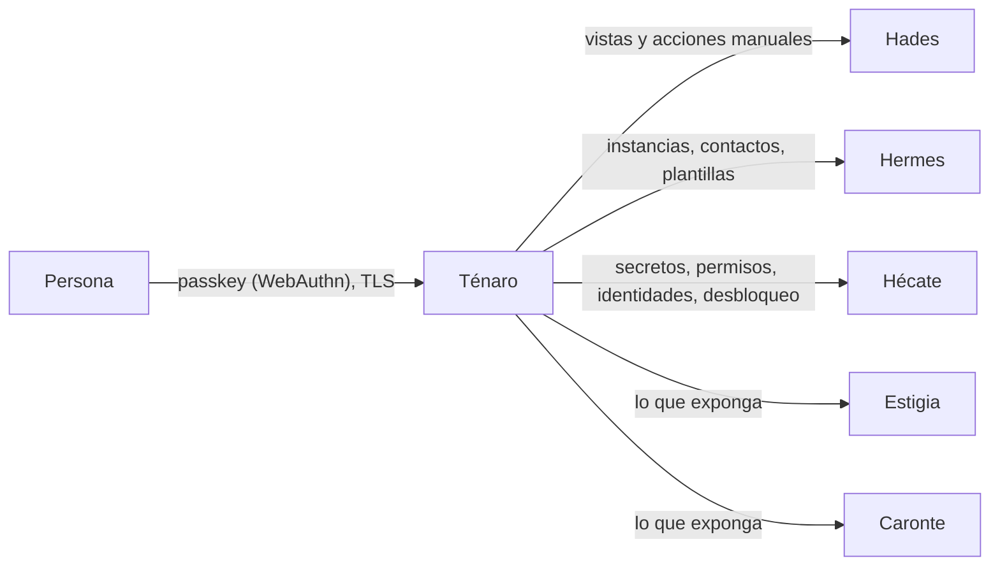
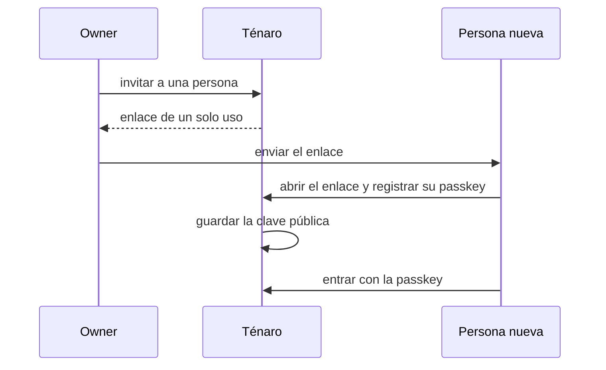

# Ténaro — la entrada a Cerbero

*En la mitología, la cueva del cabo Ténaro por la que se entraba al inframundo desde el mundo de los vivos: por ella bajaron Heracles, a buscar a Cerbero, y Orfeo.* · Estado: idea; aquí se recoge lo decidido · Última revisión: 2026-11-01

Ver también: [ARCHITECTURE](../ARCHITECTURE.md) (en especial [Identidad y seguridad](../ARCHITECTURE.md#6-identidad-y-seguridad)) · [GLOSSARY](../GLOSSARY.md) · [DECISIONS](../DECISIONS.md)

---

## 1. Propósito y frontera

Ténaro es el backend de Cerbero para la UI (*backend for frontend*): la única puerta por la que una persona entra en Cerbero. Desde ahí se gestionan los componentes, se consultan sus vistas y se hacen las acciones manuales.

| Hace | No hace |
|---|---|
| Autenticar a las personas con passkeys | Detectar, decidir ni orquestar: cada componente conserva su responsabilidad |
| Orquestar la UI: reunir lo que cada componente expone | Guardar los datos de los componentes: los consulta |
| Pasar a cada componente las acciones de gestión y las manuales, con la persona en el contexto | Exponer los componentes a internet: es la única superficie pública |
| Desbloquear Hécate con el owner | |

**Por qué es una pieza aparte:** los componentes solo hablan entre ellos por la red interna, con mTLS. Ténaro concentra la entrada de las personas, su autenticación y la atribución de lo que hacen, sin que ningún otro componente se exponga.

---

## 2. Contexto

| Con quién | Qué hace Ténaro |
|---|---|
| **Hades** | Vistas (Cases, `case-timeline`, `playbook-health`, `event-log`), gestión de Playbooks e integraciones, acciones manuales (lanzar una Response, corregir un Verdict, relanzar) |
| **Hermes** | Gestión de instancias (con su prueba de conexión), contactos y plantillas; ver librerías y su estado |
| **Hécate** | Gestión de secretos y versiones, permisos, identidades y tokens de alta, rotaciones; desbloquear y sellar |
| **Estigia, Caronte** | Lo que cada uno exponga a las personas (consultas, Data Tables, Rules) |

---

## 3. Conceptos

| Concepto | Qué es |
|---|---|
| **Usuario** | Una persona con acceso a Cerbero. Los usuarios viven en Ténaro |
| **Passkey** | Credencial sin contraseña (WebAuthn), resistente al phishing; Ténaro solo guarda la clave pública |
| **Owner / maintainer** | Los que declaran las definiciones (Playbooks, integraciones, Jobs, librerías). Sin permisos por rol en Ténaro |

---

## 4. Cómo funciona

### Entrar

- **Alta por invitación** con un enlace de un solo uso (el mismo patrón que la verificación de un canal en Hermes).
- **Recuperación:** como mínimo dos dispositivos por persona, o códigos de recuperación para el owner.
- **VPN delante** (WireGuard o Tailscale) si no se quiere exponer Ténaro a internet.

### Actuar en nombre de una persona

Cuando una persona hace algo (gestionar, lanzar una Response, corregir un Verdict), Ténaro llama al componente con su propia identidad (mTLS) y un JWT firmado por Ténaro con la persona en el contexto de auditoría. Así cada cambio queda atribuido a quien lo hizo.

### Desbloquear Hécate

Tras un reinicio, Hécate queda sellada y Ténaro lo muestra. El owner entra con su passkey y escribe la frase, que viaja por mTLS a Hécate. Los certificados duran días, así que Ténaro sigue funcionando aunque Hécate esté sellada.

---

## 5. Contratos

Ténaro usa las APIs que cada componente publica con el contrato común de Cerbero; no tiene un contrato propio para otros componentes.

---

## 6. Configuración y extensión

La autenticación va detrás de un port: el primer adapter son las passkeys; un adapter OIDC encaja si alguna vez hace falta un IdP.

---

## 7. Organización interna

Sin definir; ver [DECISIONS](../DECISIONS.md).

---

## 8. Datos

Usuarios y sus claves públicas de passkey. El resto de datos los consulta a cada componente.

---

## 9. Seguridad

- **Única superficie pública** de Cerbero, tras un proxy inverso con TLS.
- **Identidad propia** (`spiffe://cerbero.home/tenaro`), con mTLS y JWT ligado al canal hacia los componentes.
- **Sin permisos por rol:** owner y maintainer salen de las definiciones; cada modificación queda registrada con quién la hizo.

---

## 10. Operación

| Qué falla | Efecto |
|---|---|
| Ténaro | No se puede entrar ni gestionar; los componentes siguen funcionando |
| Hécate sellada | Ténaro lo muestra y permite desbloquearla |

---

## 11. Pruebas

Estrategia común de Cerbero (unit, integración, API, E2E).

---

## 12. Decisiones y riesgos

En [DECISIONS](../DECISIONS.md): passkeys en lugar de un IdP con OIDC; Ténaro como backend orquestador para la UI.

---

## 13. Preguntas frecuentes

**¿Por qué no hay contraseñas?**
Las passkeys resisten el phishing y Ténaro solo guarda la clave pública: no hay contraseñas que robar.

**¿Qué pasa si pierdo el móvil con la passkey?**
Se entra con el segundo dispositivo registrado o, en el caso del owner, con un código de recuperación.

**¿Puedo entrar desde fuera de casa?**
Sí, si Ténaro está expuesto tras el proxy con TLS, o a través de la VPN si se prefiere no exponerlo.

---

## 14. Referencias

- [WebAuthn (W3C)](https://www.w3.org/TR/webauthn/)
