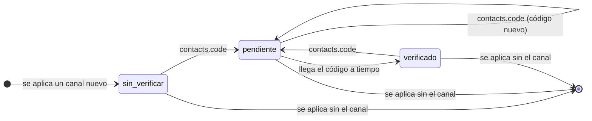
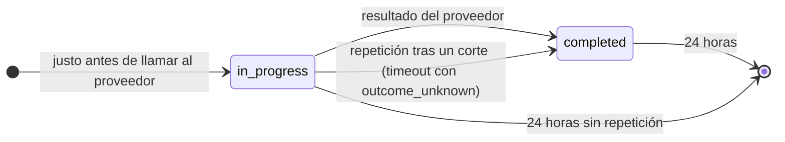
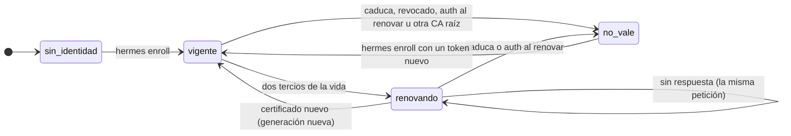

# Data Model: Base de Hermes y envío de mensajes por Telegram

El dominio de Hermes en esta feature, las tablas de su base de PostgreSQL y lo que vive fuera de ella. No hay Event
Sourcing: en docs/hermes.md solo lo usan las tasks, que llegan con `chat.ask`.

## Nombres

Los nombres de instancias, plantillas, variables y contactos siguen `^[a-z][a-z0-9_]{0,62}$`. Un SPIFFE ID sigue el
formato de Hécate (`spiffe://<trust domain>/<identidad>`).

## Entidades del dominio

| Entidad | Campos | Reglas |
|---|---|---|
| **Configuración** | versión del formato, variables, instancias, plantillas y contactos | Inmutable: se sustituye entera al aplicar. Su contenido canónico tiene una huella SHA-256 |
| **Instancia** | nombre, proveedor, parámetros, referencias a secretos, límite de uso | El proveedor existe, y el `fake` solo con `HERMES_FAKE_PROVIDERS=enabled`. Los campos de secreto del manifiesto son referencias `secret://`; los parámetros nunca llevan secretos |
| **Plantilla** | identificador y sus versiones | Al menos una versión |
| **Versión de plantilla** | número, esquema de datos y textos del mensaje | Número desde 1. Una versión creada no cambia: se añade otra |
| **Variable** | nombre y valor | Valor de texto, hasta 4096 caracteres |
| **Contacto** | nombre y canales | Al menos un canal |
| **Canal** | contacto, tipo de servicio, proveedor, instancia, dirección, verificación y código pendiente | Uno por contacto, tipo de servicio, proveedor e instancia. Sin verificar no recibe mensajes (FR-020) |
| **Mensaje neutral** | título, gravedad, resumen, hechos, acciones hechas, qué se espera y enlace | El título y el enlace no se recortan (FR-018) |
| **Petición de envío** | quien llama, destinatario, plantilla y versión, datos, instancia, `Idempotency-Key` y contexto de auditoría | Un solo destinatario (FR-021) |
| **Código de verificación** | canal, huella y caducidad | Un solo uso; solo se guarda su SHA-256 (FR-022) |
| **Clave de idempotencia** | quien llama, clave, huella de la petición, estado y respuesta | Única por quien llama y clave (FR-016) |
| **Entrada de auditoría** | cuándo, tipo, quién, función, instancia, destinatarios, `side_effect`, `discloses_data`, contexto, clave y resultado | Append-only; sin secretos, códigos ni direcciones (FR-029) |
| **Identidad de Hermes** | SPIFFE ID, serie, certificado y cadena, clave TLS, clave de firma de llamadas, `call_key_id`, `not_after`, huella de la CA raíz y renovación en curso | En ficheros, fuera de la base (FR-005) |

### Textos de una versión de plantilla

| Campo | Tipo | Regla tras sustituir |
|---|---|---|
| `title` | texto | De 1 a 256 caracteres |
| `severity` | texto | `info`, `low`, `medium`, `high` o `critical` |
| `summary` | texto, opcional | Hasta 2048 caracteres |
| `facts` | lista de `label` y `value`, opcional | Hasta 20 pares; cada texto, hasta 256 caracteres |
| `actions_done` | lista de textos, opcional | Hasta 10; cada uno, hasta 256 caracteres |
| `expected` | texto, opcional | Hasta 512 caracteres |
| `link` | texto, opcional | Una URL `https` de hasta 2048 caracteres |

Cada texto admite `${data.<ruta>}`, con la ruta separada por puntos dentro de los datos, y `${vars.<nombre>}`.

## Tablas

### `config_instances`

| Columna | Tipo | Notas |
|---|---|---|
| `name` | `text` PK | |
| `provider` | `text` NOT NULL | `telegram` o `fake` |
| `params` | `jsonb` NOT NULL, por defecto `{}` | Sin secretos |
| `secrets` | `jsonb` NOT NULL, por defecto `{}` | Campo del manifiesto → referencia `secret://` |
| `requests_per_minute` | `integer` NULL | De 1 a 600; nulo, el del manifiesto |

### `config_templates`

| Columna | Tipo | Notas |
|---|---|---|
| `template_id` | `text` | PK con `version` |
| `version` | `integer` | PK con `template_id`; CHECK `version >= 1` |
| `data_schema` | `jsonb` NOT NULL | JSON Schema, Draft 2020-12 |
| `message` | `jsonb` NOT NULL | Los textos de cada campo |
| `digest` | `bytea` NOT NULL | SHA-256 del contenido canónico, para rechazar cambios en una versión existente |

### `config_variables`

| Columna | Tipo | Notas |
|---|---|---|
| `name` | `text` PK | |
| `value` | `text` NOT NULL | |

### `config_contacts`

| Columna | Tipo | Notas |
|---|---|---|
| `name` | `text` PK | |

### `channels`

| Columna | Tipo | Notas |
|---|---|---|
| `id` | `bigint` identidad, PK | |
| `contact` | `text` NOT NULL | FK → `config_contacts(name)` ON DELETE CASCADE |
| `service` | `text` NOT NULL | `chat` |
| `provider` | `text` NOT NULL | |
| `instance` | `text` NOT NULL | FK → `config_instances(name)` |
| `address` | `text` NULL | La cuenta ligada: el chat de Telegram. Dato personal: nunca en logs, respuestas ni auditoría |
| `verified_at` | `timestamptz` NULL | No nulo: verificado |
| `code_hash` | `bytea` NULL | SHA-256 del código pendiente |
| `code_expires_at` | `timestamptz` NULL | |

- UNIQUE `(contact, service, provider, instance)`.
- CHECK: con `verified_at`, hay `address`; `code_hash` y `code_expires_at` van juntos; con código pendiente, no está
  verificado.
- La parte de la configuración (contacto, tipo de servicio, proveedor e instancia) la crea y borra la aplicación; la
  dirección, la verificación y el código los escribe Hermes al funcionar, y una aplicación los conserva en los canales
  que no cambian (FR-025).

### `idempotency_keys`

| Columna | Tipo | Notas |
|---|---|---|
| `caller` | `text` | PK con `key`: el SPIFFE ID de quien llama |
| `key` | `text` | PK con `caller`: la `Idempotency-Key` |
| `fingerprint` | `bytea` NOT NULL | SHA-256 del método, la ruta y el JSON canónico del cuerpo |
| `state` | `text` NOT NULL | `in_progress` o `completed` |
| `http_status` | `integer` NULL | Con `completed` |
| `response` | `jsonb` NULL | El sobre, con `completed` |
| `created_at` | `timestamptz` NOT NULL | La hora del intento; se borra a las 24 horas |
| `pending_audit` | `jsonb` NULL | Con `in_progress`, y solo entonces: la entrada de auditoría del envío con `timeout` y `outcome_unknown`, que se escribe si un corte deja el envío sin su registro (FR-029) |

- CHECK: con `in_progress` hay `pending_audit`, y con `completed` no.

### `used_call_tokens`

| Columna | Tipo | Notas |
|---|---|---|
| `issuer` | `text` | PK con `jti` |
| `jti` | `text` | PK con `issuer` |
| `expires_at` | `timestamptz` NOT NULL | `exp` más 30 s; después se borra |

### `audit_log`

| Columna | Tipo | Notas |
|---|---|---|
| `id` | `bigint` identidad, PK | |
| `at` | `timestamptz` NOT NULL | |
| `kind` | `text` NOT NULL | `send`, `config_applied`, `verification_code_issued` o `channel_verified` |
| `actor` | `text` NOT NULL | El SPIFFE ID de quien llama, o `admin` |
| `function` | `text` NULL | `chat.send_message` en los envíos |
| `instance` | `text` NULL | |
| `recipients` | `jsonb` NULL | Las referencias a contactos |
| `side_effect` | `text` NULL | Resuelto con la petición |
| `discloses_data` | `text` NULL | Resuelto con la petición |
| `audit_context` | `jsonb` NULL | El claim `cerbero_audit`, tal cual |
| `idempotency_key` | `text` NULL | |
| `outcome` | `jsonb` NOT NULL | En un envío, `status`, `code` y `outcome_unknown`; en una aplicación, los cambios; en una verificación, el contacto y la instancia |

- El disparador `audit_log_append_only` rechaza `UPDATE` y `DELETE`.
- Ninguna columna lleva secretos, códigos de verificación ni direcciones.

### `alembic_version`

La tabla de Alembic con la migración aplicada.

## Transiciones

### Canal

- Cambiar la instancia de un canal en el fichero borra ese canal y crea otro, sin verificar (FR-022).
- Un código caducado sigue en la fila hasta el siguiente `contacts.code`, pero no verifica nada.

### Clave de idempotencia

- La reserva guarda la entrada de auditoría del envío con resultado desconocido. Con el resultado del proveedor, la
  fila se completa con su propia entrada; si la fila sigue `in_progress` tras un corte, la repetición o la limpieza de
  las 24 horas escriben la entrada guardada, con la hora del intento, en la misma transacción (FR-029).

### Identidad de Hermes

Solo `vigente` y `renovando` están listos (FR-010).

### Estado de una instancia

Se calcula en memoria con sus últimas diez llamadas y su última prueba de conexión (FR-013):

- `unavailable`: la última prueba falló, el proveedor rechazó las credenciales (hasta que una prueba funcione) o
  fallaron las tres últimas llamadas;
- `degraded`: falló alguna de las diez últimas;
- `healthy`: lo demás. Al arrancar, Hermes prueba cada instancia.

## Fuera de la base

| Qué | Dónde | Por qué |
|---|---|---|
| La clave de firma de llamadas, los metadatos de la identidad, la renovación en curso, la última lista de revocación y las últimas claves publicadas | Directorio de estado (`HERMES_STATE_DIR`), 0700 y ficheros 0600 | Hermes los necesita para llegar a Hécate y a su base |
| El certificado, su cadena, su clave TLS y la CA raíz | Directorio del proxy (`HERMES_PROXY_DIR`), en `gen-<n>/` con el enlace `current` | Los lee Envoy, que no ve nada más |
| Los secretos resueltos | Memoria (`SecretCache`) | FR-009 |
| La instantánea de la configuración | Memoria | Se carga de la base al arrancar y tras cada aplicación |
| Las fichas de los límites de uso y los bloqueos de las claves de idempotencia | Memoria | Una sola instancia |
| El `offset` de cada sondeo | Memoria | Los cursores no se copian |
| El estado de cada instancia | Memoria | Se calcula de las últimas llamadas y de la prueba |
