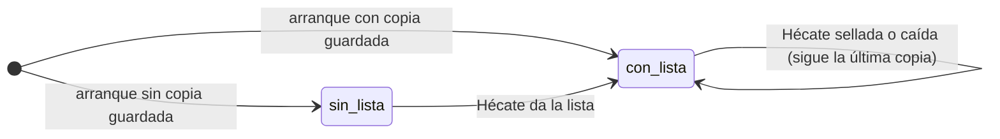

# Data Model: Lista de acceso por app

Lo que la feature 009 añade al modelo de Hécate y de Hermes. En Hécate usa el event store (`events`) y el registro de
accesos de las features anteriores: **no hay tablas nuevas ni migración**. En Hermes, la copia es un fichero más del
directorio de estado: **su base no cambia**. Decisiones en [research.md](research.md) (R1, R4, R5 y R6).

## App Access (`access/<app>`), en Hécate

Un stream por app, que solo existe cuando el admin le ha cambiado algo. Cada evento lleva su instante (`at`), como
todos los de Hécate, y ninguno lleva un secreto.

| Evento | Datos | Efecto |
|---|---|---|
| `CallerGranted` | `caller` (una identidad de app), `by` (`admin`) | La identidad puede llamar a la app |
| `CallerRevoked` | `caller`, `by` | Deja de poder |

- **Estado derivado:** `callers`, el conjunto ordenado de identidades que pueden llamar a la app, y `version`, la del
  stream. Sin stream, `callers` vacío y versión 0: nadie puede llamarla (FR-010).
- **Puede llamar** una identidad si está en `callers`. Lo que diga su token corto no cuenta (FR-007).
- **Historial:** los eventos con su instante. Quién podía llamar a la app en un momento pasado sale de aplicarlos hasta
  ese instante (SC-006).
- **Repetir una orden** que no cambia nada (conceder lo que ya está concedido, retirar lo que no lo está) no escribe
  eventos (FR-002).

### Transiciones

```text
Acceso de una identidad a una app:  sin acceso ──CallerGranted──▶ concedido ──CallerRevoked──▶ sin acceso
```

### Reglas al cambiarla

| Regla | Requisito |
|---|---|
| La app y quien llama siguen la regla de nombres de las identidades (minúsculas, dígitos y `-`, empezando por letra, hasta 63, un solo segmento); no tienen que estar dadas de alta | FR-005, FR-011 |
| Ni la app ni quien llama son `hecate` ni `admin` | FR-004 |
| Quien llama no es la propia app | FR-004 |
| Hécate está desbloqueada | FR-002 |
| Sin versión esperada; si otro cambio se adelanta, se vuelve a leer y a evaluar | FR-002 |

## Registro de accesos, en Hécate: lo que cambia

Cinco valores más de `operation`, sin migración (la columna no tiene `CHECK`):

| `operation` | Cuándo deja fila | `subject` | `identity` | `detail` |
|---|---|---|---|---|
| `access_grant` | Cada orden, cambie algo o no, y cada rechazo | `admin` | La app | `caller <identidad>` |
| `access_revoke` | Cada orden, cambie algo o no, y cada rechazo | `admin` | La app | `caller <identidad>` |
| `access_list` | Cada consulta | `admin` | — | — |
| `access_get` | Cada consulta | `admin` | La app | — |
| `callers_list` | Solo los rechazos de `GET /v1/callers`; atendida no deja fila | El SPIFFE ID de quien pregunta, o nadie | La que pregunta, si se conoce | `list`; `sealed` o `request_id` si se rechaza antes de la operación |

- Los nombres de la app y de quien llama solo van a la fila una vez bien formados, como en la Access Policy.
- `identity` es la app, como en las filas de la Access Policy es la identidad de su política, y `detail` lleva a quien
  llama porque la tabla no tiene otra columna para una segunda identidad; en las filas de la Access Policy, `detail`
  lleva la variante (`read` o `status`). El resultado va en su columna, `result`.
- Las filas de `callers_list` son como las de `key_list` y `revocation_list` de la feature 003: llevan también la
  serie del certificado presentado, si se conoce, y los rechazos de antes de la operación no nombran a nadie.

## La copia de la lista, en Hermes

| Dónde | Qué |
|---|---|
| Memoria | La lista vigente: la app (`hermes`), las identidades que pueden llamarla, la versión y cuándo se obtuvo |
| `HERMES_STATE_DIR/access.json` (0600, en el directorio 0700) | La misma lista, escrita de forma atómica cada vez que cambia, para arrancar con ella |

- **Se obtiene** al arrancar (si no hay copia guardada), en cada refresco de las publicaciones de Hécate (cada 240 s) y
  cuando llega una identidad autenticada que no está en ella (R5).
- **Se sustituye entera** con lo que da Hécate; nunca se modifica a medias.
- **Sin copia** en memoria ni en disco, Hermes no está listo (`access list not loaded`).
- **No lleva secretos** ni direcciones: solo nombres de identidades.

### Estados de Hermes respecto a su lista



Solo `con_lista` está listo (FR-009).

## Fuera del modelo

- **Las identidades hijas:** no existen en esta feature. Cuando existan, contarán como su app (R10); hoy ningún nombre
  con `/` es válido.
- **El perfilado** de lo que alcanza cada identidad dentro de una app y los permisos por función: fuera de alcance.
